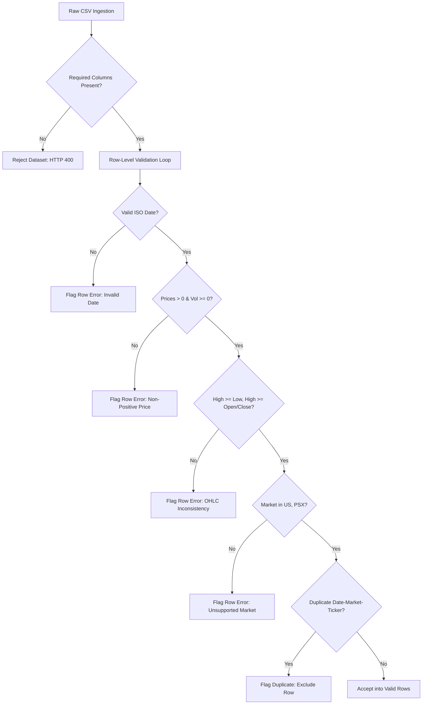

# Financial Data Contracts & Quantitative Conventions
**Document Version:** 1.0.0  
**Status:** Approved Architecture Baseline  
**Date:** 2026-10-16  
**Author:** Quantitative Finance Software Architecture & Engineering  

---

## 1. Executive Overview

In quantitative finance systems, subtle ambiguities in date parsing, currency conversion, annualization conventions, and missing-data imputation are primary sources of severe calculation error. 

This document defines the **formal data contracts, schema constraints, mathematical conventions, and cross-market policies** governing the **Quant Portfolio Optimization Engine**. All modules across the transport, domain, and persistence layers must adhere to these contracts.

---

## 2. Market Data Ingestion & Canonical Schema

### 2.1 Canonical Bar Schema Specification
A market data record represents an end-of-day (EOD) historical price bar for a specific tradable asset in a designated exchange market.

| Column Name | Status | Type | Constraints | Financial Definition |
|---|---|---|---|---|
| `date` | **Required** | `ISO Date` | Strict `YYYY-MM-DD` | Exchange-local settlement trading date. |
| `ticker` | **Required** | `String` | Non-empty, uppercase, stripped | Normalized asset symbol (e.g. `AAPL`, `MSFT`, `LUCK`, `OGDC`). |
| `market` | **Required** | `Enum` | `US` or `PSX` | Market identifier (US Equities or Pakistan Stock Exchange). |
| `close` | **Required** | `Float64` | $P > 0.0$ strictly positive | Unadjusted market closing price in local trading currency. |
| `currency` | **Required** | `String` | 3-letter ISO 4217 code | Trading currency (`USD` for US, `PKR` for PSX). |
| `open` | *Optional* | `Float64` | $P > 0.0$ if present | Official market opening price. |
| `high` | *Optional* | `Float64` | $P > 0.0$ if present | Highest traded price during the trading session. |
| `low` | *Optional* | `Float64` | $P > 0.0$ if present | Lowest traded price during the trading session. |
| `adjusted_close` | *Optional* | `Float64` | $P > 0.0$ if present | Closing price backward-adjusted for corporate splits and cash dividends. |
| `volume` | *Optional* | `Float64` | $V \ge 0.0$ non-negative | Total number of shares/units traded during the session. |

### 2.2 Strict Ingestion & Validation Rules



1. **Date Parsing & ISO Normalization:**
   - Dates must adhere to ISO 8601 `YYYY-MM-DD`.
   - Ambiguous date strings (e.g. `01/02/2025` where day and month are indistinguishable, or integer formats like `20250102`) must be strictly rejected or explicitly validated against a declared format.
   - Future dates ($Date > Today_{UTC}$) and extreme historical dates ($Date < 1970-01-01$) must generate row-level warnings.
2. **Positive Price & Non-Negative Volume:**
   - Any price column (`close`, `open`, `high`, `low`, `adjusted_close`) with a value $\le 0.0$, `NaN`, or infinite value must be rejected at the row level. Zero prices are invalid in equity asset classes.
   - Volume must be $\ge 0.0$. Negative volumes are rejected.
3. **Complete OHLC Consistency:**
   - If `high` and `low` are present: $High \ge Low$.
   - If `high`, `open`, and `close` are present: $High \ge Open$ and $High \ge Close$.
   - If `low`, `open`, and `close` are present: $Low \le Open$ and $Low \le Close$.
   - Bars violating these bounds are structurally corrupted and must be rejected with an explicit error reason.
4. **Duplicate Key Resolution:**
   - A price bar is uniquely identified by the tuple `(date, market, ticker)`.
   - If multiple rows share the same composite key, **all duplicate rows are excluded** from the valid dataset and cataloged in the error report. The system shall **never silently overwrite** or pick an arbitrary row.
5. **Zero Imputation Policy:**
   - The engine **shall never synthesize, forward-fill, backward-fill, or impute missing prices** during ingestion.
   - Missing trading days represent non-trading holidays or trading suspensions and must be handled explicitly during portfolio alignment, not silently masked in raw storage.
6. **Adjusted vs. Unadjusted Close:**
   - For all financial calculations involving returns, volatility, and optimization, **`adjusted_close` is the authoritative price** when present.
   - If `adjusted_close` is absent, the system falls back to `close` and issues an explicit calculation warning: *"Unadjusted close used; returns may be distorted by historical stock splits or dividend payments."*

---

## 3. Cross-Market & Multi-Currency Contracts (US vs. PSX)

The system supports two distinct equity markets with divergent trading structures:

| Dimension | US Equities (`US`) | Pakistan Stock Exchange (`PSX`) | Cross-Market Resolution Rule |
|---|---|---|---|
| **Trading Currency** | USD (`$`) | PKR (`Rs.`) | Returns must be computed in local currency first. Cross-market optimization requires explicit FX conversion or base-currency standardization. |
| **Trading Days / Year** | **252 days** | **250 days** | Annualization parameters must be explicitly decoupled per asset or normalized to a documented portfolio baseline. |
| **Trading Week** | Monday – Friday | Monday – Friday (Split Friday session) | Standard calendar alignment. |
| **Holidays** | US Federal Holidays (MLK, Presidents, July 4, Thanksgiving, etc.) | Pakistan National/Religious Holidays (Eid, Ashura, Iqbal Day, etc.) | Non-overlapping trading calendars. |
| **Trading Day Alignment** | Active on US open | Closed on Pakistan local holidays | **Inner Join Policy:** Compute multi-asset returns strictly on shared active dates; OR **Zero-Return Holiday Policy** with explicit user disclosure. |

### 3.1 Multi-Asset Portfolio Date Alignment Policy
When constructing a portfolio combining assets across different markets or with differing trading histories:
1. **Default Policy (Intersection / Common Trading Days):**
   - The asset return matrix is constructed using the **inner join** of observation dates where all selected assets have verified trading bars:
     $$\mathcal{D}_{\text{common}} = \bigcap_{i=1}^N \mathcal{D}_i$$
   - Eliminates artificial volatility from holiday gaps.
2. **Alternative Policy (Union with Non-Trading Days):**
   - If an asset market was closed while another was open, the closed asset's return for that calendar day is treated as $R_{i,t} = 0.0$ (price unchanged).
   - This policy introduces cash-drag effects and must be explicitly selected by the researcher with recorded audit provenance.

---

## 4. Financial Mathematics & Calculation Conventions (Session 04 Core)

### 4.1 Return Calculations & Indexing Conventions

#### Simple (Discrete Arithmetic) Returns ($R_t$)
- **Mathematical Formula:** 
  $$r_t = \frac{P_t - P_{t-1}}{P_{t-1}} = \frac{P_t}{P_{t-1}} - 1$$
- **Implementation:** `app.quant.returns.simple_returns(prices)`
- **Indexing & Shape:** The first observation $t=0$ is strictly `NaN` because no prior price exists. The returned Series/DataFrame exactly preserves the original DatetimeIndex and asset column labels.
- **Validation Policy:**
  - Input prices must be strictly positive ($P_t > 0.0$), finite, and non-empty. Zero or negative prices raise `ValueError`.
  - Non-trading days or missing periods are never silently replaced with 0.0.
- **Aggregation Property:** Simple returns are linearly additive across portfolio assets:
  $$r_{p,t} = \sum_{i=1}^N w_i r_{i,t} = \mathbf{w}^T \mathbf{r}_t$$
  They are **not** linearly additive across time.

#### Logarithmic (Continuously Compounded) Returns ($r_t$)
- **Mathematical Formula:** 
  $$r_{\log, t} = \ln\left(\frac{P_t}{P_{t-1}}\right) = \ln(P_t) - \ln(P_{t-1})$$
- **Implementation:** `app.quant.returns.log_returns(prices)`
- **Validation Policy:** Only valid positive prices ($P_t > 0.0$) are permitted; prices $\le 0.0$ raise `ValueError`.
- **Aggregation Property:** Log returns are linearly additive across time:
  $$r_{\log, 0 \to T} = \sum_{t=1}^T r_{\log, t}$$
  **Critical Restriction:** Log returns do **not** sum across portfolio assets ($\ln(\mathbf{w}^T \mathbf{P}_t) \ne \mathbf{w}^T \ln(\mathbf{P}_t)$). Portfolio return calculations must strictly utilize discrete simple returns.

#### Cumulative Returns & Wealth Curves
- **Mathematical Formula:**
  $$R_{\text{cum}}(t) = \prod_{\tau=1}^t (1 + r_\tau) - 1$$
- **Wealth Index Convention:** Initial wealth $W_0 = 1.0$. The wealth index series is $W_t = \prod_{\tau=1}^t (1 + r_\tau) = 1 + R_{\text{cum}}(t)$.
- **Implementation:** `app.quant.returns.cumulative_returns(returns, as_wealth_index=False)`
- **Boundary Condition:** Any discrete return $r_t < -1.0$ (-100% total capital loss) is rejected as economically invalid.

#### Annualized Returns (CAGR vs. Arithmetic)
- **Geometric Compounded Annual Growth Rate (CAGR):**
  $$\text{CAGR} = \left(\prod_{t=1}^N (1 + r_t)\right)^{\frac{\text{periods\_per\_year}}{N}} - 1$$
- **Arithmetic Annualized Return:**
  $$R_{\text{arith, ann}} = \left(\frac{1}{N} \sum_{t=1}^N r_t\right) \times \text{periods\_per\_year}$$
- **Annualization Factors:**
  - US Equities: 252 trading days/year
  - PSX Equities: 250 trading days/year
  - Weekly observations: 52 periods/year
  - Monthly observations: 12 periods/year
- **Implementation:** `app.quant.returns.annualized_return(returns, periods_per_year=252, method="geometric")`
- **Limitation:** Annualization assumes identical periodic compounding and is an empirical historical summary, **not** a forecast or guarantee of future performance. Applying annualization to irregular time intervals without calendar day weighting is prohibited.

---

### 4.2 Risk Metrics & Volatility Conventions

#### Variance & Volatility
- **Sample Variance ($ddof=1$, Unbiased Estimator):**
  $$s^2 = \frac{1}{N - 1} \sum_{i=1}^N (r_i - \bar{r})^2$$
  Requires $N \ge 2$ valid observations.
- **Population Variance ($ddof=0$, Maximum Likelihood Estimator):**
  $$\sigma^2 = \frac{1}{N} \sum_{i=1}^N (r_i - \bar{r})^2$$
  Requires $N \ge 1$ valid observation.
- **Periodic Volatility:** Square root of variance ($s = \sqrt{s^2}$).
- **Annualized Volatility (Square-Root of Time Scaling):**
  $$\sigma_{\text{ann}} = \sigma_{\text{periodic}} \times \sqrt{\text{periods\_per\_year}}$$
  Assumes identically and independently distributed (i.i.d.) returns.
- **Implementation:** `app.quant.risk.variance`, `app.quant.risk.volatility`, `app.quant.risk.annualized_volatility`

#### Maximum Drawdown
- **Definition:** The maximum observed peak-to-trough decline of a wealth curve:
  $$W_t = \prod_{\tau=1}^t (1 + r_\tau) \quad (W_0 = 1.0)$$
  $$M_t = \max_{0 \le \tau \le t} W_\tau \quad (\text{Running Peak Wealth})$$
  $$DD_t = \frac{W_t - M_t}{M_t} \le 0.0 \quad (\text{Drawdown Series})$$
  $$\text{MDD} = \min_{1 \le t \le T} DD_t \le 0.0$$
- **Implementation:** `app.quant.risk.maximum_drawdown(returns)`
- **Return Type:** Structured `DrawdownResult` dataclass containing:
  - `max_drawdown`: Non-positive float (e.g. -0.25 represents -25.0%). In a monotonically rising series, $\text{MDD} = 0.0$.
  - `peak_date`: Index/date of the wealth peak immediately preceding the trough.
  - `trough_date`: Index/date of the lowest wealth trough.
  - `recovery_date`: First subsequent index/date where wealth restored to or exceeded `peak_date` wealth, or `None` if unrecovered.
  - `drawdown_series`: Full pd.Series of periodic drawdowns ($DD_t \le 0.0$).

#### Downside Deviation (Semi-Deviation)
- **Mathematical Formula:**
  $$\delta_{\text{downside}} = \sqrt{\frac{1}{N - ddof} \sum_{t=1}^N \min(r_t - \tau, 0.0)^2}$$
  where $\tau$ is the periodic Minimum Acceptable Return (MAR, default 0.0).
- **Denominator Convention:** Standard Sortino & Price (1994) convention utilizes **all observations $N$** in the denominator, properly reflecting the probability-weighted downside shortfall relative to the full sample period.
- **Degrees of Freedom:** Default $ddof=0$ (literature standard for downside risk); $ddof=1$ supported for sample bias correction.
- **Annualization:** $\delta_{\text{downside, ann}} = \delta_{\text{downside, periodic}} \times \sqrt{\text{periods\_per\_year}}$.
- **Implementation:** `app.quant.risk.downside_deviation(returns, threshold=0.0, ddof=0, annualized=False)`

#### Risk-Free Rate Compounding Conversion
- **Annual Effective to Periodic Effective Rate:**
  $$r_p = (1 + r_a)^{\frac{1}{m}} - 1$$
  where $r_a$ is the annual effective rate and $m$ is compounding periods per year ($m \ge 1$).
- **Implementation:** `app.quant.risk.annual_to_periodic_rate(annual_rate, periods_per_year=252)`
- **Constraint:** Requires $r_a > -1.0$. Exact compounding is used; linear division ($r_a / m$) is explicitly distinguished as nominal.
- **Scope Note:** Sharpe and Sortino ratios are deferred to the Stage 5 risk analytics session to ensure unambiguous configuration.

---

### 4.3 Covariance and Correlation Matrix Conventions

#### Formulation & Alignment
- **Covariance Matrix:**
  $$\mathbf{\Sigma}_{i,j} = \frac{1}{N - ddof} \sum_{t=1}^N (r_{i,t} - \bar{r}_i)(r_{j,t} - \bar{r}_j)$$
- **Degrees of Freedom:** $ddof=1$ (sample covariance, default) or $ddof=0$ (population covariance).
- **Missing Data Strategy (`handle_na`):**
  - `"drop_any"` (Default & Strongly Recommended): Listwise deletion. Drops any period where at least one asset lacks an observation. Guarantees that the covariance matrix is evaluated over an identical, synchronized time window, preserving positive semi-definiteness.
  - `"pairwise"`: Pairwise deletion. Calculates each $(i, j)$ pair over available joint observations.
- **Symmetry & Diagonal Checks:**
  - Symmetry verification tolerance: $|\Sigma_{i,j} - \Sigma_{j,i}| \le 10^{-12}$.
  - Diagonal consistency: $\Sigma_{i,i} = \operatorname{Var}(r_i)$.
- **Annualized Covariance Matrix:** $\mathbf{\Sigma}_{\text{ann}} = \mathbf{\Sigma}_{\text{daily}} \times \text{periods\_per\_year}$.
- **Correlation Matrix:**
  $$\mathbf{R}_{i,j} = \frac{\Sigma_{i,j}}{\sigma_i \sigma_j}$$
  with exact 1.0 along the main diagonal and values bounded in $[-1.0, 1.0]$.
- **Implementation:** `app.quant.covariance.covariance_matrix`, `app.quant.covariance.correlation_matrix`

---

### 4.4 Portfolio Return and Risk Formulations

#### Portfolio Periodic Return & Expected Return
- **Portfolio Periodic Return:**
  $$r_{p,t} = \sum_{i=1}^N w_i r_{i,t} = \mathbf{w}^T \mathbf{r}_t$$
- **Portfolio Expected Return:**
  $$\mu_p = \mathbf{w}^T \boldsymbol{\mu} = \sum_{i=1}^N w_i \bar{r}_i$$
  Annualized expected return multiplies periodic mean by $\text{periods\_per\_year}$. This is an arithmetic historical sample estimate and does **not** represent a guaranteed return.

#### Portfolio Variance & Volatility
- **Portfolio Variance:**
  $$\sigma_p^2 = \mathbf{w}^T \mathbf{\Sigma} \mathbf{w}$$
- **Portfolio Volatility:**
  $$\sigma_p = \sqrt{\mathbf{w}^T \mathbf{\Sigma} \mathbf{w}}$$
- **Numerical Tolerances for Floating-Point Noise:**
  - If $-10^{-12} \le \sigma_p^2 < 0.0$, the variance is clamped to $0.0$.
  - If $\sigma_p^2 < -10^{-12}$, a `ValueError` is raised (materially invalid negative variance indicating non-PSD covariance).
- **Weight Support:** Long-only ($w_i \ge 0$) and long-short ($w_i \in \mathbb{R}$) weight vectors are fully supported at the mathematical layer.
- **Weight Summaries & Normalization:**
  - `validate_weights`: Validates finite numeric weights, verifies length/assets match. Does **never** silently renormalize weights.
  - `summarize_weights`: Produces `PortfolioWeightSummary` (gross exposure, net exposure, fully invested check within $10^{-6}$, short position check).
  - `normalize_weights`: Explicitly scales $\tilde{w}_i = w_i / \sum w_j$.

---

### 4.5 Cross-Market Multi-Currency Limitation (US vs. PSX)
- Assets from the US exchange are priced in USD (`$`); assets from PSX are priced in PKR (`Rs.`).
- **Independent Return Policy:** In this session, historical percentage returns are calculated independently in each asset's native price currency:
  $$r_{i,t}^{\text{USD}} = \frac{P_{i,t}^{\text{USD}}}{P_{i,t-1}^{\text{USD}}} - 1, \quad r_{j,t}^{\text{PKR}} = \frac{P_{j,t}^{\text{PKR}}}{P_{j,t-1}^{\text{PKR}}} - 1$$
- **Cross-Currency Aggregation Limitation:** Directly aggregating USD and PKR assets into a single portfolio without FX adjustment introduces unhedged currency risk. Cross-currency multi-asset portfolio optimization requires a formal base-currency selection and daily FX exchange rate conversion matrix, which must be specified before cross-currency optimization is permitted.

---

### 4.6 Portfolio Definition & Investment Constraint Contracts (Session 05)


#### Asset Selection & Identity
- **Asset Disambiguation:** Tickers cannot be assumed globally unique across exchanges. Every asset is uniquely referenced by the composite identifier `TICKER:MARKET` (e.g. `AAPL:US` vs `LUCK:PSX`).
- **Asset Ordering:** A stable, deterministic asset ordering is preserved from the portfolio definition throughout all subsequent vector and matrix operations.
- **Empty / Duplicate Selections:** Selecting zero assets or duplicate tickers/asset identifiers is strictly rejected with a `ValueError`.

#### Investment Constraints & Bounding
- **Asset Weight Bounds:**
  $$l_i \le w_i \le u_i \quad \forall i \in \{1, \dots, N\}$$
  - Default bounds apply to any asset lacking an explicit override: $[l_{\text{default}}, u_{\text{default}}]$ (defaults to $[0.0, 1.0]$ for long-only).
  - Finite bound requirement: $l_i, u_i \in \mathbb{R}$ (NaN or infinite bounds raise `ConstraintValidationError`).
  - Consistency check: $l_i \le u_i$ for all assets. If $l_i > u_i$, a `ConstraintInfeasibleError` is raised.
- **Long-Only vs. Long-Short:**
  - If `allow_short = False` (default), all lower bounds must satisfy $l_i \ge -10^{-12}$. Any negative lower bound raises an immediate feasibility error.
  - If `allow_short = True`, negative lower bounds and short positions are permitted at the mathematical layer.
- **Total Portfolio Weight (Target Investment):**
  $$\sum_{i=1}^N w_i = W_{\text{target}}$$
  (Default $W_{\text{target}} = 1.0$ for fully invested portfolios; cash-buffered or leverage targets $W_{\text{target}} \ne 1.0$ supported).
- **Exposure Limits:**
  - Gross exposure cap: $\sum_{i=1}^N |w_i| \le \text{Gross}_{\max}$. Must satisfy $\text{Gross}_{\max} \ge |W_{\text{target}}| - 10^{-6}$.
  - Net exposure limits: $\text{Net}_{\min} \le \sum_{i=1}^N w_i \le \text{Net}_{\max}$.
- **Inclusion & Exclusion Rules:**
  - `included_assets`: Assets required to receive a positive allocation ($w_i > 0$ and $l_i \ge 10^{-4}$).
  - `excluded_assets`: Assets barred from allocation (forced to $l_i = 0.0, u_i = 0.0$).
  - Simultaneous inclusion and exclusion of the same asset raises `ConstraintInfeasibleError`.

#### Pre-Optimization Mathematical Feasibility Checks
Prior to invoking numerical optimization solvers, the configuration is checked against fundamental analytical bounds:
1. **Sum of Lower Bounds:**
   $$\sum_{i=1}^N l_i \le W_{\text{target}} + 10^{-6}$$
   If $\sum l_i > W_{\text{target}}$, the configuration is impossible because meeting minimum allocations already exceeds total capital.
2. **Sum of Upper Bounds:**
   $$\sum_{i=1}^N u_i \ge W_{\text{target}} - 10^{-6}$$
   If $\sum u_i < W_{\text{target}}$, the configuration is impossible because even allocating maximum allowed capital to every asset fails to reach the target investment.

#### Historical Synchronization & Observation Invariant
- A portfolio definition requires that selected assets share at least **2 common trading observation dates** within the requested historical window:
  $$|\mathcal{D}_{\text{common}}| = \left|\bigcap_{i=1}^N \mathcal{D}_i\right| \ge 2$$
  If $|\mathcal{D}_{\text{common}}| < 2$, the portfolio definition is flagged as invalid with an actionable error.

---

### 4.7 Portfolio Optimization Engine Contracts (Session 06)

#### Solver Selection & Formulation
- **Primary Solver:** SciPy Sequential Least Squares Programming (`scipy.optimize.minimize(method="SLSQP")`, SciPy 1.17+).
- **Convex Quadratic Objective (Minimum Variance):**
  $$\min_{\mathbf{w}} \frac{1}{2} \mathbf{w}^T \mathbf{\Sigma} \mathbf{w}$$
  Analytical Gradient: $\nabla f(\mathbf{w}) = \mathbf{\Sigma} \mathbf{w}$.
- **Non-Linear Objective (Maximum Sharpe Ratio):**
  $$\min_{\mathbf{w}} -S(\mathbf{w}) = -\frac{\mathbf{w}^T \boldsymbol{\mu} - R_f}{\sqrt{\mathbf{w}^T \mathbf{\Sigma} \mathbf{w} + \epsilon}}$$
  Analytical Gradient: $\nabla (-S(\mathbf{w})) = -\frac{\boldsymbol{\mu}}{\sigma_p(\mathbf{w})} + \frac{(\mu_p(\mathbf{w}) - R_f) \mathbf{\Sigma} \mathbf{w}}{\sigma_p(\mathbf{w})^3}$.
- **Deterministic Equal-Weight Baseline:**
  $$w_i = \frac{W_{\text{target}}}{N}$$
  Subject to immediate validation against configured investment constraints. If constraints are breached (e.g. $1/N > u_i$), the baseline is flagged as `INVALID_FOR_CONSTRAINTS`.

#### Supported Constraints
1. **Per-Asset Bounds:** $l_i \le w_i \le u_i$ for all $i \in \{1, \dots, N\}$.
2. **Total Target Investment:** $\sum_{i=1}^N w_i = W_{\text{target}}$ (equality constraint).
3. **Long-Only Policy:** $l_i \ge 0, u_i \le 1, w_i \ge 0$.
4. **Long-Short Policy:** $l_i < 0$ permitted when `allow_short=True`.
5. **Gross Exposure Cap:** $\sum_{i=1}^N |w_i| \le \text{Gross}_{\max}$ enforced via inequality constraint.

#### Non-Positive Excess Return Safeguard
When all asset expected returns satisfy $\max_i \mu_i \le R_f$, the Sharpe ratio maximization problem is economically invalid (it creates an artificial mathematical incentive to maximize volatility to make a negative ratio closer to zero). The engine strictly terminates with status `NON_POSITIVE_EXCESS_RETURNS` without claiming an optimal portfolio.

#### Covariance Matrix Quality Controls
1. **Eigenvalue Check:** $\lambda_{\min}(\mathbf{\Sigma}) \ge -10^{-8}$. Matrices with materially negative eigenvalues are strictly rejected.
2. **Conditioning Diagnostic:** Matrices with condition number $\kappa > 10^{10}$ or $\lambda_{\min} \le 10^{-12}$ emit an explicit warning regarding potential non-uniqueness of the minimum-variance portfolio.

---

## 5. Domain Contracts & Typed Schemas

### 5.1 Validation Report Schema
```python
class RowIssue(BaseModel):
    row: int
    reasons: list[str]

class ValidationWarning(BaseModel):
    message: str

class ValidationReport(BaseModel):
    content_sha256: str
    rows_examined: int
    valid_rows: int
    rejected_rows: int
    errors: list[RowIssue]
    warnings: list[ValidationWarning]
    valid_data: list[dict] | None = None
```

### 5.2 Dataset Metadata Schema
```python
class DatasetMetadata(BaseModel):
    dataset_id: str
    filename: str
    created_at: str
    content_sha256: str
    rows_examined: int
    valid_rows: int
    rejected_rows: int
    errors: list[RowIssue]
    warnings: list[ValidationWarning]
```

### 5.3 Optimization Request & Response Schemas
```python
class OptimizationRequest(BaseModel):
    dataset_id: str
    tickers: list[str] = Field(min_length=2)
    start_date: date
    end_date: date
    objective: Literal["min_volatility", "max_sharpe", "target_return"]
    target_return: float | None = None
    risk_free_rate: float = Field(default=0.0, ge=0.0)
    min_weight: float = Field(default=0.0, ge=0.0, le=1.0)
    max_weight: float = Field(default=1.0, ge=0.0, le=1.0)
    sector_constraints: dict[str, float] | None = None

class OptimizationResponse(BaseModel):
    dataset_id: str
    objective: str
    solver_status: Literal["CONVERGED", "INFEASIBLE", "FAILED"]
    weights: dict[str, float]
    expected_return: float
    volatility: float
    sharpe_ratio: float
    annualization_factor: int
    diagnostics: dict | None = None
```

### 5.4 Infeasibility Contract
When an optimization problem has conflicting constraints (e.g. $\sum w_{i,\min} > 1.0$ or target return exceeds all asset returns):
- The API **must return HTTP 422 Unprocessable Entity**.
- The response body must adhere to:
  ```json
  {
    "error_code": "OPTIMIZATION_INFEASIBLE",
    "message": "The specified constraints cannot be satisfied simultaneously.",
    "conflicts": [
      {
        "constraint": "target_return",
        "requested": 0.35,
        "maximum_achievable": 0.24,
        "detail": "Requested target return exceeds maximum historical asset return in universe."
      }
    ]
  }
  ```

---

## 6. Efficient Frontier & Portfolio Risk Analytics Contracts (Session 07)

### 6.1 Mathematical Formulation of the Efficient Frontier

For any requested target return $R_{\text{target}}$, the optimization engine solves the continuous quadratic program:

$$\min_{\mathbf{w}} \quad \frac{1}{2} \mathbf{w}^\top \mathbf{\Sigma} \mathbf{w}$$

Subject to:
1. $\sum_{i=1}^N w_i = W_{\text{target}}$ (typically $1.0$).
2. $\mathbf{w}^\top \boldsymbol{\mu} = R_{\text{target}}$ (exact target expected return).
3. $l_i \le w_i \le u_i$ for all $i \in \{1, \dots, N\}$.
4. $\sum_{i=1}^N |w_i| \le \text{Gross}_{\max}$ (if shorting permitted and gross cap configured).

### 6.2 Linear Programming Feasible Return Range

Before solving quadratic programs, exact achievable return bounds $[\mu_{\min}, \mu_{\max}]$ are computed using SciPy HiGHS dual-simplex linear programming:
$$\mu_{\min} = \min_{\mathbf{w}} \boldsymbol{\mu}^\top \mathbf{w} \quad \text{s.t. } \sum w_i = W_{\text{target}}, \; l_i \le w_i \le u_i$$
$$\mu_{\max} = \max_{\mathbf{w}} \boldsymbol{\mu}^\top \mathbf{w} \quad \text{s.t. } \sum w_i = W_{\text{target}}, \; l_i \le w_i \le u_i$$

Any target return $R_{\text{target}} \notin [\mu_{\min} - 10^{-5}, \mu_{\max} + 10^{-5}]$ is classified as mathematically `infeasible` with empty weights, without running the QP solver. No fallback weights or chart points are fabricated.

### 6.3 Dominance Classification Contract

The Global Minimum-Variance (GMV) portfolio anchors the Markowitz bullet:
- **`efficient`**: Portfolios on the upper branch with $R_{\text{target}} \ge R_{\text{GMV}} - 10^{-5}$.
- **`dominated_inefficient`**: Portfolios on the lower branch with $R_{\text{target}} < R_{\text{GMV}} - 10^{-5}$ (dominated because they offer lower expected return for equal or higher volatility).
- **`infeasible`**: Targets mathematically unreachable under the constraint system.
- **`failed`**: Targets where numerical solver failed to achieve convergence within tolerance.

### 6.4 Standalone Risk Metrics Conventions

1. **Sharpe Ratio**:
   $$S = \frac{R_p - R_f}{\sigma_p}$$
   - Both numerator and denominator must use consistent frequencies (both annualized or both periodic).
   - If $\sigma_p \le 10^{-12}$, Sharpe ratio is undefined; raises `ValueError` in calculation and is recorded as `null` in API schemas. Division by zero or NaN generation is prohibited.

2. **Sortino Ratio**:
   $$\text{Sortino} = \frac{R_p - \text{MAR}}{\sigma_{\text{downside}}}$$
   - Downside deviation $\sigma_{\text{downside}} = \sqrt{\frac{1}{N - \text{ddof}} \sum_{t=1}^N \min(r_t - \text{MAR}_{\text{periodic}}, 0)^2}$.
   - If no returns fall below MAR, $\sigma_{\text{downside}} = 0.0$ and Sortino ratio is recorded as `null`. Substitution of total volatility for downside deviation is strictly prohibited.

3. **Maximum Drawdown**:
   $$\text{MDD} = \min_{t} \frac{W_t - \max_{0 \le \tau \le t} W_\tau}{\max_{0 \le \tau \le t} W_\tau}$$
   - Calculated on cumulative compounding wealth index $W_t = \prod (1 + r_t)$. Returned as non-positive float or positive magnitude in summary models.

### 6.5 Multi-Portfolio Strategy Comparison Contract

The `/api/v1/portfolios/compare` endpoint evaluates multiple portfolio strategies side-by-side:
- **`Global Minimum Variance`** (exact numerical QP solution)
- **`Maximum Sharpe Ratio`** (tangency portfolio solution)
- **`Equal Weight`** ($w_i = 1/N$ baseline)
- **`Custom Allocations`** (arbitrary user-defined allocations)

**Invariants Enforced:**
- All compared allocations are evaluated on the exact same underlying synchronized price matrix, common historical window, and asset universe.
- Mismatched date ranges or incompatible asset sets are rejected.
- Multi-currency portfolios (e.g. USD and PKR) are strictly rejected with HTTP 422 under the cross-currency isolation safeguard.

---

## 7. API Reliability Contracts & Data Provenance (Session 08)

### 7.1 Defensive Data Immutability Contract
- Market data price bars stored in the in-memory registry `_DATASETS` are immutable from the client's perspective.
- `get_dataset_rows(dataset_id)` and `query_dataset(...)` return defensive copies (`[dict(r) for r in rows]`).
- Any in-place modification of dictionaries returned to callers or downstream services does not mutate the authoritative registered dataset or cache entries.

### 7.2 Standardized Data Provenance Contract
Every portfolio optimization, efficient frontier, and portfolio comparison response includes comprehensive data provenance metadata:
- **`dataset_id`**: The UUIDv4 identifier of the registered dataset source.
- **`portfolio_name`**: Name of the evaluated portfolio definition.
- **`currency`**: Base currency of the underlying asset returns (e.g. `USD`, `PKR`).
- **`date_coverage`**:
  - `requested_start_date` and `requested_end_date` (ISO-8601).
  - `effective_start_date` and `effective_end_date` (ISO-8601 common dates).
  - `common_observation_count`: Exact number of synchronized historical return observations used in calculation.
- **`annualization`**:
  - `annualized`: Boolean flag.
  - `periods_per_year`: Compounding frequency factor ($1 \le m \le 365$).
  - `risk_free_rate`: Annual risk-free rate used for Sharpe calculation.
- **`warnings`**: Explicit notices on data exclusions, small sample size warnings, or unadjusted close usage.

### 7.3 Boundary Limits Contract
- Max assets per portfolio: $100$.
- Max compounding periods per year: $365$.
- Max CSV upload size: $10\text{ MB}$.
- Max CSV row count: $250,000$ rows.
- Target returns count along frontier: $2 \le N \le 100$.

---

## 8. Persistent Market Data Storage & Lifecycle Contracts (Session 10)

### 8.1 Authoritative Relational Persistence
The database (PostgreSQL in production, SQLite in test/development) is the authoritative source of truth for all registered market data:
- `datasets`: Container storing UUID, filename, registration timestamp, SHA-256 digest, row counts, and status.
- `dataset_assets`: Computed asset universe per dataset, recording `asset_id` (`TICKER:MARKET`), market, currency, date bounds, and observation counts.
- `price_bars`: Normalized daily price observations (`date`, `open`, `high`, `low`, `close`, `adj_close`, `volume`).

### 8.2 Natural Uniqueness & Referential Integrity
- **Price Bar Uniqueness:** Enforced by unique constraint `(dataset_id, ticker, market, date)`. Duplicate observations within a single dataset are strictly prevented.
- **Foreign Key Cascades:** Child records in `dataset_assets` and `price_bars` specify `ON DELETE CASCADE`. Removing a dataset removes all dependent assets and price bars atomically.

### 8.3 SHA-256 Content Deduplication Policy
- Uploading an identical CSV file (yielding an identical SHA-256 digest) resolves to the existing dataset ID and updates the display filename if a new name is provided.
- Redundant price bars and asset rows are not duplicated in persistent storage.

### 8.4 Deterministic Historical Query Ordering
All database price queries enforce deterministic ordering:
$$\text{ORDER BY } \text{price\_bars.date ASC}, \text{price\_bars.ticker ASC}$$
This guarantees mathematical reproducibility when constructing synchronized asset return matrices for portfolio optimization.

