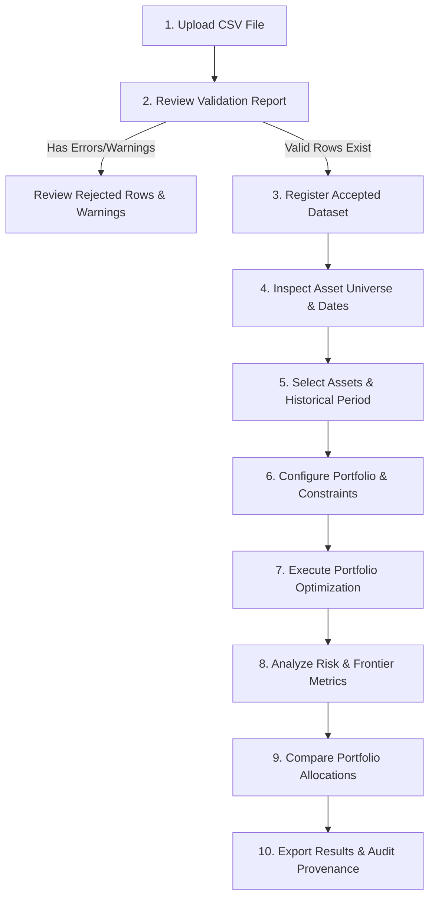

# Requirements Specification — Quant Portfolio Optimization Engine
**Document Version:** 1.0.0  
**Status:** Approved Architecture Baseline  
**Date:** 2026-10-16  
**Author:** Quantitative Finance Software Architecture & Engineering  

---

## 1. Introduction & Product Scope

The **Quant Portfolio Optimization Engine** is an institutional-grade quantitative research and portfolio construction platform. The system enables quantitative analysts, portfolio managers, and sophisticated retail investors to ingest raw historical price data, validate its mathematical and structural integrity, compute statistical return and risk analytics, configure multi-asset investment constraints, solve for optimal portfolio allocations, plot the Markowitz efficient frontier, and evaluate strategies through backtesting.

### 1.1 Staged Implementation Lifecycle
To ensure institutional correctness and avoid premature complexity, the platform progresses through 8 disciplined phases:
- **Stage 1 (Complete):** CSV Market Data Engine, Schema Validation, Inclusive Querying, In-Memory Caching.
- **Stage 2 (Complete):** Financial Mathematics, Return Conventions, Annualized Volatility, Covariance/Correlation, Risk Metrics.
- **Stage 3 (Complete):** Portfolio Definition, Capital Constraints, Position Caps, Asset Selection & Feasibility.
- **Stage 4 (Complete — Session 06):** Mathematical Optimization Engine (Minimum Variance, Maximum Sharpe, Equal-Weight Baseline, SLSQP).
- **Stage 5 (Complete — Session 07):** Efficient Frontier Curve Generation, Target-Return Optimization, Portfolio Risk Analytics (Sharpe, Sortino, Drawdown), and Multi-Portfolio Strategy Comparison.
- **Stage 5.1 / Reliability (Complete — Session 08):** API Integration & Reliability Hardening (Thread-Safe In-Memory Registry, Row Immutability, Provenance Standardization, Concurrency & Input Boundaries).
- **Stage 6 (Complete — Session 09):** Quantitative Research Dashboard UI (React 19, TypeScript 6, Vite 8, Institutional HCI).
- **Stage 8 / Persistence (Complete — Session 10):** Relational Database Persistence (PostgreSQL / SQLite, SQLAlchemy 2.0, Alembic, Transactional Atomicity, SHA-256 Deduplication, Dataset Lifecycle).
- **Stage 7 (Upcoming):** Walk-Forward Backtesting Engine, Slippage/Transaction Cost Modeling, Rebalancing Simulation.

---

## 2. User Personas & Core Workflows

### 2.1 User Personas
1. **Quantitative Researcher (Primary):** Seeks mathematically rigorous returns and covariance modeling, custom constraints, and reproducible optimization results without silent data corruption.
2. **Portfolio Manager (Secondary):** Evaluates asset allocation trade-offs along the efficient frontier, assesses tail-risk and drawdown, and reviews cross-market exposure (US vs. PSX).
3. **Risk Analyst (Secondary):** Audits data-quality warnings, inspects missing-value policies, and verifies regulatory/compliance constraints.

### 2.2 Core Workflow Specifications

#### Workflow 1: Import a CSV Market-Data File
- **User Goal:** Ingest historical daily price bars for US and PSX equities.
- **Required Inputs:** Multipart form-data `.csv` file (max 10 MB, $\le 250,000$ rows).
- **Validation Rules:** Valid CSV encoding (UTF-8), non-empty, presence of required column headers (`date`, `ticker`, `market`, `close`, `currency`).
- **Expected System Behavior:** Stream-read file, calculate SHA-256 digest, parse into structured price bars.
- **Success State:** Returns preview summary with row counts, schema status, and digest.
- **Empty State:** File with headers only returns `0` examined rows and actionable warning.
- **Error State:** Missing required columns returns HTTP 400 with missing column list; file $>10$ MB returns HTTP 413; non-CSV returns HTTP 415.
- **Audit/Provenance:** Compute content SHA-256 hash, record original filename and upload timestamp.

#### Workflow 2: Review Validation Errors and Warnings
- **User Goal:** Identify why specific rows were rejected and review data-quality warnings.
- **Required Inputs:** Uploaded CSV bytes (preview mode).
- **Validation Rules:** Date parseability, ticker non-empty, market $\in \{\text{US}, \text{PSX}\}$, currency non-empty, $Close > 0$, optional prices $> 0$, volume $\ge 0$, $High \ge Low$, $High \ge \max(Open, Close)$, $Low \le \min(Open, Close)$, duplicate key detection.
- **Expected System Behavior:** Isolate invalid rows into an error catalog referencing original 1-based CSV line numbers with specific rejection reasons. Collect non-blocking warnings (missing optional columns).
- **Success State:** Structured validation report detailing `rows_examined`, `valid_rows`, `rejected_rows`, `errors`, and `warnings`.
- **Empty State:** Clean dataset returns empty `errors` array.
- **Error State:** Server parse failure returns sanitized HTTP 400.
- **Audit/Provenance:** Row-level error messages attached to file content hash.

#### Workflow 3: Confirm and Register Accepted Dataset
- **User Goal:** Commit validated data into the active session registry for downstream analytics.
- **Required Inputs:** Uploaded CSV file to registration endpoint.
- **Validation Rules:** Dataset must contain at least 1 valid row (`valid_rows > 0`).
- **Expected System Behavior:** Exclude rejected rows, store valid price bars in memory/database, assign a unique `dataset_id` (UUIDv4).
- **Success State:** Returns HTTP 200/201 with `dataset_id`, metadata summary, and row counts.
- **Empty State:** N/A.
- **Error State:** Zero valid rows returns HTTP 422 with full validation diagnostic report.
- **Audit/Provenance:** `dataset_id`, upload timestamp (UTC ISO 8601), user session ID, content SHA-256.

#### Workflow 4: Inspect Available Assets and Date Coverage
- **User Goal:** Explore available tickers, markets, currencies, and start/end dates in a registered dataset.
- **Required Inputs:** `dataset_id`.
- **Validation Rules:** `dataset_id` must exist in active registry.
- **Expected System Behavior:** Query metadata store, compute date bounds and unique ticker listings.
- **Success State:** JSON response with summary statistics: total valid bars, asset list with per-ticker date coverage, markets present.
- **Empty State:** Dataset with zero historical bars is impossible (prevented at registration).
- **Error State:** Unknown or expired `dataset_id` returns HTTP 404 with restart disclaimer.
- **Audit/Provenance:** Linked to `dataset_id`.

#### Workflow 5: Select Assets and Historical Period
- **User Goal:** Extract aligned price series for a target asset basket over an inclusive historical window.
- **Required Inputs:** `dataset_id`, `start_date`, `end_date`, list of `tickers`, optional `market`.
- **Validation Rules:** `start_date <= end_date`, ISO-8601 dates, tickers must exist in dataset.
- **Expected System Behavior:** Inclusive date filtering; cross-asset date intersection/alignment.
- **Success State:** Structured price matrix/time series containing observed prices for selected assets.
- **Empty State:** Valid date range containing zero observations returns HTTP 200 with `row_count: 0, data: []`.
- **Error State:** `start_date > end_date` returns HTTP 422; missing dataset returns HTTP 404.
- **Audit/Provenance:** Query parameter hash logged and cached.

#### Workflow 6: Define Portfolio Weights and Constraints
- **User Goal:** Specify asset weights (for evaluation) or mathematical bounds (for optimization).
- **Required Inputs:** Asset basket, target weights or bounds $[w_{i,\min}, w_{i,\max}]$, position caps, sector/market exposure limits, sum-of-weights rule ($\sum w_i = 1$).
- **Validation Rules:** Lower bounds $\ge 0$ (long-only), upper bounds $\le 1$, $w_{i,\min} \le w_{i,\max}$, $\sum w_{i,\min} \le 1 \le \sum w_{i,\max}$ (feasibility check).
- **Expected System Behavior:** Validate constraint consistency before triggering optimization.
- **Success State:** Validated constraint specification with unique `constraint_set_id`.
- **Empty State:** Unconstrained default: $0 \le w_i \le 1$ and $\sum w_i = 1$.
- **Error State:** Contradictory bounds (e.g., $\sum w_{i,\min} > 1$) rejected immediately with actionable 422 error detailing the mathematical conflict.
- **Audit/Provenance:** Parameter snapshot saved with timestamp.

#### Workflow 7: Run Optimization Job
- **User Goal:** Calculate optimal asset weights under selected objective and constraints.
- **Required Inputs:** Aligned historical return series, risk-free rate $R_f$, objective function (`max_sharpe`, `min_volatility`, `target_return`), constraint set.
- **Validation Rules:** Minimum sample size ($T \ge N + 5$), covariance matrix must be positive semi-definite.
- **Expected System Behavior:** Execute quadratic/convex solver in worker threadpool; verify convergence.
- **Success State:** Returns optimal weights vector $\mathbf{w}^*$, expected return $E[R_p]$, volatility $\sigma_p$, Sharpe ratio, solver status (`CONVERGED`).
- **Empty State:** N/A.
- **Error State:** Infeasible constraints or solver convergence failure returns HTTP 422 with domain diagnostic object (slack variables, violated constraints).
- **Audit/Provenance:** Solver version, objective value, iterations, parameter payload.

#### Workflow 8: Interpret Risk and Return Metrics
- **User Goal:** Evaluate portfolio performance, risk concentrations, and tail-risk exposures.
- **Required Inputs:** Portfolio weights, historical asset returns.
- **Validation Rules:** Weights sum to $1.0 \pm 10^{-6}$, assets match return columns.
- **Expected System Behavior:** Compute portfolio annualized return, annualized volatility, maximum drawdown, Value at Risk (Parametric and Historical VaR 95%/99%), Conditional VaR (CVaR / Expected Shortfall), and diversification ratio.
- **Success State:** Comprehensive risk tear-sheet with exact metric definitions, annualization base (252 vs 250), and units.
- **Empty State:** N/A.
- **Error State:** Singular covariance matrix or insufficient historical bars returns HTTP 422 with statistical diagnostic.
- **Audit/Provenance:** Calculation timestamp, formula conventions logged.

#### Workflow 9: Compare Portfolio Alternatives
- **User Goal:** Contrast multiple portfolios (e.g. Equal-Weight vs. Minimum Variance vs. Maximum Sharpe vs. Custom Benchmark).
- **Required Inputs:** Array of portfolio weight vectors over identical asset universe and historical timeframe.
- **Validation Rules:** All portfolios share identical price series and benchmark settings.
- **Expected System Behavior:** Evaluate metrics side-by-side; calculate marginal risk contributions and weight differentials.
- **Success State:** Comparative matrix with differential return, risk, and Sharpe deltas.
- **Empty State:** Single portfolio displays individual tear-sheet.
- **Error State:** Mismatched asset universes return HTTP 422.
- **Audit/Provenance:** Comparison ID referencing base dataset.

#### Workflow 10: Export Results and Reproduce Previous Analysis
- **User Goal:** Export verified audit report (JSON/CSV) and reproduce exact figures from stored metadata.
- **Required Inputs:** Job ID or exported configuration manifest.
- **Validation Rules:** Manifest schema compliance.
- **Expected System Behavior:** Replay exact data hash, date bounds, return formula, and solver options; verify identical numerical output within $10^{-6}$ tolerance.
- **Success State:** Downloadable structured archive (JSON manifest + CSV tables) and reproducibility verification token.
- **Empty State:** N/A.
- **Error State:** Expired or missing in-memory job ID returns HTTP 404 with re-run instructions.
- **Audit/Provenance:** SHA-256 manifest signature.

---

## 3. Functional Requirements Catalog

### Status Classifications
- `Current`: Implemented and verified in the Stage 1 baseline.
- `Next`: Required in upcoming development sessions (Stage 1 refinement & Stage 2).
- `Later`: Planned for subsequent architectural stages (Stages 3–8).

### 3.1 CSV Ingestion & Market Data Engine
| ID | Requirement Statement | Status | Verification Criteria |
|---|---|---|---|
| **FR-001** | The system shall ingest market price series via standard comma-separated value (CSV) file uploads up to 10 MB in size. | `Current` | Verified via HTTP multipart upload; returns HTTP 413 when file $> 10$ MB. |
| **FR-002** | The system shall enforce a maximum row limit of 250,000 price bars per uploaded CSV file. | `Current` | Verified; CSV $> 250,000$ rows rejected with clear HTTP 400 error. |
| **FR-003** | The system shall require the presence of five mandatory column headers: `date`, `ticker`, `market`, `close`, `currency`. | `Current` | Missing any required header returns HTTP 400 listing missing columns. |
| **FR-004** | The system shall support five optional column headers: `open`, `high`, `low`, `adjusted_close`, `volume`. | `Current` | Optional columns parsed when present; non-presence triggers non-blocking warnings. |
| **FR-005** | The system shall validate that market identifiers are strictly restricted to `US` and `PSX`. | `Current` | Rows with unrecognized markets rejected with row-level error. |
| **FR-006** | The system shall validate that price columns (`close`, `open`, `high`, `low`, `adjusted_close`) contain strictly positive numeric values ($P > 0$). | `Current` | Non-positive prices rejected with row-level error. |
| **FR-007** | The system shall validate that `volume`, when present, contains non-negative numeric values ($V \ge 0$). | `Current` | Negative volume rejected with row-level error. |
| **FR-008** | The system shall reject unparseable non-numeric string values in optional numeric columns rather than silently coercing them to null. | `Next` | Input such as `open="invalid"` must generate an invalid numeric row error. |
| **FR-009** | The system shall perform complete OHLC bar consistency validation: $High \ge Low$, $High \ge Open$, $High \ge Close$, $Low \le Open$, $Low \le Close$. | `Next` | Violating bars must be rejected with specific OHLC violation reasons. |
| **FR-010** | The system shall detect duplicate `(date, market, ticker)` composite keys and reject all duplicate rows. | `Current` | Duplicate rows excluded from valid set and flagged in error report. |
| **FR-011** | The system shall normalize date fields to strict ISO 8601 (`YYYY-MM-DD`) and reject ambiguous date strings. | `Next` | Non-ISO formats like `20250102` or ambiguous formats rejected or explicitly parsed. |
| **FR-012** | The system shall generate a validation report containing content SHA-256, row counts (`examined`, `valid`, `rejected`), error list with 1-based CSV line numbers, and warnings list. | `Current` | Verified via `/api/v1/market-data/preview`. |
| **FR-013** | The system shall provide an inclusive date-range query endpoint supporting optional ticker and market filters. | `Current` | Verified via `/api/v1/market-data/datasets/query`. |
| **FR-014** | The system shall maintain an in-memory process-local cache for preview and query responses with TTL and eviction. | `Current` | Bounded cache verified with SHA-256 query hashing. |
| **FR-015** | The system shall enforce a bounded capacity limit (e.g. max 30 active datasets) on the in-memory dataset registry with FIFO/LRU eviction. | `Next` | Protects server RAM from unbounded growth during testing. |
| **FR-016** | The system shall offload CSV parsing and validation to a worker threadpool to prevent blocking FastAPI's async event loop. | `Next` | Eliminates server freezing during heavy file uploads. |

### 3.2 Financial Mathematics & Statistical Analytics (Stage 2)
| ID | Requirement Statement | Status | Verification Criteria |
|---|---|---|---|
| **FR-017** | The system shall calculate simple arithmetic daily returns: $R_t = (P_t - P_{t-1}) / P_{t-1}$. | `Next` | Hand-calculated numerical benchmark reconciliation (tolerance $10^{-6}$). |
| **FR-018** | The system shall calculate logarithmic daily returns: $r_t = \ln(P_t / P_{t-1})$. | `Next` | Hand-calculated numerical benchmark reconciliation. |
| **FR-019** | The system shall compute sample annualized mean return using market-specific trading day conventions (252 for US, 250 for PSX). | `Next` | Annualization factor must match exchange calendar specification. |
| **FR-020** | The system shall compute sample covariance and correlation matrices across multiple assets over aligned observation dates. | `Next` | Symmetry ($\Sigma = \Sigma^T$) and positive semi-definiteness ($\lambda_i \ge 0$) verified. |
| **FR-021** | The system shall support Ledoit-Wolf shrinkage covariance estimation for portfolios with high dimensional assets ($N \approx T$). | `Later` | Shrinkage intensity $\delta \in [0, 1]$ documented and verified. |
| **FR-022** | The system shall compute historical drawdown series, maximum drawdown (MDD), and peak-to-trough duration. | `Next` | Validated against benchmark equity curves. |
| **FR-023** | The system shall calculate the annualized Sharpe Ratio using an explicitly parameterized risk-free rate $R_f$: $\text{SR} = (E[R_p] - R_f) / \sigma_p$. | `Next` | Verified with zero and positive risk-free rate benchmarks. |
| **FR-024** | The system shall calculate the Sortino Ratio using downside semi-deviation below a minimum acceptable return (MAR). | `Next` | Upside deviations must not penalize the volatility denominator. |

### 3.3 Portfolio Definition & Investment Constraints (Stage 3)
| ID | Requirement Statement | Status | Verification Criteria |
|---|---|---|---|
| **FR-025** | The system shall support definition of multi-asset portfolios with explicit fractional weights $w_i$. | `Later` | Weight vectors validated for asset alignment. |
| **FR-026** | The system shall enforce the full investment constraint: $\sum_{i=1}^N w_i = 1.0 \pm 10^{-6}$. | `Later` | Violating weight vectors rejected with HTTP 422. |
| **FR-027** | The system shall support long-only box constraints: $0 \le w_{i,\min} \le w_i \le w_{i,\max} \le 1$. | `Later` | Negative weights disallowed in long-only mode. |
| **FR-028** | The system shall support individual asset position caps (e.g. $w_i \le 0.15$). | `Later` | Infeasible caps ($\sum w_{i,\max} < 1$) rejected before solver execution. |
| **FR-029** | The system shall support group/sector/market allocation constraints: $\sum_{i \in G} w_i \le C_G$. | `Later` | Group membership validated against asset metadata. |
| **FR-030** | The system shall evaluate constraint set feasibility prior to optimization and return actionable diagnostics on contradiction. | `Later` | Clear error reporting identifying conflicting constraints. |

### 3.4 Optimization Engine (Stage 4)
| ID | Requirement Statement | Status | Verification Criteria |
|---|---|---|---|
| **FR-031** | The system shall solve for the Global Minimum Variance (GMV) portfolio: $\min_\mathbf{w} \mathbf{w}^T \mathbf{\Sigma} \mathbf{w}$. | `Later` | First-order optimality conditions (KKT) verified within tolerance. |
| **FR-032** | The system shall solve for the Maximum Sharpe Ratio (Tangency) portfolio under positive risk premiums. | `Later` | Tangency point confirmed tangent to efficient frontier. |
| **FR-033** | The system shall solve for the Target Return portfolio: $\min_\mathbf{w} \mathbf{w}^T \mathbf{\Sigma} \mathbf{w} \text{ s.t. } \mathbf{w}^T \mathbf{\mu} \ge R_{\text{target}}$. | `Later` | Realized portfolio return matches or exceeds target. |
| **FR-034** | The system shall support an Equal-Weight baseline benchmark ($w_i = 1/N$). | `Later` | Computed automatically for every configured universe. |
| **FR-035** | The system shall return explicit solver status (`CONVERGED`, `INFEASIBLE`, `MAX_ITERATIONS_REACHED`) without throwing unhandled server exceptions. | `Later` | Infeasible optimizations return HTTP 422 with diagnostic payload. |

### 3.5 Efficient Frontier & Risk Analytics (Stage 5)
| ID | Requirement Statement | Status | Verification Criteria |
|---|---|---|---|
| **FR-036** | The system shall generate the Markowitz Efficient Frontier curve by sweeping target returns across the feasible spectrum $[\mu_{\min}, \mu_{\max}]$. | `Later` | All plotted frontier points must be mathematically feasible portfolios. |
| **FR-037** | The system shall calculate Value-at-Risk (Parametric and Historical VaR) at 95% and 99% confidence levels over 1-day and 10-day horizons. | `Later` | Reconciled against standard statistical distributions. |
| **FR-038** | The system shall calculate Conditional Value-at-Risk (CVaR / Expected Shortfall) at 95% and 99% confidence levels. | `Later` | CVaR $\ge$ VaR verified for all test cases. |
| **FR-039** | The system shall calculate marginal contribution to risk (MCR) and percentage risk contribution for each asset: $\%RC_i = w_i (\mathbf{\Sigma} \mathbf{w})_i / \sigma_p^2$. | `Later` | Sum of risk contributions must equal 100%. |

### 3.6 Research Dashboard & User Experience (Stage 6)
| ID | Requirement Statement | Status | Verification Criteria |
|---|---|---|---|
| **FR-040** | The system shall provide an institutional-grade, responsive dashboard interface following modern financial HCI principles. | `Later` | WCAG 2.1 AA contrast compliance, responsive desktop/tablet layouts. |
| **FR-041** | Every UI view, table, and analytical component shall support five standard states: Loading, Empty, Validation/Warning, Error, and Populated/Success. | `Later` | Verified through automated front-end state testing. |
| **FR-042** | Financial metrics shall be displayed with standardized financial formatting (currency codes, 2-decimal percentages, monospace tabular digits). | `Later` | Explicit numeric formatters for all tabular outputs. |
| **FR-043** | All interactive charts (frontier, equity curves, drawdown waterfalls) shall display explicit legends, units, tooltips, and date stamps. | `Later` | Interactive hover cards with full precision values. |

### 3.7 Backtesting Engine (Stage 7)
| ID | Requirement Statement | Status | Verification Criteria |
|---|---|---|---|
| **FR-044** | The system shall simulate historical walk-forward portfolio rebalancing without look-ahead bias. | `Later` | Weights at time $t$ calculated using information strictly available at $t-1$. |
| **FR-045** | The system shall support configurable rebalancing frequencies: Daily, Weekly, Monthly, Quarterly, and Threshold-Triggered. | `Later` | Rebalance dates align with exchange trading calendar. |
| **FR-046** | The system shall model proportional transaction costs (e.g. 10 bps per dollar traded) and fixed execution ticket fees. | `Later` | Cost deducted from cash ledger upon rebalance. |
| **FR-047** | The system shall model execution slippage assumptions. | `Later` | Executed prices adjust adversely based on volume participation. |

### 3.8 Production Persistence, Security & Governance (Stage 8)
| ID | Requirement Statement | Status | Verification Criteria |
|---|---|---|---|
| **FR-048** | The system shall persist datasets, market observations, and user accounts to a relational database (PostgreSQL / SQLite fallback) with migrations (Alembic). | `Complete` | Full data survivability across server restarts; automated Alembic migrations. |
| **FR-049** | The system shall provide cryptographic reproducibility manifests linking any analytical output to its raw data SHA-256 and calculation parameters. | `Complete` | Manifest replay recreates identical numerical results; SHA-256 validation. |
| **FR-050** | The system shall never expose internal server tracebacks, file system paths, or secrets in API error responses. | `Complete` | Verified; error responses adhere to sanitized JSON shapes. |
| **FR-051** | The system shall securely authenticate users using email and bcrypt-hashed passwords, issuing HS256 JWT access tokens. | `Complete` | Verified; password hashes stored with bcrypt; tokens validated on protected routes. |
| **FR-052** | The system shall support both SameSite=Lax HttpOnly cookies for browser clients and `Authorization: Bearer <token>` for API integrations. | `Complete` | Verified; dual extraction with explicit Authorization header precedence. |
| **FR-053** | The system shall enforce strict dataset ownership and tenant isolation; private datasets shall only be accessible to their owner. | `Complete` | Verified; cross-tenant query, metadata, or optimization attempts return 404/403. |
| **FR-054** | The system shall support role-based authorization (`researcher`, `admin`) and block disabled user accounts immediately. | `Complete` | Verified; role verification dependency and active-status check on all protected calls. |
| **FR-055** | The system shall protect login against brute-force attacks via sliding-window rate limiting. | `Complete` | Verified; 5 consecutive failed attempts trigger temporary lockout. |
| **FR-056** | The system shall disallow wildcard CORS with credentialed requests and enforce defensive security headers (`X-Content-Type-Options`, `X-Frame-Options`, `Referrer-Policy`). | `Complete` | Verified; explicit origin validation and security header middleware. |
| **FR-057** | The frontend application shall support institutional login, registration, authenticated researcher state, session persistence, and secure logout. | `Complete` | Verified; React 19 AuthContext and accessible login/register interface. |
| **FR-058** | The system shall model realistic portfolio simulation with discrete simple compounding, asset weight drift, and day-0 initial allocation friction. | `Complete` | Verified; pure accounting simulation with exact cash-drag and friction modeling. |
| **FR-059** | The system shall support rebalancing schedules: `buy_and_hold`, `daily`, `weekly`, `monthly`, and `quarterly`. | `Complete` | Verified; exact calendar alignment and turnover attribution. |
| **FR-060** | The system shall compute basis-point transaction costs and execution slippage proportional to traded notional value. | `Complete` | Verified; turnover $\tau = \frac{1}{2}\sum |w_{\text{target}} - w_{\text{current}}|$, notional $N = \tau \cdot V$, fees deducted from cash. |
| **FR-061** | The system shall implement walk-forward expanding-window optimization with strict zero look-ahead bias. | `Complete` | Verified; estimation window strictly precedes out-of-sample evaluation window. |
| **FR-062** | The system shall persist backtest runs in relational storage (`backtest_runs` table) with foreign keys and tenant isolation. | `Complete` | Verified; Alembic migration `8993dbd79e8a` applied, SQLAlchemy models, user tenant isolation enforced. |
| **FR-063** | The system shall provide secure REST endpoints for creating, listing, retrieving, and deleting backtest runs. | `Complete` | Verified; `POST /api/v1/backtests`, `GET /api/v1/backtests`, `GET /api/v1/backtests/{id}`, `DELETE /api/v1/backtests/{id}`. |
| **FR-064** | The web dashboard shall provide a dedicated Backtesting workspace featuring interactive simulation configuration, past run selector, dual SVG equity curves (gross vs. net), drawdown chart, and rebalancing audit logs. | `Complete` | Verified; React 19 `BacktestingPage` integrated with full API client and unit tests. |

### 3.9 Scenario Analysis, Stress Testing & Sensitivity Analysis (Stage 9)
| ID | Requirement Statement | Status | Verification Criteria |
|---|---|---|---|
| **FR-065** | The system shall compute instantaneous asset shocks preserving unshocked cash: $V_{\text{after}} = \sum V_i(1+s_i) + C$. | `Complete` | Verified; zero shocks produce zero impact; unshocked cash preserved; denominator safety enforced. |
| **FR-066** | The system shall enforce exact additive asset contribution reconciliation: $\sum_{i=1}^N \Delta V_i = \Delta V$. | `Complete` | Verified; sum of dollar contributions matches total portfolio loss/gain within floating-point epsilon. |
| **FR-067** | The system shall execute historical window stress replay using strictly empirical observations without synthetic forward-filling. | `Complete` | Verified; observation date range reported in output metadata; missing bars rejected cleanly. |
| **FR-068** | The system shall compute volatility and correlation stress on asset covariance matrices with eigenvalue verification. | `Complete` | Verified; invalid non-PSD matrices identified; optional spectral projection ($M_{\text{psd}} = Q \max(\Lambda, 0) Q^T$) supported. |
| **FR-069** | The system shall execute 1-factor and 2-factor parametric sensitivity sweeps over bounded grid dimensions ($\le 441$ points). | `Complete` | Verified; grids strictly bounded; deterministic monotonic curves generated. |
| **FR-070** | The system shall persist scenario runs in relational storage (`scenario_runs` table) with foreign keys and tenant isolation. | `Complete` | Verified; Alembic migration `e4f5a6b7c8d9` applied, SQLAlchemy model, user tenant isolation enforced. |
| **FR-071** | The system shall provide authenticated REST endpoints for scenario execution, stress testing, sensitivity sweeps, and run management. | `Complete` | Verified; `POST /api/v1/scenarios`, `POST /api/v1/scenarios/stress-test`, `POST /api/v1/scenarios/sensitivity`, `GET /api/v1/scenarios`, `GET /api/v1/scenarios/{id}`, `DELETE /api/v1/scenarios/{id}`. |
| **FR-072** | The web dashboard shall provide an institutional Scenario Analysis workspace with preset templates, waterfall contribution charts, sensitivity curves, and run management. | `Complete` | Verified; React 19 `ScenarioAnalysisPage` integrated with real API client and automated Vitest tests. |

### 3.10 Monte Carlo Simulation, Probabilistic Risk Analysis, VaR & CVaR (Stage 10)
| ID | Requirement Statement | Status | Verification Criteria |
|---|---|---|---|
| **FR-073** | The system shall implement deterministic stochastic return generation for Multivariate Normal and Multivariate Student-t distributions using caller-controlled seeds. | `Complete` | Verified; identical seed reproduces bitwise identical return draws; empirical moments converge to theoretical parameters. |
| **FR-074** | The system shall factorize covariance matrices via Cholesky decomposition, with spectral positive semidefiniteness projection ($\min(\lambda_i, 10^{-8})$) for ill-conditioned matrices. | `Complete` | Verified; rank-deficient and perturbed matrices project onto PSD cone and factorize without numerical failure. |
| **FR-075** | The system shall model multi-period portfolio wealth compounding ($V_{i,t} = V_{i,t-1}(1+r_{i,t})$) with support for both `buy_and_hold` drift and `constant_weights` periodic rebalancing. | `Complete` | Verified; terminal wealth calculations tested against independent hand calculations. |
| **FR-076** | The system shall implement empirical and parametric Value-at-Risk (VaR) and Conditional Value-at-Risk (CVaR / Expected Shortfall) with standardized loss-sign convention ($L = V_0 - V_T$, positive values represent loss). | `Complete` | Verified; tested on small hand-calculated tail samples with ties and compared against standard normal analytical benchmarks. |
| **FR-077** | The system shall calculate multi-estimator risk comparisons across Monte Carlo, Parametric, and Historical empirical models over consistent horizons. | `Complete` | Verified; standalone endpoint and embedded simulation comparisons reconcile. |
| **FR-078** | The system shall persist simulation runs in relational storage (`risk_simulation_runs` table) with foreign keys and user tenant isolation. | `Complete` | Verified; Alembic migration `f5a6b7c8d9e0` applied; cross-tenant run retrieval/deletion prohibited. |
| **FR-079** | The system shall provide authenticated REST endpoints for Monte Carlo simulation (`POST /api/v1/risk-simulations`), standalone VaR/CVaR (`POST /api/v1/risk-simulations/var-cvar`), and run CRUD operations. | `Complete` | Verified; authenticated routes, input resource limits ($\le 10,000$ paths, $\le 252$ days), typed validation errors. |
| **FR-080** | The web dashboard shall provide a dedicated Monte Carlo Risk workspace featuring distribution histograms with VaR/CVaR thresholds, trajectory fan charts, multi-estimator comparisons, and saved runs drawer. | `Complete` | Verified; React 19 / TypeScript `MonteCarloPage` integrated with real API client and automated Vitest tests. |

### 3.11 Portfolio Performance Attribution, Benchmark Analysis & Risk-Adjusted Evaluation (Stage 11)
| ID | Requirement Statement | Status | Verification Criteria |
|---|---|---|---|
| **FR-081** | The system shall evaluate portfolio return series against an empirical benchmark asset, computing periodic active return series ($a_t = r_{p,t} - r_{b,t}$), cumulative arithmetic active return, and geometric excess return. | `Complete` | Verified; dates inner-joined, calendar discrepancies and currency mismatches rejected without imputation. |
| **FR-082** | The system shall calculate annualized tracking error ($TE = \operatorname{Std}(a_t)\sqrt{m}$) and Information Ratio ($IR = \frac{\bar{a}m}{TE}$) with matching frequency conventions. | `Complete` | Verified; hand-calculated benchmark tests match; zero tracking error returns typed None. |
| **FR-083** | The system shall calculate portfolio Beta ($\beta = \frac{\operatorname{Cov}(r_p, r_b)}{\operatorname{Var}(r_b)}$), Jensen's Alpha, Treynor Ratio, and Up/Down market capture ratios. | `Complete` | Verified; regression models tested against independent covariance calculations; zero benchmark variance handled safely. |
| **FR-084** | The system shall compute single-period asset return contributions ($c_{i,t} = w_{i,t-1} r_{i,t}$) and link them over multi-period horizons via Menchero (2000) logarithmic linking weights. | `Complete` | Verified; multi-period asset contributions reconcile additively to cumulative portfolio return ($\sum_i C_i = R_{0:T}$) within $10^{-6}$. |
| **FR-085** | The system shall conditionally defer Brinson allocation and selection attribution when empirical benchmark constituent weights or industry classifications are unobserved in the market dataset. | `Complete` | Verified; explicit diagnostic warning emitted; zero synthetic constituent weighting. |
| **FR-086** | The system shall evaluate saved backtest runs directly against benchmark assets present in the source dataset, extracting realized net return series. | `Complete` | Verified; authenticated endpoint `GET /api/v1/performance/backtests/{backtest_id}` with tenant ownership checks. |
| **FR-087** | The system shall persist performance attribution reports in relational storage (`performance_reports` table) with foreign keys and tenant isolation. | `Complete` | Verified; Alembic migration `a1b2c3d4e5f6` applied; CRUD routes enforce user access control. |
| **FR-088** | The web dashboard shall provide an institutional Performance Analytics workspace (`PerformancePage.tsx`) featuring source selection (custom portfolio or saved backtest), dual SVG cumulative wealth and drawdown curves, asset contribution breakdown, risk-adjusted metrics, and saved report management. | `Complete` | Verified; React 19 / TypeScript `PerformancePage` integrated with real API client and automated Vitest tests. |

### 3.12 Portfolio Research Experiments, Strategy Comparison & Reproducible Runs (Stage 12)
| ID | Requirement Statement | Status | Verification Criteria |
|---|---|---|---|
| **FR-089** | The system shall formalize research experiments with immutable canonical configurations, separating experiment definitions from sequential, non-destructive execution runs. | `Complete` | Verified; `ResearchExperimentModel` and `ResearchExperimentRunModel` separated; re-running creates run 2 without overwriting run 1. |
| **FR-090** | The system shall generate deterministic SHA-256 configuration fingerprints using canonical recursive key sorting, 8-decimal float formatting, and non-semantic field exclusion. | `Complete` | Verified; identical configurations produce identical fingerprints; semantic modifications alter fingerprint; non-semantic formatting perturbations preserve it. |
| **FR-091** | The system shall verify source dataset existence and cryptographic content provenance (SHA-256) prior to execution, flagging unverifiable runs with explicit reproducibility warnings. | `Complete` | Verified; run records reflect `is_reproducible` boolean and audit warnings if dataset hash shifts or is missing. |
| **FR-092** | The system shall execute supported research workflows (target weights, mean-variance, max Sharpe, Monte Carlo risk simulation, benchmark attribution) reusing existing backend domain engines. | `Complete` | Verified; zero duplicate mathematical code; results captured in typed summary and linked domain artifacts. |
| **FR-093** | The system shall persist experiments and execution runs in relational storage (`research_experiments` and `research_experiment_runs`) with foreign keys, cascade deletion, and tenant isolation. | `Complete` | Verified; Alembic migration `b2c3d4e5f6a7` applied; cross-tenant access and unauthorized deletion rejected. |
| **FR-094** | The system shall provide authenticated REST endpoints for experiment CRUD, run execution, run history retrieval, and multi-run strategy comparison. | `Complete` | Verified; `POST/GET /api/v1/research/experiments`, `GET/PATCH/DELETE /api/v1/research/experiments/{id}`, `POST/GET /api/v1/research/experiments/{id}/runs`, `GET /api/v1/research/runs/{run_id}`, `POST /api/v1/research/comparisons`. |
| **FR-095** | The system shall implement a multi-run comparison service enforcing currency compatibility, period alignment, gross vs net cost transparency, and clear metric availability without fabrication. | `Complete` | Verified; cross-currency comparisons rejected; unavailable metrics return `None`; comparative delta metrics calculated. |
| **FR-096** | The web dashboard shall provide an institutional Research Lab workspace (`ResearchLabPage.tsx`) featuring Experiment Library, Hypothesis Builder, Run History with provenance badges, and Multi-Run Strategy Comparison matrix. | `Complete` | Verified; React 19 / TypeScript `ResearchLabPage` integrated with real API client and automated Vitest tests. |

### 3.13 Robust Portfolio Optimization, Estimation Uncertainty & Constraint Sensitivity (Stage 13)
| ID | Requirement Statement | Status | Verification Criteria |
|---|---|---|---|
| **FR-097** | The system shall formulate and solve portfolio allocations under explicitly defined Box ($\mu_i \pm \kappa \cdot \text{SE}_i$) and Ellipsoidal ($(\mu - \hat{\mu})^\top \hat{\Sigma}^{-1}(\mu - \hat{\mu}) \le \kappa^2$) expected-return uncertainty sets. | `Complete` | Verified; worst-case return analytically evaluated; matches independent hand-calculated solutions; zero uncertainty reproduces baseline allocations. |
| **FR-098** | The system shall regularize sample covariance matrices via structured linear shrinkage $\Sigma_{\text{shrunk}} = (1-\lambda)\hat{\Sigma} + \lambda T$ supporting diagonal sample variances, scaled identity, and constant correlation targets. | `Complete` | Verified; matrix symmetry, positive definiteness, and shrinkage intensity bounds ($\lambda \in [0, 1]$) strictly enforced. |
| **FR-099** | The system shall support robust Maximum Sharpe, Global Minimum Variance, and Mean-Variance Utility objectives solved via SciPy SLSQP with analytical gradient evaluation. | `Complete` | Verified; economic excess return check ($\max(\mu_{\text{worst}}) > R_f$) enforced before Sharpe optimization; convergence status and iteration counts reported. |
| **FR-100** | The system shall compute portfolio interpretability diagnostics: $D_1$ weight distance ($\sum |w_i^{\text{robust}} - w_i^{\text{base}}|$), Herfindahl-Hirschman concentration index ($HHI = \sum w_i^2$), effective asset count ($N_{\text{eff}} = 1/HHI$), and maximum single-asset weight shift. | `Complete` | Verified; unit tests verify metric calculations and monotonicity as uncertainty expands. |
| **FR-101** | The system shall provide bounded 1D constraint and parameter sensitivity sweeps ($\le 25$ grid evaluations) evaluating allocation response across uncertainty radii, shrinkage intensity, or position caps. | `Complete` | Verified; infeasible configurations return explicit status without silent constraint relaxation or unbounded solver loops. |
| **FR-102** | The system shall execute strictly chronological out-of-sample backtests separating in-sample training data from out-of-sample evaluation data with transaction costs and execution slippage. | `Complete` | Verified; zero look-ahead bias; return and covariance estimation confined strictly to training window; realization evaluated on out-of-sample bars. |
| **FR-103** | The system shall expose authenticated REST API routes under `/api/v1/robust-optimization` (`/optimize`, `/sensitivity`, `/backtest`) with dataset tenant isolation. | `Complete` | Verified; unauthenticated requests rejected (401); cross-tenant dataset access rejected (403/404); strict Pydantic payload validation. |
| **FR-104** | The web dashboard shall provide an institutional Robust Optimization workspace (`RobustOptimizationPage.tsx`) featuring Optimization & Diagnostics, Constraint Sensitivity Sweeps, and Out-of-Sample Backtesting workflows. | `Complete` | Verified; React 19 / TypeScript `RobustOptimizationPage` integrated with real API client and automated Vitest tests. |

### 3.14 Black-Litterman Portfolio Optimization & Bayesian View Incorporation (Stage 14)
| ID | Requirement Statement | Status | Verification Criteria |
|---|---|---|---|
| **FR-105** | The system shall compute market-implied equilibrium excess returns ($\Pi = r_f \mathbf{1} + \gamma \Sigma w_{\text{eq}}$) via reverse optimization given benchmark weights and risk aversion $\gamma$. | `Complete` | Verified; equilibrium returns match theoretical reverse optimization analytically; zero-view prior identity proven. |
| **FR-106** | The system shall support construction and validation of pick matrices ($P \in \mathbb{R}^{K \times N}$) and view vectors ($q \in \mathbb{R}^K$) for absolute and dollar-neutral relative views. | `Complete` | Verified; dimension matching, asset resolution, and relative view row-sum normalization ($1$ and $-1$, summing to $0$) enforced. |
| **FR-107** | The system shall calibrate diagonal view uncertainty matrix $\Omega$ using both He-Litterman proportionality ($\Omega = \operatorname{diag}(P \tau \Sigma P^\top)$) and Idzorek confidence scaling ($\Omega_{k,k} = \frac{1-c_k}{c_k}(P \tau \Sigma P^\top)_{k,k}$). | `Complete` | Verified; confidence monotonicity tested; confidence $\to 1$ forces posterior onto view; confidence $\to 0$ reverts to equilibrium. |
| **FR-108** | The system shall compute the Black-Litterman posterior distribution $\mathcal{N}(\mu_{\text{BL}}, \Sigma_{\text{post}})$ using the numerically stable Woodbury matrix identity. | `Complete` | Verified; identical to 2-asset analytical worked example within $10^{-8}$; positive definiteness maintained. |
| **FR-109** | The system shall solve for both unconstrained closed-form Bayesian weights and constrained SLSQP allocations under long-only, leverage, and box constraints. | `Complete` | Verified; budget equality ($\sum w_i = 1$) and boundary constraints strictly satisfied; infeasibility reported without silent fallback. |
| **FR-110** | The system shall compute portfolio interpretability diagnostics: active tilts ($\Delta w = w_{\text{BL}} - w_{\text{eq}}$), tracking error, active share, Herfindahl concentration, and view absorption percentages. | `Complete` | Verified; active tilts sum to zero for dollar-neutral views; view absorption correctly measures tilt magnitude. |
| **FR-111** | The system shall execute strictly chronological out-of-sample backtests separating in-sample estimation ($t \le T_{\text{split}}$) from out-of-sample simulation with transaction costs and execution slippage. | `Complete` | Verified; zero look-ahead bias; comparative simulation against equilibrium benchmark executes cleanly via `run_portfolio_simulation`. |
| **FR-112** | The system shall expose authenticated REST API routes under `/api/v1/black-litterman` (`/optimize`, `/backtest`) and provide an institutional React 19 / TypeScript workspace (`BlackLittermanPage.tsx`). | `Complete` | Verified; multi-tenant dataset isolation enforced; Vitest and Pytest test suites passing at 100%. |

### 3.15 Equal Risk Contribution & Hierarchical Risk Parity (Stage 15)
| ID | Requirement Statement | Status | Verification Criteria |
|---|---|---|---|
| **FR-113** | The system shall compute exact Euler marginal ($MRC_i = \frac{(\Sigma w)_i}{\sigma_p}$), total ($TRC_i = w_i \cdot MRC_i$), and percentage ($\%RC_i = \frac{TRC_i}{\sigma_p}$) risk contributions, guaranteeing $\sum_{i=1}^N TRC_i = \sigma_p$ and $\sum_{i=1}^N \%RC_i = 1.0$. | `Complete` | Verified; Euler homogeneity holds within $10^{-8}$; analytical benchmarks match hand calculations. |
| **FR-114** | The system shall formulate and solve the Equal Risk Contribution (ERC) portfolio via convex log-barrier optimization ($\min_y \frac{1}{2}y^\top \Sigma y - \sum b_i \ln(y_i)$), supporting custom user-defined risk budgets $b_i$. | `Complete` | Verified; matches 2-asset analytical benchmark ($w_1 = \sigma_2/(\sigma_1+\sigma_2)$) within $10^{-6}$; risk drift $|\%RC_i - b_i| \le 10^{-4}$. |
| **FR-115** | The system shall implement the 3-step Hierarchical Risk Parity (HRP) algorithm: (1) correlation distance metric ($d_{i,j} = \sqrt{(1-\rho_{i,j})/2}$), (2) hierarchical linkage tree clustering and quasi-diagonalization, and (3) top-down recursive bisection with inverse-variance cluster variance weighting. | `Complete` | Verified; matches analytical 2-asset solution; permutation invariant; immune to singular/rank-deficient covariance matrices. |
| **FR-116** | The system shall compute analytical Inverse Variance ($w_i \propto 1/\sigma_i^2$) and Equal Weight ($w_i = 1/N$) benchmark allocations for comparison. | `Complete` | Verified; weights sum to 1.0; correct analytical formulas verified against unit tests. |
| **FR-117** | The system shall compute quantitative risk inequality and diversification diagnostics: Risk Gini Coefficient, Effective Number of Bets entropy ($N_{\text{ent}} = e^{-\sum \%RC_i \ln \%RC_i}$), and Diversification Ratio ($DR = \frac{w^\top \sigma}{\sigma_p}$). | `Complete` | Verified; unit tests confirm bounds ($G \in [0, 1]$, $N_{\text{ent}} \in [1, N]$, $DR \ge 1.0$). |
| **FR-118** | The system shall resolve the Session 18 Black-Litterman excess return zero-view refinement ($w_{\text{raw}} = \frac{1}{\gamma}\Sigma^{-1}(\mu_{\text{BL}} - r_f\mathbf{1})$), guaranteeing exact recovery of equilibrium weights $w_{\text{eq}}$ when views are empty. | `Complete` | Verified; unit test confirms $\|w_{\text{BL}} - w_{\text{eq}}\|_\infty < 10^{-6}$ for all $r_f \ge 0$. |
| **FR-119** | The system shall execute strictly chronological out-of-sample backtests separating in-sample training data ($t \le T_{\text{split}}$) from out-of-sample evaluation data with transaction costs and execution slippage. | `Complete` | Verified; zero look-ahead bias; comparative simulation against Equal Weight benchmark executes cleanly via `run_portfolio_simulation`. |
| **FR-120** | The system shall expose authenticated REST API routes under `/api/v1/risk-parity` (`/optimize`, `/backtest`) and provide an institutional React 19 / TypeScript workspace (`RiskParityPage.tsx`). | `Complete` | Verified; multi-tenant dataset isolation enforced; Vitest and Pytest test suites passing at 100%. |

### 3.16 Advanced Factor Investing & Multi-Factor Risk Decomposition (Stage 16)
| ID | Requirement Statement | Status | Verification Criteria |
|---|---|---|---|
| **FR-121** | The system shall estimate multivariate OLS factor regressions ($R_{i,t} - r_{f,t} = \alpha_i + \sum_{k=1}^K \beta_{i,k} F_{k,t} + \epsilon_{i,t}$), computing annualized alpha, standard errors, t-statistics, p-values, $R^2$, and specific idiosyncratic variance $s_{\epsilon,i}^2$. | `Complete` | Verified; analytical single-asset regression matches OLS formulas within $10^{-8}$; t-statistics and p-values verified. |
| **FR-122** | The system shall synthesize deterministic factor time series from asset returns without look-ahead bias or external dependencies: CAPM 1-Factor (MKT), Fama-French 3-Factor (MKT, SMB, HML), Carhart 4-Factor (MKT, SMB, HML, MOM), and PCA statistical eigen-factors via Singular Value Decomposition (SVD). | `Complete` | Verified; deterministic output; zero look-ahead bias; factor returns match analytical specifications. |
| **FR-123** | The system shall construct the Barra structural covariance matrix $\Sigma_{\text{model}} = B \Sigma_F B^\top + \Sigma_\epsilon$, enforcing exact matrix symmetry and positive semidefiniteness. | `Complete` | Verified; $\|\Sigma - \Sigma^\top\|_\infty = 0$; all eigenvalues $\lambda_i > 0$. |
| **FR-124** | The system shall compute exact Barra risk decomposition additively partitioning portfolio variance into systematic and idiosyncratic risk ($\sigma_p^2 = \sigma_{\text{sys}}^2 + \sigma_{\text{idio}}^2$), satisfying exact percentage sum to 100%. | `Complete` | Verified; matches 2-asset 1-factor analytical benchmark within $10^{-6}$; systematic + specific variance percentage sum to $100.0 \pm 0.01\%$. |
| **FR-125** | The system shall compute individual factor risk contributions via Euler homogeneous decomposition ($\text{Contr}_k = \beta_{p,k}(\Sigma_F \beta_p)_k$), guaranteeing $\sum_{k=1}^K \text{Contr}_k = \sigma_{\text{sys}}^2$. | `Complete` | Verified; sum of factor variance contributions equals total systematic variance within $10^{-8}$. |
| **FR-126** | The system shall formulate and solve factor-constrained portfolio optimization ($\beta_{k,\min} \le B_{:,k}^\top w \le \beta_{k,\max}$) across Minimum Variance, Maximum Sharpe, and Maximum Utility objectives via SciPy SLSQP. | `Complete` | Verified; optimal weights sum to 1.0; realized portfolio factor betas strictly respect specified tilt bounds. |
| **FR-127** | The system shall enforce multi-tenant dataset access control and reject unauthenticated or cross-tenant factor attribution and optimization requests. | `Complete` | Verified; unauthenticated requests return 401; cross-tenant requests return 403/404. |
| **FR-128** | The system shall expose authenticated REST API routes (`/api/v1/factor-investing/attribute`, `/api/v1/factor-investing/optimize`) and provide an institutional React 19 / TypeScript workspace (`FactorInvestingPage.tsx`). | `Complete` | Verified; Vitest test suite and TypeScript production build passing at 100%. |

### 3.17 Dynamic Factor Walk-Forward Backtesting & Alpha Generation (Stage 17)
| ID | Requirement Statement | Status | Verification Criteria |
|---|---|---|---|
| **FR-129** | The system shall execute chronological rolling walk-forward factor estimations ($W \ge 30$) with periodic re-estimation of factor loadings ($B_t$), factor covariance ($\Sigma_{F,t}$), and structural Barra covariance ($\Sigma_{\text{model},t}$), strictly enforcing zero look-ahead bias ($\tau \in [t - W, t - 1]$). | `Complete` | Verified; benchmark unit tests confirm identical allocations when future data varies; $W < 30$ and $T \le W + 5$ rejected cleanly with 422. |
| **FR-130** | The system shall implement dynamic strategy archetypes including Multi-Factor Alpha Tilting ($\alpha_i = \sum s_k \tilde{B}_{i,k}$), Factor-Constrained Minimum Variance ($\min \frac{1}{2} w^\top \Sigma_{\text{model}} w$ with factor beta bounds), and Cross-Sectional Factor Momentum Rotation (top-$Q$ selection). | `Complete` | Verified; rotation weights allocated exactly to top $Q$ assets; tilt weights optimize utility under risk aversion and turnover penalties. |
| **FR-131** | The system shall model realistic discrete frictional wealth compounding tracking continuous asset weight drift, 1-way portfolio turnover ($\frac{1}{2}\sum |w_i - w_{i,\text{prev}}|$), and basis-point trading commission plus execution slippage deductions. | `Complete` | Verified; analytical 2-asset worked example verifies exact turnover and fee calculation within $10^{-6}$; net equity tracks friction accurately. |
| **FR-132** | The system shall track and report chronological factor exposure time series ($B_{p,k,t}$), systematic volatility, specific volatility, and systematic variance percentage across each rebalance epoch. | `Complete` | Verified; time-series arrays match rebalance count; systematic share bounded between 0% and 100%. |
| **FR-133** | The system shall compute institutional performance and risk analytics: CAGR, annualized volatility, Sharpe ratio, Sortino ratio, maximum drawdown, Calmar ratio, active return (alpha vs benchmark), tracking error, and Information Ratio. | `Complete` | Verified; performance calculations match standard quantitative formulas; benchmark metrics evaluated side-by-side. |
| **FR-134** | The system shall expose authenticated REST API endpoint (`POST /api/v1/factor-investing/backtest`) with tenant dataset ownership enforcement, and provide an institutional React 19 / TypeScript workspace with interactive SVG wealth compounding & drawdown charts, KPI cards, and rebalance audit history. | `Complete` | Verified; Vitest test suite and TypeScript production build passing at 100%; cross-tenant access returns 403/404; unauthenticated returns 401. |

### 3.18 Multi-Asset Class Allocation, Cash Drag & Multi-Currency FX Hedging (Stage 18)
| ID | Requirement Statement | Status | Verification Criteria |
|---|---|---|---|
| **FR-135** | The system shall convert local asset returns across multiple currencies into base portfolio reporting currency using the exact discrete simple return identity $(1 + R_{i,t}^{\text{base}}) = (1 + R_{i,t}^{\text{loc}})(1 + R_{k(i),t}^{\text{fx}})$. | `Complete` | Verified; analytical 2-asset worked example verifies exact conversion to within $10^{-12}$. |
| **FR-136** | The system shall provide currency forward hedging overlays with Covered Interest Parity (CIP) carry differentials ($R_{i,t}^{\text{hedged}} = R_{i,t}^{\text{base}} - h_k(R_{k,t}^{\text{fx}} - \text{Carry}_k)$) allowing customizable hedge ratios $h_k \in [0.0, 1.0]$. | `Complete` | Verified; fully hedged ($h=1.0$) neutralizes FX fluctuations and accrues forward carry differential. |
| **FR-137** | The system shall decompose total unhedged base variance additively into local asset variance ($w^\top \Sigma_{\text{loc}} w$), FX currency variance ($w^\top \Sigma_{\text{fx}} w$), and asset-FX cross-covariance ($2 w^\top \Sigma_{\text{cross}} w$). | `Complete` | Verified; percentage risk shares sum to exactly 100.0% within $10^{-6}$. |
| **FR-138** | The system shall solve hierarchical multi-asset quadratic optimization under full budget condition $\sum w_i + w_{\text{cash}} = 1.0$, asset class allocation bounds ($L_c \le \sum_{i \in c} w_i \le U_c$), and cash buffer limits. | `Complete` | Verified; SLSQP solver converges and optimal allocations satisfy all class limits and cash bounds. |
| **FR-139** | The system shall model cash yield and return drag dynamically ($w_{\text{cash}} \cdot (\sum \frac{w_i}{1 - w_{\text{cash}}} R_{i,t} - r_f)$) and execute chronological walk-forward backtests with continuous weight drift and basis-point trading friction. | `Complete` | Verified; look-ahead bias prevention test confirms out-of-sample data changes leave in-sample allocations invariant ($< 10^{-12}$). |
| **FR-140** | The system shall expose authenticated REST API routes (`/api/v1/multi-asset/optimize`, `/api/v1/multi-asset/backtest`) and provide an institutional React 19 / TypeScript workspace (`MultiAssetPage.tsx`). | `Complete` | Verified; 324 backend tests and 30 frontend tests passing at 100%; production build clean. |

### 3.19 Non-Linear Execution Costs, Market Impact Modeling & Optimal Trade Scheduling (Stage 19)
| ID | Requirement Statement | Status | Verification Criteria |
|---|---|---|---|
| **FR-141** | The system shall implement the Almgren-Chriss (2000) optimal trade scheduling engine computing the closed-form deterministic trajectory $x_j^* = X_0 \frac{\sinh(\kappa (T - t_j))}{\sinh(\kappa T)}$ balancing temporary price impact and inventory timing risk. | `Complete` | Verified; analytical 2-period closed-form test confirms trajectory, trade schedule, and expected utility match exact mathematical benchmark within $10^{-12}$. |
| **FR-142** | The system shall compute Time-Weighted Average Price (TWAP) and Volume-Weighted Average Price (VWAP) execution benchmarks alongside the Almgren-Chriss trajectory for direct comparison of execution shortfall and variance. | `Complete` | Verified; TWAP matches linear trajectory ($x_j = X_0 (1 - j/N)$); Almgren-Chriss converges to TWAP as risk aversion $\lambda \to 0$. |
| **FR-143** | The system shall calculate institutional execution metrics including Expected Shortfall $E[x]$, Shortfall Variance $V[x]$, Utility Loss $U[x] = E[x] + \lambda V[x]$, Half-Life of Liquidation $\tau_{1/2} = \frac{\ln(2)}{\kappa}$, and Percentage Savings vs TWAP. | `Complete` | Verified; utility loss strictly less than or equal to TWAP utility for $\lambda > 0$; half-life mathematically consistent with urgency $\kappa$. |
| **FR-144** | The system shall implement the institutional Square-Root Law of market impact $\text{Impact}_{\text{bps}} = Y \cdot \sigma_{\text{daily}} \cdot \sqrt{\frac{|\text{Order Size}|}{\text{ADV}}} \times 10^4$, decomposing total rebalance execution cost into permanent impact, temporary impact, and linear broker fees. | `Complete` | Verified; square-root scaling verified across varied ADV and order sizes; cost breakdown satisfies additive reconciliation within $10^{-6}$. |
| **FR-145** | The system shall evaluate multi-asset portfolio rebalance execution costs between initial and target weights, computing total turnover, days to liquidate at participation caps, and asset-level impact breakdown. | `Complete` | Verified; rebalance engine correctly maps bare tickers and dataset asset IDs, enforces ADV limits, and computes aggregate portfolio execution friction. |
| **FR-146** | The system shall expose authenticated REST API endpoints (`POST /api/v1/execution/optimal-schedule`, `POST /api/v1/execution/rebalance-impact`) with dataset tenant isolation, and provide an institutional React 19 / TypeScript workspace (`ExecutionPage.tsx`) with interactive SVG trajectory charts and impact breakdown tables. | `Complete` | Verified; 335 backend tests and 32 frontend tests passing at 100%; cross-tenant access returns 403/404; unauthenticated returns 401; Vite production build clean. |

### 3.20 Regime-Switching Asset Allocation, Hidden Markov Models (HMM) & Dynamic Volatility Targeting (Stage 20)
| ID | Requirement Statement | Status | Verification Criteria |
|---|---|---|---|
| **FR-147** | The system shall implement a Gaussian Hidden Markov Model (HMM) for latent market regime detection ($K \in \{2, 3\}$), calibrated via numerically scaled Baum-Welch Expectation-Maximization (EM) with log-likelihood tracking, BIC/AIC diagnostics, and Viterbi state path decoding. | `Complete` | Verified; hand-calculated 2-state analytical benchmark matches to $< 10^{-8}$; log-likelihood increases monotonically across EM steps; Viterbi path decoded cleanly. |
| **FR-148** | The system shall enforce deterministic label-switching resolution by sorting latent regimes monotonically by trace covariance (or scalar variance) such that State 0 consistently denotes the lowest-volatility regime across calibrations. | `Complete` | Verified; unit test confirms State 0 has lower annualized volatility than State 1 across repeated seed variations; state permutation preserves transition semantics. |
| **FR-149** | The system shall strictly prevent look-ahead bias in dynamic allocation by conditioning portfolio decisions solely upon causal forward-filtered probabilities $\hat{\alpha}_t = P(s_t = k \mid r_1, \dots, r_t)$, restricting smoothed probabilities $\gamma_t = P(s_t = k \mid r_1, \dots, r_T)$ to retrospective analysis. | `Complete` | Verified; out-of-sample data perturbation test confirms historical filtered allocations at $t < T$ remain strictly invariant ($< 10^{-12}$). |
| **FR-150** | The system shall compute regime-conditioned blended covariance matrices $\mathbf{\Sigma}_{\text{blend}, t} = \sum_{k=1}^K \hat{\alpha}_{t,k} \mathbf{\Sigma}_k$ and dynamically scale portfolio risk exposure via volatility targeting leverage multiplier $k_t = \min\left(\text{Lev}_{\max}, \frac{\sigma_{\text{target}}}{\hat{\sigma}_t}\right)$, allocating remaining budget $1 - k_t$ to risk-free cash when $k_t < 1.0$. | `Complete` | Verified; benchmark unit tests confirm exact leverage calculations and cash allocations across low-volatility and high-volatility regimes. |
| **FR-151** | The system shall execute chronological walk-forward backtests with rolling lookback window estimation, dynamic leverage multipliers, discrete basis-point transaction costs, and evaluate institutional performance metrics (CAGR, realized volatility, Sharpe ratio, Sortino ratio, max drawdown, Calmar ratio, and tracking error to target volatility). | `Complete` | Verified; backtest engine executes full walk-forward timeline with discrete fee deduction and equity compounding; realized volatility tracks target closely. |
| **FR-152** | The system shall expose authenticated REST API routes (`POST /api/v1/regime-switching/detect`, `POST /api/v1/regime-switching/backtest`) with dataset tenant isolation, and provide an institutional React 19 / TypeScript workspace (`RegimeSwitchingPage.tsx`) with interactive SVG probability timelines, transition heatmaps, dynamic leverage charts, and rebalance audit history. | `Complete` | Verified; 347 backend tests passing; 34 frontend unit tests passing; TypeScript compilation and Vite production bundle clean; unauthenticated access returns 401; cross-tenant access returns 403/404. |

### 3.21 Multi-Asset Performance Attribution, Brinson-Fachler Decomposition & Systematic Factor Risk Attribution (Stage 21)
| ID | Requirement Statement | Status | Verification Criteria |
|---|---|---|---|
| **FR-153** | The system shall implement the single-period Brinson-Fachler (1985) and Brinson-Hood-Beebower (1986) arithmetic performance attribution engines decomposing active excess return into Allocation Effect $A_i$, Selection Effect $S_i$, and Interaction Effect $I_i$, verifying exact single-period additive reconciliation $\sum_i (A_i + S_i + I_i) \equiv \Delta R$. | `Complete` | Verified; analytical hand-calculated benchmark matches to $< 10^{-12}$; zero active tilt test verifies 0.0 effects; BF vs BHB benchmark-relative baseline verified. |
| **FR-154** | The system shall implement Cariño (1999) logarithmic compounding multi-period linking to scale sub-period attribution effects into cumulative terms $\tilde{A}_i = \sum_t c_t A_{i,t}$, $\tilde{S}_i = \sum_t c_t S_{i,t}$, $\tilde{I}_i = \sum_t c_t I_{i,t}$, guaranteeing zero multi-period residual error: $\sum_i (\tilde{A}_i + \tilde{S}_i + \tilde{I}_i) \equiv R_p^{\text{cum}} - R_b^{\text{cum}}$ within $10^{-10}$. | `Complete` | Verified; 2-asset 2-period analytical benchmark reconciles to $\le 10^{-12}$ error; multi-period walk-forward test confirms exact reconciliation across monthly/weekly rebalance cycles. |
| **FR-155** | The system shall support flexible asset-to-segment grouping (by GICS sectors, market regions, or asset classes) and evaluate aggregated segment-level weights, active tilts, and net contributions. | `Complete` | Verified; synthetic cross-sector API integration test validates multi-segment aggregation and active weight calculation. |
| **FR-156** | The system shall implement multi-factor Barra-style systematic risk and return attribution decomposing active return into systematic factor returns $\Delta \beta_k \bar{F}_k$ and specific asset selection $\alpha_{\text{spec}}$, and tracking error variance into systematic covariance risk $\Delta \beta^T \mathbf{\Sigma}_F \Delta \beta$ and specific idiosyncratic variance $\Delta w^T \mathbf{\Sigma}_\epsilon \Delta w$. | `Complete` | Verified; numerical decomposition test confirms systematic return + specific return $\equiv$ total active return within $10^{-6}$; risk variance percentages sum to $100\%$. |
| **FR-157** | The system shall support CAPM, Fama-French 3-Factor, Carhart 4-Factor, and statistical PCA factor model specifications for factor attribution. | `Complete` | Verified; factor construction engine constructs factor time-series directly from asset returns without data fabrication; regression exposures align with factor definitions. |
| **FR-158** | The system shall expose authenticated REST API routes (`POST /api/v1/attribution/brinson`, `POST /api/v1/attribution/factor`) with dataset tenant isolation, and provide an institutional React 19 / TypeScript workspace (`BrinsonAttributionPage.tsx`) with interactive SVG attribution waterfall charts, sector breakdown tables, and active risk progress bars. | `Complete` | Verified; 359 backend tests passing (100%); 36 frontend tests passing (100%); Vite production build clean; unauthenticated access returns 401; cross-tenant access returns 403/404. |

### 3.22 Copula-Based Tail Dependency, Non-Linear Extreme Co-Movement & Tail Risk Parity Allocation (Stage 22)
| ID | Requirement Statement | Status | Verification Criteria |
|---|---|---|---|
| **FR-159** | The system shall implement probability integral transforms mapping continuous asset returns to uniform pseudo-observations $u_i \in (0, 1)$ via non-parametric empirical ranks $\hat{u}_{i,t} = \frac{\operatorname{rank}(R_{i,t})}{T+1}$ and parametric Student-t marginal CDFs, strictly avoiding boundary singularities at 0 and 1. | `Complete` | Verified; unit tests confirm values strictly bounded in $(0, 1)$ across empirical and parametric transformations; zero look-ahead leakage in training estimation. |
| **FR-160** | The system shall implement Canonical Maximum Likelihood (CML) estimators for bivariate Archimedean and Elliptical copulas (Clayton, Gumbel, Student-t, Gaussian baseline, and best-fit selection via AIC/BIC), enforcing strict parameter domain bounds ($\theta > 0$ for Clayton, $\theta \ge 1$ for Gumbel, $\nu > 2$ for Student-t). | `Complete` | Verified; Clayton ($\lambda_L = 2^{-1/\theta}$), Gumbel ($\lambda_U = 2 - 2^{1/\theta}$), Student-t, and Gaussian tail dependence formulas match analytical benchmarks to $< 10^{-7}$; AIC/BIC model selection verified. |
| **FR-161** | The system shall quantify asymmetric lower-tail ($\lambda_L$) and upper-tail ($\lambda_U$) dependence coefficients across all asset pairs, distinguishing crash risk comovement from upside correlation. | `Complete` | Verified; Clayton confirms $\lambda_L > 0, \lambda_U = 0$; Gumbel confirms $\lambda_L = 0, \lambda_U > 0$; Student-t confirms symmetric $\lambda_L = \lambda_U > 0$; Gaussian baseline confirms $\lambda_L = \lambda_U = 0$. |
| **FR-162** | The system shall implement reproducible multivariate dependent return simulation using Marshall-Olkin Laplace algorithms (for Clayton) and Cholesky correlation transformations with chi-square scaling (for Student-t and Gaussian), mapping uniform samples through marginal inverse CDFs under a deterministic random seed. | `Complete` | Verified; identical inputs and random seeds yield bitwise identical simulated return matrices; seed perturbation produces distinct sample paths; finite-sample dependence matches fitted parameters. |
| **FR-163** | The system shall evaluate portfolio Copula-CVaR ($\text{CVaR}_\alpha$) and Euler tail risk contributions ($TRC_i = -w_i \mathbb{E}[R_i \mid R_p \le -\text{VaR}_\alpha]$), strictly verifying the Euler homogeneous reconciliation invariant $\sum_{i=1}^N TRC_i \equiv \text{CVaR}_\alpha(w)$ within $10^{-10}$ residual error. | `Complete` | Verified; analytical and Monte Carlo unit tests confirm exact Euler summation holds with zero numerical residual ($< 10^{-12}$). |
| **FR-164** | The system shall solve for Tail Risk Parity (TRP) portfolio weights equalizing asset tail risk contributions subject to budget $\sum w_i = 1$ and long-only $w_i \ge 0$ constraints, exposing authenticated REST API endpoints (`POST /api/v1/copula/fit`, `POST /api/v1/copula/simulate`, `POST /api/v1/copula/tail-risk-parity`) and a dedicated React 19 / TypeScript workspace (`CopulaTailRiskPage.tsx`). | `Complete` | Verified; 372 backend tests pass (100%); 38 frontend tests pass (100%); Vite production build clean; unauthenticated calls return 401; cross-tenant access returns 404/403. |

### 3.23 Regular Vine Copula Architecture & Mathematical Frailty Remediation (Stage 23)
| ID | Requirement Statement | Status | Verification Criteria |
|---|---|---|---|
| **FR-165** | The system shall remediate DEF-28-01 by implementing exact Chambers-Mallows-Stuck (1976) positive-stable frailty generation ($V \sim S(1/\theta, 1, (\cos(\pi / 2\theta))^\theta)$) for multivariate Gumbel copula simulation, restoring true upper tail dependence $\lambda_U = 2 - 2^{1/\theta} > 0$. | `Complete` | Verified; unit test `test_positive_stable_gumbel_simulation_tail_dependence` proves simulated upper-tail empirical dependence $\lambda_U > 0.35$ matches analytical benchmark $0.5857$ for $\theta=2.0$ with zero lower-tail crash clustering. |
| **FR-166** | The system shall implement Joe (1996) conditional distribution $h$-functions ($h(u, v; \theta) = F(u \mid v) = \frac{\partial C(u, v)}{\partial v}$) and inverse $h$-functions ($h^{-1}(p, v; \theta)$) for Gaussian, Student-t, Clayton, Gumbel (via Brent's root-finding algorithm), and Independence pair-copulas, maintaining strict $(0, 1)$ bounds. | `Complete` | Verified; unit test `test_h_function_inverse_roundtrip_identity` proves analytical round-trip identity $h^{-1}(h(u, v), v) \equiv u$ across all five families with error $< 10^{-6}$. |
| **FR-167** | The system shall construct Regular Vine Copula decompositions (Pair-Copula Constructions - PCC) across $d-1$ hierarchical trees ($T_1, \dots, T_{d-1}$) with $d(d-1)/2$ bivariate building blocks for both Canonical Vine (C-Vine: star pivot ordering based on maximal sum of absolute Kendall's taus) and D-Vine (sequential line path) structures. | `Complete` | Verified; unit test `test_c_vine_and_d_vine_tree_decomposition` verifies exact tree dimension counts ($T_1: d-1, T_2: d-2, \dots$) and correct conditioning set progression ($D = \emptyset$ in $T_1$, $|D| = k-1$ in $T_k$). |
| **FR-168** | The system shall support automated copula family selection per vine tree edge via Akaike Information Criterion (AIC) minimization over Clayton, Gumbel, Student-t, Gaussian, and Independence families with exact parameter domain boundary validation. | `Complete` | Verified; tree edge fitting selects optimal family minimizing AIC; parameter domain bounds strictly enforced. |
| **FR-169** | The system shall execute sequential probability integral transform vine simulation by sampling independent uniforms $w \sim \mathcal{U}(0, 1)^d$, recursively mapping via inverse $h$-functions $h^{-1}$ across trees, and inverting through marginal empirical quantile functions under deterministic random seeds. | `Complete` | Verified; unit test `test_vine_simulation_reproducibility` confirms identical seed produces bitwise identical simulated return matrix; seed variation produces distinct trajectories. |
| **FR-170** | The system shall evaluate portfolio tail risk and solve for Vine Tail Risk Parity (TRP) allocations equalizing Euler CVaR contributions, exposing authenticated REST API endpoints (`POST /api/v1/copula/vine/fit`, `POST /api/v1/copula/vine/simulate`, `POST /api/v1/copula/vine/tail-risk-parity`) and a dedicated institutional React 19 / TypeScript workspace (`CopulaTailRiskPage.tsx`). | `Complete` | Verified; 385 backend tests pass (100%); 41 frontend tests pass (100%); Vite production build clean; unauthenticated calls return 401; cross-tenant access returns 404/403. |

---

## 4. Non-Functional Requirements (NFRs)

### 4.1 Numerical Correctness & Precision
- **NFR-001 (Floating-Point Precision):** All internal mathematical calculations must execute using IEEE 754 64-bit double precision (`float64` / NumPy `float64`).
- **NFR-002 (Reconciliation Tolerance):** Optimization weights must satisfy equality constraints within $\epsilon = 1 \times 10^{-6}$. Matrix symmetry must satisfy $\|\mathbf{\Sigma} - \mathbf{\Sigma}^T\|_\infty \le 1 \times 10^{-12}$.
- **NFR-003 (Deterministic Output):** Given identical inputs and solver seeds, calculations must yield bitwise identical outputs across executions on the same architecture.

### 4.2 Performance & Responsiveness
- **NFR-004 (CSV Ingestion Latency):** Preview and validation of a 25,000-row CSV file shall complete within $\le 500\text{ ms}$ on standard server hardware (Provisional target).
- **NFR-005 (Cached Query Latency):** Querying a cached dataset by date range and tickers shall respond with $p_{95} \le 50\text{ ms}$.
- **NFR-006 (Optimization Execution Latency):** Standard Mean-Variance optimization for up to $N = 50$ assets over 5 years of daily data shall complete within $\le 2.0\text{ seconds}$ (Provisional target).
- **NFR-007 (Asynchronous Isolation):** No CPU-bound validation or optimization calculation shall block the FastAPI async event loop for $> 15\text{ ms}$.

### 4.3 Data Integrity & Immutability
- **NFR-008 (Provenance Hashing):** Every dataset must be indexed by the SHA-256 digest of its raw byte content. Modifying a single character generates a distinct dataset identity.
- **NFR-009 (Zero Imputation Guarantee):** The system shall never fabricate, forward-fill, or synthesize missing prices unless an explicit user-selected fill policy is logged in calculation metadata.

### 4.4 Security & Operational Safety
- **NFR-010 (Input Sanitization):** All CSV uploads must be validated against file size, line limits, and character encodings before being passed to parsing libraries.
- **NFR-011 (Secret Protection):** Zero secrets, credentials, or production tokens shall be committed to version control. Configuration must load from environment variables via typed Pydantic Settings.
- **NFR-012 (Sanitized Error Responses):** Public API error responses must contain human-readable error messages and code identifiers; detailed stack traces must be emitted to internal logs only.

### 4.5 Accessibility & Institutional HCI
- **NFR-013 (WCAG Compliance):** The web dashboard must meet WCAG 2.1 Level AA standards for color contrast, focus navigation, and screen readability.
- **NFR-014 (Responsive Layouts):** The dashboard shall render without loss of function on viewports from 1280px (desktop) down to 768px (tablet).
