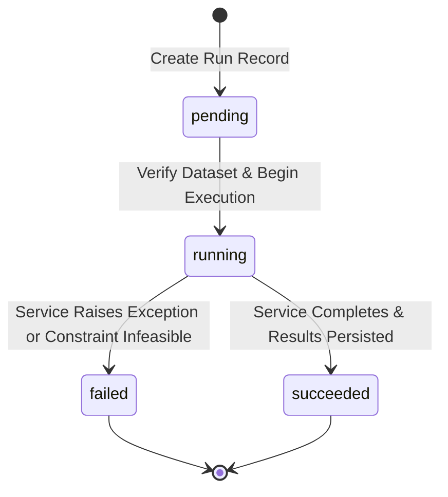

# Research Experiment Contracts & Reproducible Research Governance
**Document Version:** 1.0.0  
**Status:** Approved Research Framework Baseline  
**Date:** 2026-10-18  
**Author:** Quantitative Systems Architect, Financial Mathematics Specialist & Engineering Team  

---

## 1. Executive Conceptual Framework

A quantitative research engine requires a formal, auditable separation between **hypotheses**, **executions**, **outputs**, and **cross-strategy comparisons**.

The framework establishes four distinct domain concepts:

1. **Experiment Definition:** An immutable or versioned blueprint specifying the asset universe, portfolio construction rules, optimization parameters, rebalancing frequencies, transaction cost assumptions, benchmark reference, and stochastic seeds.
2. **Experiment Execution (Run):** A single execution instance of an Experiment Definition against an authoritative dataset version. Each run records its execution timestamp, runtime duration, execution status (`pending`, `running`, `succeeded`, `failed`, `cancelled`), and dataset SHA-256 hash at execution time.
3. **Execution Results:** A typed, immutable summary of performance and risk metrics (Cumulative Return, CAGR, Volatility, Sharpe, Sortino, Drawdown, VaR/CVaR, Active Return, Tracking Error) linked to an authoritative domain artifact (e.g., a persisted `backtest_run`, `performance_report`, or `risk_simulation_run`).
4. **Experiment Comparison:** A cross-sectional evaluation of two or more completed experiment runs, enforcing strict comparability rules regarding currency homogeneity, evaluation periods, and gross vs. net accounting.

```
+-------------------------------------------------------------+
|                  RESEARCH EXPERIMENT (ID, Owner, Version)  |
|  - Canonical Configuration (Assets, Strategy, Solver, Costs)|
|  - Configuration Fingerprint (SHA-256)                      |
|  - Dataset Reference & Provenance Hashing                   |
+-------------------------------------------------------------+
                                |
                                | (Triggers 1 to N Runs)
                                v
+-------------------------------------------------------------+
|               EXPERIMENT RUN #1, #2, ... #N                 |
|  - Run Number, Execution Status, Duration (ms)             |
|  - Dataset Content SHA-256 at Execution Time                |
|  - Provenance & Reproducibility Verification Flag           |
|  - Typed Summary KPI Snapshot                               |
|  - Reference to Domain Artifact (Backtest / Report / Sim)   |
+-------------------------------------------------------------+
                                |
                                | (Select 2+ Runs)
                                v
+-------------------------------------------------------------+
|               STRATEGY COMPARISON WORKSPACE                 |
|  - Side-by-Side Performance & Risk Metrics                  |
|  - Configuration Differential (Asset Weights, Frictions)    |
|  - Currency & Evaluation Period Alignment Validation        |
+-------------------------------------------------------------+
```

---

## 2. Canonical Configuration & SHA-256 Fingerprinting

To guarantee deterministic provenance, any research experiment configuration must be canonicalized prior to hashing:

### 2.1 Canonical Serialization Rules
1. **Key Normalization:** Dictionary keys must be sorted lexicographically at all nesting levels.
2. **Ticker & Asset Normalization:** Asset identifiers must be stripped of leading/trailing whitespace, converted to uppercase, and sorted alphabetically in list structures.
3. **Floating-Point Rounding:** Continuous numerical parameters (weights, cost bps, slippage bps, risk-free rates) are rounded to $10^{-8}$ decimal precision to prevent platform-dependent floating-point representation discrepancies.
4. **JSON Serialization:** Serialized using UTF-8 encoding with zero whitespace separators (`separators=(',', ':')`).
5. **Fingerprint Derivation:**
   $$\text{Config Fingerprint} = \text{SHA256}(\text{Canonical JSON})$$

### 2.2 Semantic vs. Non-Semantic Fields
- **Included in Fingerprint (Semantic):** `strategy_type`, `dataset_id`, `assets`, `weights`, `objective`, `constraints`, `rebalance_frequency`, `transaction_cost_bps`, `slippage_bps`, `benchmark_asset`, `risk_free_rate`, `seed`, `distribution`, `start_date`, `end_date`.
- **Excluded from Fingerprint (Non-Semantic):** `name`, `description`, `created_at`, `updated_at`, `user_id`.

A modification to any semantic field generates a new fingerprint, guaranteeing that changed parameters are never confused with earlier runs.

---

## 3. Supported Research Strategy Types

The engine supports five primary research experiment modalities, reusing existing services without duplicating numerical calculations:

| Strategy / Experiment Type | Execution Engine | Core Parameters | Output Reference |
|---|---|---|---|
| `target_weights` (Fixed Allocation) | `app/backtesting/service.py` | `assets`, `weights`, `rebalance_frequency`, `transaction_cost_bps`, `slippage_bps` | `BacktestRunModel` |
| `equal_weight` ($1/N$ Baseline) | `app/backtesting/service.py` | `assets`, `rebalance_frequency`, `transaction_cost_bps`, `slippage_bps` | `BacktestRunModel` |
| `walk_forward_optimization` | `app/backtesting/service.py` | `assets`, `objective` (`min_variance`, `max_sharpe`), `constraints`, `estimation_window`, `rebalance_frequency` | `BacktestRunModel` |
| `benchmark_attribution` | `app/performance/service.py` | `assets`, `weights`, `benchmark_asset`, `risk_free_rate`, `start_date`, `end_date` | `PerformanceReportModel` |
| `monte_carlo_risk` | `app/risk_simulation/service.py` | `assets`, `weights`, `distribution`, `num_paths`, `horizon_days`, `seed`, `rebalance_policy` | `RiskSimulationRunModel` |

---

## 4. Execution Lifecycle & State Machine



### 4.1 State Definitions
- `pending`: Run initialized and validated; awaiting service invocation.
- `running`: Dispatched to execution threadpool; calculations in progress.
- `succeeded`: Execution completed successfully; result reference and summary metrics persisted.
- `failed`: Execution failed due to numerical non-convergence, infeasible constraints, or missing data. Sanitized error stored.
- `cancelled`: Execution manually cancelled (reserved for asynchronous job scaling).

### 4.2 Non-Destructive Rerun Rule
Rerunning an experiment **NEVER** overwrites or deletes earlier run records. Each rerun increments the experiment's sequential `run_number` ($1 \to 2 \to 3 \dots$) and creates a distinct, immutable record in `research_experiment_runs`.

---

## 5. Reproducibility Guarantee & Limitations

### 5.1 Provenance Verification
At the moment of run execution, the system captures:
1. `config_fingerprint`: Canonical SHA-256 of the experiment configuration.
2. `dataset_version_hash`: Current SHA-256 byte digest of the referenced dataset.
3. `reproducibility_status`: A boolean flag `is_reproducible` set to:
   - `True` if `dataset.content_sha256 == run.dataset_version_hash` and the source dataset still exists.
   - `False` with an explicit audit note if the dataset has been deleted or modified.

### 5.2 Determinism Guarantees
- **Deterministic Workflows:** Equal weight, target weights, expanding-window walk-forward backtesting, and performance attribution will yield bitwise identical output when re-executed on the identical dataset.
- **Stochastic Workflows:** Monte Carlo risk simulations preserve the caller-specified random integer `seed`. Under an identical seed and dataset, generated paths and tail quantiles replicate deterministically.
- **Cross-Platform Caveat:** Differences in low-level BLAS/LAPACK implementations, compiler vectorization, or Python minor versions may introduce minor floating-point divergence ($\le 10^{-7}$). Absolute bitwise parity is guaranteed within the same virtual environment.

---

## 6. Multi-Run Strategy Comparison Rules

When comparing two or more experiment runs in the comparison service or Research Lab UI:

1. **Currency Invariant:** All compared runs must share an identical base currency (e.g., all `USD` or all `PKR`). Comparing a USD backtest against a PKR backtest is rejected with HTTP 422.
2. **Gross vs. Net Transparency:** If Run A includes transaction costs/slippage and Run B is frictionless, the comparison table must explicitly display cost bps ($10\text{ bps}$ vs $0\text{ bps}$) to prevent misleading comparisons.
3. **Date Range Disclosure:** Runs spanning different date ranges must display their respective dates and observation counts prominently.
4. **Unavailable Metric Policy:** If a metric (e.g. tracking error or VaR) is unsupported by a run's underlying engine, it is returned as `null` and displayed as `—` (N/A). Missing metrics are **never fabricated or synthesized**.
5. **No Universal Ranking Score:** The engine provides objective financial statistics. It does not compute a proprietary "composite grade" or claim that one strategy is definitively superior.

---

## 7. Retention, Deletion & Dependency Policy

1. **Experiment Deletion:** Deleting a `research_experiment` cascades and deletes all associated `research_experiment_runs`.
2. **Referenced Domain Artifacts:** If a referenced `BacktestRunModel` or `PerformanceReportModel` is deleted independently, foreign keys use `ON DELETE SET NULL`, and the experiment run remains intact with its stored snapshot summary metrics while flagging that the detailed source time-series has been pruned.
3. **Dataset Deletion:** If a source dataset is deleted, foreign keys cascade or retain audit stubs, marking the experiment as non-reproducible.
