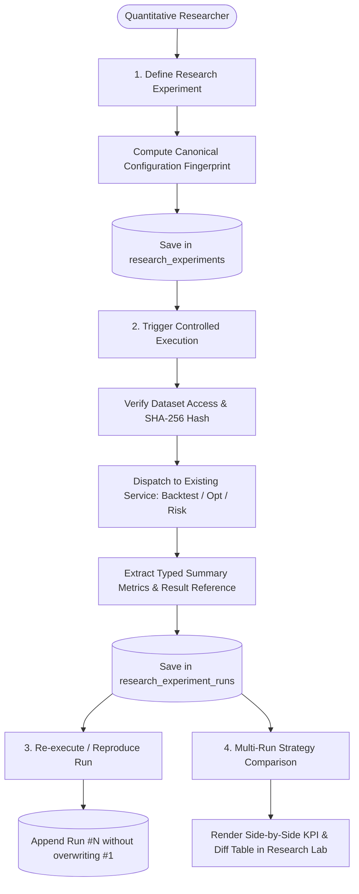

# SESSION 16 AUDIT — Portfolio Research Experiments, Strategy Comparison & Reproducible Runs

**Audit Date:** 2026-10-18  
**Auditor:** Quantitative Systems Architect & Research Engineering Specialist  
**Target Module:** Session 16 — Portfolio Research Experiments & Strategy Comparison Workspace  
**Baseline Stage:** Stage 11 Complete (Session 15 Baseline: 235 backend tests passing, 16 frontend tests passing, Vite production build verified)  
**Database Migration Head:** `a1b2c3d4e5f6` (`performance_reports` table)

---

## 1. Existing Reusable Research Capabilities

The repository has matured into a comprehensive institutional quantitative engine across Sessions 1 to 15:

1. **Market Data & Provenance (`backend/app/market_data/`):**
   - Authoritative historical OHLCV price series for US and PSX assets.
   - SHA-256 byte-level content hashing (`content_sha256`) guaranteeing dataset immutability and provenance tracking.
   - Verified date ranges, observation counts, currency verification, and single-currency homogeneity invariant.
   - Tenant-isolated persistence in `datasets`, `dataset_assets`, and `price_bars`.

2. **Portfolio Universe & Mathematical Constraints (`backend/app/portfolio/` & `backend/app/quant/constraints.py`):**
   - Formal constraints: default min/max weights, asset-specific weight bounds, long-only vs. long-short permissions, target gross exposure, and net exposure bounds.
   - Feasibility checks (`check_constraint_feasibility`) and weight validation (`validate_weights_against_constraints`).

3. **Numerical Optimization & Efficient Frontier (`backend/app/portfolio/optimization_service.py` & `backend/app/quant/solvers/`):**
   - SLSQP quadratic programming solvers for:
     - Minimum Variance Portfolio (GMV).
     - Maximum Sharpe Ratio Portfolio (Tangency).
     - Target Return Optimization.
     - Equal-Weight Benchmark ($1/N$).
   - Markowitz Efficient Frontier continuous curve generation with solver convergence status.

4. **Walk-Forward Backtesting Engine (`backend/app/backtesting/`):**
   - True multiplicative discrete compounding ($V_t = V_{t-1}(1 + r_t)$).
   - Natural asset weight drift ($w_{i,t} = w_{i,t-1}(1+r_{i,t})/(1+r_{p,t})$).
   - Scheduled rebalancing (`buy_and_hold`, `daily`, `weekly`, `monthly`, `quarterly`).
   - Basis-point transaction costs and execution slippage on traded notional.
   - Expanding-window walk-forward re-optimization with strict zero look-ahead bias.
   - Relational persistence in `backtest_runs`.

5. **Scenario Analysis & Stress Testing (`backend/app/scenarios/`):**
   - Instantaneous asymmetric asset price shocks with exact additive attribution reconciliation ($\sum \Delta V_i = \Delta V$).
   - Historical window stress replay from empirical price bars without synthetic extrapolation.
   - Covariance stress with spectral positive semidefiniteness (PSD) projection ($M_{\text{psd}} = Q \max(\Lambda, 0) Q^T$).
   - 1D/2D parametric sensitivity grid sweeps ($\le 441$ points).
   - Relational persistence in `scenario_runs`.

6. **Monte Carlo Probabilistic Risk Analysis (`backend/app/risk_simulation/` & `backend/app/quant/var_cvar.py`):**
   - Deterministic stochastic asset returns via caller-specified seeds (`numpy.random.default_rng(seed)`).
   - Multivariate Normal and Student-t ($\nu \ge 3$) return models.
   - Value-at-Risk (VaR) and Conditional Value-at-Risk (CVaR / Expected Shortfall) with standardized loss-sign convention ($L = V_0 - V_T$).
   - Multi-estimator comparison (Monte Carlo, Parametric Normal, Empirical Historical).
   - Relational persistence in `risk_simulation_runs`.

7. **Performance Attribution & Benchmark Comparison (`backend/app/quant/performance.py` & `backend/app/performance/`):**
   - Calendar-synchronized active return series ($a_t = r_{p,t} - r_{b,t}$).
   - Annualized tracking error ($TE = \operatorname{Std}(a_t)\sqrt{m}$) and Information Ratio ($IR = \frac{\bar{a}m}{TE}$).
   - Portfolio Beta ($\beta = \frac{\operatorname{Cov}(r_p, r_b)}{\operatorname{Var}(r_b)}$), Jensen's Alpha ($\alpha$), Treynor Ratio, and Up/Down capture ratios.
   - Menchero (2000) multi-period logarithmic linking weights ensuring exact additive reconciliation ($\sum C_i = R_{0:T}$).
   - Relational persistence in `performance_reports`.

---

## 2. Reproducibility Assessment of Persisted Data

| Domain Artifact | Stored Configuration Fields | Reproducibility Grade | Limitations / Gaps |
|---|---|---|---|
| **Backtest Runs** | `strategy_type`, `rebalance_frequency`, `initial_capital`, `transaction_cost_bps`, `slippage_bps`, `start_date`, `end_date`, `strategy_config_json` (assets, weights, solver settings) | **Full** | Fully reproducible if source `dataset_id` content SHA-256 remains unchanged. |
| **Scenario Runs** | `scenario_type`, `initial_capital`, `request_config_json` (assets, weights, shocks, dates, multipliers) | **Full** | Fully reproducible; deterministic linear valuation and spectral projection. |
| **Monte Carlo Runs** | `distribution`, `rebalance_policy`, `horizon_days`, `num_paths`, `request_config_json` (seed, assets, weights, initial capital) | **Full** | Fully reproducible under identical seed and library versions ($S_1 = S_2 \implies \mathbf{R}_1 = \mathbf{R}_2$). |
| **Performance Reports** | `benchmark_asset`, `risk_free_rate`, `start_date`, `end_date`, request configuration | **Full** | Fully reproducible against source dataset price series. |
| **Optimization Solvers** | Transformed directly via `POST /api/v1/optimization/solve`, but not independently persisted as runs in prior sessions | **Partial** | Persisting an experiment configuration enables re-executing optimization and storing the resulting optimal weights and metrics. |

---

## 3. Comparison Feasibility & Common Metrics

All completed analytical runs across backtesting, performance attribution, and optimization generate a common core of annualized return and risk statistics:
1. **Cumulative Return ($R_{0:T}$):** Expressed as discrete percentage change over period.
2. **Compound Annual Growth Rate (CAGR / Annualized Return):** Geometric annualization $R_{\text{ann}} = (1 + R_{0:T})^{m/T} - 1$.
3. **Annualized Volatility ($\sigma_{\text{ann}}$):** Standard deviation of periodic returns scaled by $\sqrt{m}$.
4. **Maximum Drawdown ($\text{MaxDD}$):** Worst peak-to-trough drop.
5. **Sharpe Ratio ($SR$):** Risk-adjusted excess return over volatility.
6. **Sortino Ratio ($SoR$):** Downside deviation risk-adjusted return.
7. **Active Metrics (when benchmark evaluated):** Active return, tracking error, Information Ratio, Beta, Jensen's Alpha.
8. **Friction Drag & Turnover (when backtested):** Total transaction costs, slippage, and rebalances.
9. **Tail Risk (when simulated):** 95% and 99% VaR and CVaR.

### Comparison Rules & Guardrails
- **Currency Invariant:** Cannot compare USD experiments with PKR experiments without explicit FX conversion.
- **Evaluation Window Alignment:** Experiments with different date ranges must display their respective start/end dates and observation counts prominently; common-window metrics must be calculated when time-series overlap allows.
- **Gross vs. Net Separation:** Cannot compare net returns (after transaction costs and slippage) against gross theoretical returns without clearly labeling the cost disparity.

---

## 4. Missing Configuration & Provenance Fields

Prior to Session 16, the system lacked:
1. **Experiment Definition Model:** No entity linked a set of related strategy runs together under a persistent hypothesis or research project.
2. **Canonical Configuration Fingerprint:** No standardized, whitespace-agnostic SHA-256 hashing across strategy configuration dictionaries.
3. **Run Versioning & Lineage:** Rerunning a configuration created disparate isolated records without tracking run numbers ($1, 2, 3\dots$) or execution duration.
4. **Source Data Drift Detection:** No validation step checked whether the underlying dataset was still identical to the content hash recorded when the experiment was defined.

---

## 5. Security & Resource-Isolation Considerations

1. **Strict Tenant Isolation:** Experiments and runs must be foreign-keyed to `users.id` with `ondelete="CASCADE"`. Cross-tenant reading, modification, execution, or deletion must return HTTP 404/403.
2. **Referenced Resource Authorization:** A researcher cannot attach or run an experiment on a private dataset owned by another user.
3. **No Mass Assignment:** `user_id` and execution timestamps must be set server-side from the authenticated JWT session.
4. **Safe Error Handling:** Failed execution runs must store sanitized error summaries; internal Python tracebacks and SQL statements must never be exposed.
5. **Resource Limits:** Experiment execution must enforce bounds on asset counts ($\le 50$), backtest dates, and Monte Carlo paths ($\le 10,000$).

---

## 6. Proposed Research Workflow

---

## 7. Acceptance Criteria & Expected Files

- [x] `docs/SESSION_16_AUDIT.md` (this audit document).
- [x] `docs/RESEARCH_EXPERIMENT_CONTRACTS.md` (formal configuration, execution, and reproducibility contracts).
- [x] Database migration `b2c3d4e5f6a7_create_research_experiments_tables.py` adding `research_experiments` and `research_experiment_runs`.
- [x] Domain models in `backend/app/db/models.py` (`ResearchExperimentModel`, `ResearchExperimentRunModel`).
- [x] Pydantic schemas in `backend/app/research/models.py`.
- [x] Core fingerprinting and reproducibility logic in `backend/app/research/fingerprint.py`.
- [x] Controlled execution orchestrator in `backend/app/research/service.py`.
- [x] FastAPI REST router in `backend/app/api/v1/research_routes.py` and mounted in `routes.py`.
- [x] Comprehensive test suites:
  - `backend/tests/test_research_engine.py` (fingerprint stability, canonical serialization, configuration validation).
  - `backend/tests/test_research_api.py` (CRUD, execution, tenant isolation, comparison, reproducibility).
- [x] Frontend types, API client methods, and React 19 workspace component `frontend/src/components/pages/ResearchLabPage.tsx`.
- [x] Navigation wiring (`Sidebar.tsx`, `Header.tsx`, `OverviewPage.tsx`, `App.tsx`).
- [x] Frontend test suite verification (`npm test -- --run`) and production build (`npm run build`).
- [x] Documentation updates (`MASTER_PLAN.md`, `SYSTEM_ARCHITECTURE.md`, `REQUIREMENTS_SPEC.md`, `TEST_STRATEGY.md`, `SESSION_16_REPORT.md`).
