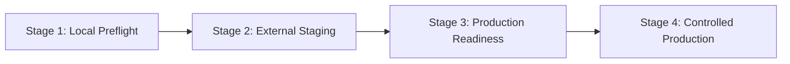

# SESSION 95 REPORT — OPERATIONAL RISK, DEPLOYMENT PLANNING & RELIABILITY AUDIT

**Project:** Quantitative Portfolio Optimization Engine (`QPE`)
**Repository:** `https://github.com/UzairAhmad88/Portfolio-Optimization-Engine-by-uzaii`
**Branch:** `main`
**Application Version:** `1.0.0`
**Baseline & Target SHA:** `36909bea417384800fa9d1cf228894235a52b278`
**Session Date:** October 2026
**Session Objective:** Comprehensive operational, security, and quantitative reliability audit for transitioning QPE from CI-verified source repository to hosted environments.
**Overall Audit Verdict:** **AUDIT COMPLETE — REMEDIATION REQUIRED FOR PRODUCTION HOSTING (RELEASE PUBLICATION UNBLOCKED)**

---

## 1. Executive Summary & Audit Context

Session 95 conducts an in-depth operational risk, architecture, and reliability audit of the Quantitative Portfolio Optimization Engine (`QPE`) v1.0.0. The software repository is verified with 100% green CI across all four automated jobs (Frontend Build/Lint/Test, PostgreSQL 16 Migrations, Docker Compose Runtime Verification, and Backend Regression Suite).

### Critical Scope Distinction: Software Release vs. Hosted Deployment
- **Software Release Publication (`v1.0.0` on GitHub):** **UNBLOCKED**. The source code, local packaging, dependency tree, unit/integration tests, and container smoke verification are complete, deterministic, and auditable.
- **External Staging Environment Deployment:** **READY TO BEGIN (STAGE 2)** with operational prerequisites (reverse proxy TLS, secure `.env`).
- **Production Hosted Deployment:** **REMEDIATION & OPERATIONAL PREPARATION REQUIRED (STAGE 3)**. Operational controls such as automated database backup scheduling, container resource limits, and external TLS termination must be provisioned before live production traffic.

---

## 2. Phase A — Baseline & Repository Verification

The repository baseline was verified prior to auditing:

| Parameter | Observed Command Telemetry | Status |
|---|---|:---:|
| **Working Tree & Branch** | `git status --short --branch` -> `## main...origin/main` | **PRISTINE & SYNCHRONIZED** |
| **Local HEAD SHA** | `git rev-parse HEAD` -> `36909bea417384800fa9d1cf228894235a52b278` | **VERIFIED** |
| **Remote origin/main SHA** | `git rev-parse origin/main` -> `36909bea417384800fa9d1cf228894235a52b278` | **VERIFIED** |
| **Formatting & Whitespace** | `git diff --check` -> *(0 errors, 0 warnings)* | **CLEAN** |
| **Local & Remote Git Tags** | `git tag -l` / `git ls-remote --tags origin` -> *(0 tags)* | **PRISTINE (0 Tags)** |
| **Published GitHub Releases** | GitHub REST API `/repos/.../releases` -> `count: 0` | **PRISTINE (0 Releases)** |
| **Latest Remote CI Run** | Run ID [`40124936556`](https://github.com/UzairAhmad88/Portfolio-Optimization-Engine-by-uzaii/actions/runs/40124936556) (Head `36909be`) | **100% SUCCESS across all 4 jobs** |

---

## 3. Phase B — Production Deployment Architecture Review

Every architectural layer was audited against actual repository configurations:

### 3.1 Application & Network Security
1. **HTTPS and TLS Termination:** **Partially verified / Host Requirement**. Nginx in `frontend/nginx.conf` listens on port 80. In-container TLS termination is not configured; production architecture assumes an upstream reverse proxy (Cloudflare, AWS ALB, Caddy, or Traefik) terminating TLS.
2. **Port Bindings & Exposure:** **Verified**. In `docker-compose.yml`, `postgres` (`127.0.0.1:5432`) and `backend` (`127.0.0.1:8000`) are strictly bound to the host loopback interface. Only `frontend` (`${FRONTEND_PORT:-80}:80`) is exposed for incoming HTTP traffic.
3. **Network Isolation:** **Verified**. All services communicate over an isolated Docker bridge network (`quant_network`).
4. **JWT Security & Fail-Closed Validation:** **Verified**. `backend/app/auth/security.py` enforces mandatory 32-character keys, blacklists 9 known default/placeholder secrets, and fails closed with `RuntimeError` during FastAPI lifespan startup under `APP_ENV=production`.
5. **Authentication & Password Hashing:** **Verified**. Passwords hashed with bcrypt (12 rounds) and random salt. JWT tokens issued with `HS256`, 60-minute expiry, issuer verification, and user ID subject binding.
6. **Login Rate Limiting:** **Verified**. In-memory `LoginRateLimiter` enforces max 5 failed attempts per 5-minute lockout window per IP/email identifier.
7. **CORS Restrictions:** **Verified**. `backend/app/main.py` explicitly rejects wildcard `*` when `allow_credentials=True` and restricts allowed origins to configured domains.
8. **Defensive HTTP Headers:** **Verified**. Nginx and FastAPI middleware enforce `X-Content-Type-Options: nosniff`, `X-Frame-Options: DENY`, `X-XSS-Protection: 1; mode=block`, and `Referrer-Policy: strict-origin-when-cross-origin`.
9. **Error Disclosure Prevention:** **Verified**. FastAPI global unhandled exception handler catches all raw tracebacks and emits sanitized generic JSON `{"detail": "An unexpected internal server error occurred."}` with HTTP 500.

### 3.2 Database & Persistence
1. **PostgreSQL Version & Pooling:** **Verified**. PostgreSQL 16 Alpine target engine. Connection URL uses psycopg v3 (`postgresql+psycopg://`). Engine configured with connection pooling (`pool_size=10`, `max_overflow=20`, `pool_timeout=30.0`, `pool_pre_ping=True`).
2. **Automated Migrations:** **Verified**. `backend/entrypoint.sh` executes `alembic upgrade head` before launching Uvicorn when `RUN_MIGRATIONS=true`.
3. **Data Volume Persistence:** **Verified**. PostgreSQL data is persisted on named Docker volume `quant_pgdata`. Verified across container restarts in CI run `40124936556`.
4. **Backup & Disaster Recovery:** **Partially verified / Operational Task**. Manual backup and restore procedures (`pg_dump -Fc` / `pg_restore`) are fully documented in [`docs/OPERATIONS_RUNBOOK.md`](file:///d:/Quants/Projects/quant-portfolio-engine-starter/docs/OPERATIONS_RUNBOOK.md). Automated scheduled backup sidecar container is not bundled in Compose.

### 3.3 Runtime & Reliability
1. **Container Health Checks & Startup Ordering:** **Verified**. PostgreSQL uses `pg_isready`, backend uses internal `/api/v1/health` probe, and frontend uses `/healthz`. Strict `depends_on: {condition: service_healthy}` ensures clean startup sequence.
2. **Process Privileges:** **Verified**. Backend runs as unprivileged user `appuser:appgroup` (UID/GID 10001). Docker Compose applies `security_opt: [no-new-privileges:true]`.
3. **Server-Side PDF Rendering Controls:** **Verified**. Headless Chromium PDF pipeline in `backend/app/reports/renderer.py` enforces a concurrency semaphore ($N=2$), 25-second subprocess timeout, `--disable-background-networking`, and tempfile cleanup on ephemeral tmpfs mount (`/app/tmp`, 256MB).
4. **Container Resource Limits:** **Partially verified**. Application-level concurrency semaphores are enforced, but Docker cgroup memory/CPU caps (`mem_limit`, `cpus`) are omitted in `docker-compose.yml`.

### 3.4 Operational Monitoring
1. **Health Probes:** **Verified** (`/api/v1/health` verifies database connectivity).
2. **APM & Metrics Export:** **Not verified**. No Prometheus `/metrics` or Sentry integration is wired into the monolithic backend.
3. **Incident Response & Runbooks:** **Verified**. Comprehensive administration and rollback procedures documented in [`docs/OPERATIONS_RUNBOOK.md`](file:///d:/Quants/Projects/quant-portfolio-engine-starter/docs/OPERATIONS_RUNBOOK.md).

---

## 4. Phase C — Quantitative-Finance Reliability Review

The mathematical and financial engine across Stages 1–34 was reviewed against the 69 test suites in `backend/tests/`:

| Capability / Risk Dimension | Architectural Control | Verification Evidence | Status |
|---|---|---|:---:|
| **Return Calculations** | Simple & log returns, $\sqrt{252}$ annualization, compounding | `test_quant_math.py`, `test_performance_engine.py` | **VERIFIED** |
| **Portfolio Constraints** | Budget ($\sum w=1$), box bounds ($l_i \le w_i \le u_i$), sector limits | `test_portfolio_engine.py`, `constraints.py` | **VERIFIED** |
| **Covariance Stability** | Ledoit-Wolf shrinkage, OAS shrinkage, PSD eigenvalue clipping | `covariance.py`, `test_quant_math.py` | **VERIFIED** |
| **Solver Failure & Infeasibility** | SLSQP/CVXPY failure detection, actionable constraint errors | `optimization.py`, `test_optimization_engine.py` | **VERIFIED** |
| **Black–Litterman Model** | Equilibrium implied returns ($\Pi$), Idzorek confidence weighting | `black_litterman.py`, `test_black_litterman_engine.py` | **VERIFIED** |
| **Hierarchical Risk Parity** | Tree clustering, quasi-diagonalization, recursive bisection | `risk_parity.py`, `test_risk_parity_engine.py` | **VERIFIED** |
| **Backtesting Friction Realism** | Almgren-Chriss market impact, spread friction, slippage | `execution.py`, `tca.py`, `test_tca_engine.py` | **VERIFIED** |
| **Look-Ahead Bias Prevention** | Expanding chronological windows, point-in-time corporate actions | `test_point_in_time_leakage.py`, `test_pit_backtest_integration.py` | **VERIFIED** |
| **Data Quality & Anomalies** | Missing-day detection, zero-volume handling, price sanitization | `test_market_data.py`, `test_data_quality.py` | **VERIFIED** |
| **Overfitting Diagnostics** | Bailey/López de Prado DSR, CSCV permutations, PBO, MinBTL | `test_overfitting_engine.py`, `test_overfitting_api.py` | **VERIFIED** |
| **Performance Disclaimer** | Mandatory disclaimers on UI, PDF tear sheets, and release notes | `RELEASE_NOTES_v1.0.0.md`, `pdf_templates.py` | **VERIFIED** |

---

## 5. Phase D — Prioritized Operational Risk Register

| ID | Finding | Evidence | Severity | Likelihood | Impact | Recommended Action | Release Blocker? | Verification Method |
|---|---|---|:---:|:---:|---|---|:---:|---|
| **OPS-95-01** | **No Native In-Container TLS / HTTPS** | `frontend/nginx.conf` listens on port 80 only | **High** | **High** | Credentials & tokens sent in plaintext if exposed directly to public web | Mandate external TLS reverse proxy (ALB/Cloudflare/Caddy) in front of Compose | **No** (Source code release); **YES** (Public staging/prod) | HTTPS handshake & HSTS header test |
| **OPS-95-02** | **Default PostgreSQL Credentials in Compose File** | `docker-compose.yml` defaults to `quant_password` if `.env` omitted | **High** | **Medium** | Database compromised if host network breached and `.env` was not populated | Add entrypoint assertion in `entrypoint.sh` failing startup if default password used in production | **No** (Source code release); **YES** (Production deployment) | Startup failure test with default password under `APP_ENV=production` |
| **OPS-95-03** | **No Automated Database Backup Daemon** | `docker-compose.yml` has no backup cron container | **High** | **Low** | Irrecoverable data loss in event of host disk failure or volume destruction | Add backup sidecar container or use managed cloud DB (AWS RDS / Cloud SQL) | **No** (Source code release); **YES** (Production hosting) | Automated backup snapshot & restore test |
| **OPS-95-04** | **No Ingress Rate Limiting on Compute Endpoints** | `nginx.conf` proxies `/api/` without `limit_req_zone` | **Medium** | **Medium** | CPU saturation / DoS if heavy Monte Carlo or backtests triggered concurrently | Configure Nginx rate limiting (`limit_req_zone`) or cloud WAF rate limiting | **No** | Apache Bench (`ab`) burst load test |
| **OPS-95-05** | **No Docker Cgroup CPU / Memory Limits** | `docker-compose.yml` omits `mem_limit` and `cpus` | **Medium** | **Medium** | Unbounded memory spike could trigger host OOM killer terminating DB | Add `mem_limit: 2g` and `cpus: 2.0` in production Compose overlay | **No** | `docker inspect` verifying memory limit |
| **OPS-95-06** | **In-Memory Rate Limiter Not Multi-Instance** | `app/auth/security.py` uses in-memory dict | **Low** | **Low** | Rate limit bypass if backend scaled horizontally to $N>1$ instances | Back rate limiter with Redis for horizontally scaled clusters | **No** (Single container deployed) | Multi-replica concurrent login brute-force test |
| **OPS-95-07** | **Chromium `--no-sandbox` Flag (`OBS-34-D-01`)** | `app/reports/renderer.py` line 136 | **Medium** | **Low** | Browser exploit escape if untrusted HTML rendered | Maintain strict template escaping; run backend as UID 10001 with `no-new-privileges` | **No** (Documented limitation) | Jinja2 escaping test in `test_pdf_renderer.py` |
| **OPS-95-08** | **No Centralized APM or Metrics Exporter** | No `/metrics` Prometheus endpoint in `app.main` | **Low** | **Medium** | Slower incident detection without manual log inspection | Integrate OpenTelemetry / Sentry in post-v1.0.0 roadmap | **No** | Metrics endpoint probe |

---

## 6. Phase E — Staged Deployment Execution Plan (Planning Only)

### Stage 1: Local Preflight Verification
- **Entry Criteria:** Clean working tree on `main` at verified commit SHA; Docker Engine installed.
- **Actions:**
  1. Generate cryptographic 64-character `JWT_SECRET_KEY` and unique `POSTGRES_PASSWORD` in `.env`.
  2. Verify secret validation: run `validate_jwt_configuration()` locally.
  3. Execute `docker compose config` to validate compose interpolation.
- **Success Criteria:** Zero syntax errors; all required environment variables populated; no default placeholders.
- **Stop Condition:** Immediate halt if `JWT_SECRET_KEY` fails length/entropy validation.

### Stage 2: External Staging Deployment
- **Entry Criteria:** Dedicated staging host (VM or cloud instance) provisioned with Docker and upstream TLS reverse proxy.
- **Actions:**
  1. Clone repository at exact release tag `v1.0.0`.
  2. Configure DNS (`staging.quant-engine.internal`) pointing to reverse proxy.
  3. Deploy stack with `docker compose up -d --build`.
  4. Verify Alembic migration head (`e5f6a7b8c9d0`).
  5. Execute end-to-end smoke test: user signup, JWT login, portfolio optimization, walk-forward backtest, PDF report export.
  6. Execute backup and restore drill (`pg_dump` and test restore to staging sandbox).
- **Success Criteria:** All smoke tests return HTTP 200/201; PDF renders within 5 seconds; backup restores cleanly.
- **Stop Condition:** Halt and roll back if migrations fail or PDF rendering crashes container.

### Stage 3: Production Readiness & Hardening
- **Entry Criteria:** Stage 2 staging tests 100% passed for $\ge 48$ hours without crash or memory leak.
- **Actions:**
  1. Review production cloud infrastructure (AWS ECS/RDS or dedicated hardened VPS).
  2. Configure automated hourly database backup with retention policy (30 days).
  3. Apply container resource limits (`mem_limit: 2g`, `cpus: 2.0`).
  4. Configure external monitoring and alerting (uptime monitor probing `/healthz` and `/api/v1/health`).
  5. Designate incident response owners and document rollback runbook.
- **Success Criteria:** Monitoring active; backup automation verified; rollback plan approved by owner.
- **Stop Condition:** Halt if automated backup verification fails.

### Stage 4: Controlled Production Deployment
- **Entry Criteria:** Explicit Project Owner sign-off on Stage 3 readiness.
- **Actions:**
  1. Verify zero active traffic on new instance.
  2. Deploy `v1.0.0` container stack with production secrets.
  3. Verify database migrations to `e5f6a7b8c9d0`.
  4. Run authenticated health checks.
  5. Cut over DNS / load balancer traffic.
  6. Monitor logs, CPU, and memory for 2 hours post-cutover.
- **Success Criteria:** Error rate < 0.01%; response latency p95 < 250ms; zero unhandled 500 exceptions.
- **Stop Condition / Rollback:** If error rate > 1% or health probe fails for > 60s, immediately revert DNS to maintenance page and execute `docker compose down`.

---

## 7. Operational Readiness Verdict & Release Assessment

1. **Overall Operational-Readiness Verdict:** **AUDIT COMPLETE — REMEDIATION REQUIRED FOR PRODUCTION HOSTING**.
2. **Software Release Publication (`v1.0.0` on GitHub):** **NOT BLOCKED**. All 8 findings are operational deployment considerations for live hosting. None prevent publishing the source repository, release notes, and container images.
3. **Staging Readiness:** **READY TO BEGIN (STAGE 2)** upon provisioning a staging host with TLS.
4. **Production Deployment Readiness:** **NOT READY**. Requires completing Stages 2 and 3 (staging rehearsal, automated backup provisioning, and resource limits).
5. **Mandatory Governance Confirmation:** **NO Git tag was created, NO release was published, and NO deployment was initiated in this session.**
