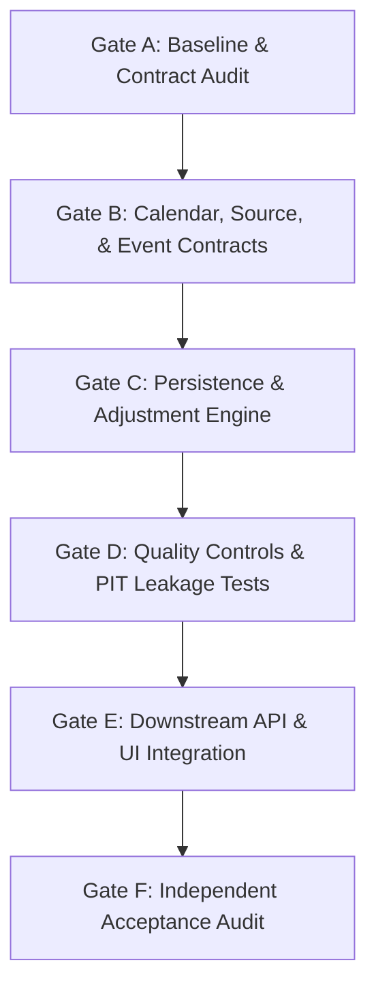

# STAGE 31 GATE A — BASELINE REPOSITORY & CONTRACT AUDIT
## Point-in-Time Market Data Integrity & Corporate Actions (US Equities + PSX)

**Stage:** Stage 31 — Point-in-Time Market Data Integrity & Corporate Actions  
**Gate:** Gate A — Baseline and Contract Audit  
**Status:** Audit Complete — Ready for Owner Review  
**Date:** October 21, 2026  
**Auditor:** Quantitative Finance Software Architecture & Engineering  

---

## 1. Executive Summary & Audit Baseline

In accordance with the Master Prompt for Stage 31, an exhaustive baseline inspection of the repository was conducted before any file or database modifications. This report establishes the actual implementation state across market data schemas, provider integrations, return semantics, calendar handling, point-in-time protections, and downstream consumers.

### Current Repository State:
- **Repository URL:** `https://github.com/UzairAhmad88/Portfolio-Optimization-Engine-by-uzaii.git`
- **Active Branch:** `main` (synchronized with `origin/main`).
- **Head Commit:** `4782849467daabfa32697353265cc87c666d409e` (`feat: complete quantitative portfolio optimization engine through Stage 30 with Session 49 independent audit`).
- **Working Tree:** Pristine; all Stage 30 deliverables committed; untracked deployment config `vercel.json` isolated.
- **Test Baseline:** 469 backend tests passing (exit code 0, 213.12s); 43 frontend tests passing (exit code 0, 11.40s); clean Vite production build (1.47s).

---

## 2. Existing Market-Data Schemas and Persisted Entities

Inspection of [`backend/app/db/models.py`](file:///d:/Quants/Projects/quant-portfolio-engine-starter/backend/app/db/models.py) and [`backend/app/market_data/repository.py`](file:///d:/Quants/Projects/quant-portfolio-engine-starter/backend/app/market_data/repository.py) reveals the existing persistence schema:

| Entity / Table | Primary Key | Key Attributes | Identified Limitations for Stage 31 |
| :--- | :--- | :--- | :--- |
| **`DatasetModel`** (`datasets`) | `id` (UUIDv4) | `user_id`, `filename`, `content_sha256`, `rows_examined`, `valid_rows`, `rejected_rows`, `errors_json`, `warnings_json`, `status` | Contains no corporate action metadata, no calendar version reference, and no point-in-time ingestion/availability timestamps. |
| **`AssetModel`** (`dataset_assets`) | `id` (Integer autoincrement) | `dataset_id`, `asset_id` (`TICKER:MARKET`), `ticker`, `market`, `currency`, `start_date`, `end_date`, `observation_count` | `asset_id` is a composite string (`TICKER:MARKET`). Symbol changes (e.g. `FB` $\to$ `META`) will break continuity or create phantom disjoint assets. |
| **`PriceBarModel`** (`price_bars`) | `id` (BigInteger / Integer) | `dataset_id`, `asset_id`, `ticker`, `market`, `currency`, `date`, `open`, `high`, `low`, `close`, `adj_close`, `volume` | Stores unadjusted `close` and provider-supplied `adj_close`. Stores **zero** corporate action event links, adjustment factors, announcement dates, or revision IDs. |

### Missing Schemas:
- **Corporate Action Event Table:** Completely absent. No tables exist for stock splits, reverse splits, cash dividends, or symbol lineage.
- **Calendar & Session Registry:** Completely absent. No database tables or domain classes exist for exchange calendars, session statuses, or holiday schedules.
- **Point-in-Time Metadata:** Completely absent. No entity records publication timestamps, announcement dates, source revision history, or cutoff boundaries.

---

## 3. Current Provider / Source Integrations and Capabilities

Inspection of [`backend/app/market_data/service.py`](file:///d:/Quants/Projects/quant-portfolio-engine-starter/backend/app/market_data/service.py):
1. **Source Type:** Strictly hardcoded to `"csv_upload"`.
2. **Provider Adapters:** Zero external live or historical provider adapters exist (no integrations with Polygon, Tiingo, Yahoo Finance, SEC EDGAR, PSX Data Portal, Bloomberg, Refinitiv, or EODHD).
3. **Capabilities:**
   - Ingestion is purely batch-driven via user CSV file upload.
   - Provider timestamps: None. The system only sees the date string in the CSV.
   - Provider corporate action feeds: None.
   - Revision tracking: None. If a provider corrects a historical bar, uploading a new CSV creates a new isolated dataset rather than recording an in-place revision audit trail.

---

## 4. Existing Price Adjustment and Return Semantics

Inspection of [`backend/app/market_data/repository.py`](file:///d:/Quants/Projects/quant-portfolio-engine-starter/backend/app/market_data/repository.py) and [`backend/app/quant/returns.py`](file:///d:/Quants/Projects/quant-portfolio-engine-starter/backend/app/quant/returns.py):
1. **Price Matrix Extraction:**
   In `repository.py` lines 261–263:
   ```python
   "price": b.adj_close if b.adj_close is not None else b.close
```
2. **Return Calculation:**
   In `returns.py` line 73:
   ```python
   def simple_returns(prices: pd.Series | pd.DataFrame) -> pd.Series | pd.DataFrame:
     _validate_price_data(prices)
     return prices.pct_change(fill_method=None)
```
3. **Severe Financial Risks Identified:**
   - **Silent Provider Black Box:** When `adj_close` is present in the CSV, the engine treats it as ground truth. The system cannot determine whether the provider used CRSP methodology, split-only adjustment, gross dividend reinvestment, or net dividend reinvestment.
   - **Discontinuity Shock:** When `adj_close` is missing, the engine falls back to raw `close`. If a 2-for-1 stock split occurs, raw close drops by 50%, producing a catastrophic artificial $-50\%$ return spike in backtesting.
   - **No Dividend Cash Flow Tracking:** Cash dividends are not modeled as portfolio cash flow injections; they are either implicitly assumed to be fully reinvested backward (via provider `adj_close`) or completely omitted (via raw `close`).
   - **No System-Derived Adjustment Engine:** The repository currently has zero logic to compute adjustment factors ($f_{\text{split}}, f_{\text{div}}$) or derive reproducible total-return price series from canonical corporate action ledgers.

---

## 5. Current Calendar and Session Handling

Inspection of [`backend/app/quant/vine_backtest.py`](file:///d:/Quants/Projects/quant-portfolio-engine-starter/backend/app/quant/vine_backtest.py), [`backend/app/backtesting/engine.py`](file:///d:/Quants/Projects/quant-portfolio-engine-starter/backend/app/backtesting/engine.py), and [`docs/FINANCIAL_DATA_CONTRACTS.md`](file:///d:/Quants/Projects/quant-portfolio-engine-starter/docs/FINANCIAL_DATA_CONTRACTS.md):
1. **Calendar Modeling:**
   - There is **no exchange calendar abstraction** in the Python codebase.
   - Rebalance schedules rely entirely on ISO calendar boundary transitions on observed CSV rows:
     `curr_dt.isocalendar().week != prev_dt.isocalendar().week`
2. **Market Holidays & Missing Sessions:**
   - Missing trading days in CSVs are not checked against exchange schedules.
   - If an asset is missing for 10 trading days due to an exchange suspension or data corruption, the system does not detect it during ingestion.
   - In `get_dataset_price_matrix_dataframe`, non-overlapping dates are silently dropped via `clean_df = pivot_df.dropna()`. This can drop legitimate trading sessions if one asset in a 10-asset portfolio had missing data.
3. **Cross-Market US vs PSX:**
   - US trading days (~252/year) and PSX trading days (~250/year) have non-overlapping national and religious holidays.
   - The system lacks a calendar engine to distinguish a genuine market closure (e.g., PSX closed for Eid-ul-Fitr while US is open) from a corrupt missing observation.

---

## 6. Existing Point-in-Time Safeguards and Limitations

1. **Window Slicing vs Temporal Information Sets:**
   - Walk-forward backtests in Stage 24–30 slice historical data strictly up to day $t-1$ (`pt_slice = R_matrix[t - estimation_window : t, :]`).
   - This prevents intraday lookahead on day $t$ asset returns.
2. **The Lookahead Leakage Flaw:**
   - If the input CSV contains `adjusted_close`, those prices were backward-adjusted by the data provider using corporate action events that occurred in the future (e.g. a split in 2025 backward-adjusts all prices from 2020 to 2024).
   - A model optimizing a portfolio in 2022 receives prices adjusted for a 2025 split that was unknown in 2022.
   - The engine has **no point-in-time information cutoff** (`as_of_date` / `as_of_timestamp`), no announcement date tracking, and no point-in-time verification certification.

---

## 7. Downstream Consumers and Sensitive Call Sites

Every analytical module in the Quant Portfolio Engine depends on market data queries:

| Consumer Module | File Location | Data Access Method | Sensitivity to Price/Return Semantics |
| :--- | :--- | :--- | :--- |
| **Portfolio Validation** | `backend/app/portfolio/service.py` | `get_dataset_rows()` | Verifies ticker existence, date spans, and currency homogeneity. |
| **Mean-Variance Optimization** | `backend/app/portfolio/optimization_service.py` | `get_dataset_price_matrix_dataframe()` | Computes sample covariance matrix and expected returns from price matrix. |
| **Classic Backtesting** | `backend/app/backtesting/engine.py` | `get_dataset_rows()` | Simulates rebalancing, equity curves, Sharpe ratio, and drawdowns. |
| **Risk Parity Engine** | `backend/app/risk_parity/service.py` | `get_dataset_price_matrix_dataframe()` | Evaluates asset marginal risk contributions from return covariance. |
| **Copula Tail Risk & TRP** | `backend/app/copula/service.py` | `get_dataset_price_matrix_dataframe()` | Fits Clayton/Gumbel/Student-t/Vine copulas and simulates tail losses. |
| **Dynamic Walk-Forward Vine Engine** | `backend/app/quant/vine_backtest.py` | `get_dataset_price_matrix_dataframe()` | Out-of-sample rebalancing, rolling volatility, and TCA attribution. |
| **Factor Investing Engine** | `backend/app/factor_investing/service.py` | `get_dataset_price_matrix_dataframe()` | Regresses asset returns against Fama-French / systematic factor returns. |
| **Multi-Asset Allocation** | `backend/app/multi_asset/service.py` | `get_dataset_price_matrix_dataframe()` | Handles multi-asset optimization and FX rate currency conversion. |
| **Scenario Analysis & Stress Testing** | `backend/app/scenarios/service.py` | `get_dataset_price_matrix_dataframe()` | Historical window replay and asset price shocks. |
| **Performance Attribution** | `backend/app/performance/service.py` | `get_dataset_price_matrix_dataframe()` | Brinson-Fachler and systematic factor attribution against benchmarks. |

**Strict Compatibility Invariant:**  
Existing endpoints and functions (especially `get_dataset_rows` and `get_dataset_price_matrix_dataframe`) must preserve their exact default signatures and return structures so that zero existing stages or regression tests are disrupted.

---

## 8. Existing Migrations, Tests, and Test Commands

### Migration History (`backend/alembic/versions/`):
- `0a14be571daa`: `create_market_data_tables` (creates `datasets`, `dataset_assets`, `price_bars`)
- `7c4a4e92cae9`: `create_users_table_and_dataset_ownership`
- `8993dbd79e8a`: `create_backtest_runs_table`
- `a1b2c3d4e5f6`: `create_performance_reports_table`
- `e4f5a6b7c8d9`: `create_scenario_runs_table`
- `b2c3d4e5f6a7`: `create_research_experiments_tables`
- `f5a6b7c8d9e0`: `create_risk_simulation_runs_table`

### Standard Test Commands:
- Full backend regression: `backend\.venv\Scripts\python.exe -m pytest backend/tests/ -q`
- Market data focused: `backend\.venv\Scripts\python.exe -m pytest backend/tests/test_market_data.py backend/tests/test_persistence_and_database.py -q`
- Frontend vitest suite: `npm run test` (in `frontend/`)
- Frontend production build: `npm run build` (`tsc -b && vite build`)

---

## 9. Comprehensive Gap Matrix

| Workstream / Capability | Implementation Status | Ground Truth Details in Codebase |
| :--- | :---: | :--- |
| **US Exchange Calendar (NYSE/NASDAQ)** | **ABSENT** | Only generic week-difference checking in simulation loops. No holiday schedule or session validator. |
| **PSX Exchange Calendar (Pakistan Stock Exchange)** | **ABSENT** | Completely unmodeled. No Pakistani national or Islamic religious holiday schedules exist. |
| **Missing Session Detection** | **ABSENT** | Missing observations are dropped silently in pandas without calendar comparison. |
| **Canonical Corporate Action Model** | **ABSENT** | Zero schemas or entities exist for stock splits, reverse splits, cash dividends, or symbol changes. |
| **Stable Asset Master vs Ticker Identity** | **ABSENT** | Ticker is used directly as identity (`asset_id = TICKER:MARKET`). Symbol renames cause identity collision. |
| **Deterministic Adjustment Engine** | **ABSENT** | Engine only passes through provider `adj_close` or unadjusted `close`. Zero system adjustment calculation logic. |
| **Price Return vs Total Return Semantics** | **PARTIAL** | Math formulas exist in `returns.py`, but are applied uniformly to whichever price column is extracted. |
| **Hand-Calculated Numerical Fixtures** | **ABSENT** | No unit tests exist verifying forward/reverse split conservation or cash dividend adjustments. |
| **Data Quality & Anomaly Detection** | **PARTIAL** | Basic row validation in `validate_csv` (positive close, high >= low). No checks for split jumps, stale prices, or missing sessions. |
| **Structured Explainable DQ Findings** | **ABSENT** | Basic string lists in `errors` / `warnings`. No severity levels (`ERROR`, `WARNING`, `INFO`) or rule IDs (`DQ_*`). |
| **Strict Point-in-Time Cutoff Querying** | **ABSENT** | No `as_of` timestamp querying. Future corporate actions leak backward into historical data via provider `adj_close`. |
| **Provenance & Audit Certification** | **ABSENT** | Datasets have SHA-256 digest, but zero provenance tracking for corporate actions or point-in-time verification status. |
| **Frontend Visibility & Audit Dashboard** | **ABSENT** | `MarketDataPage.tsx` only previews and registers CSVs. Displays no corporate actions, calendars, or PIT diagnostics. |

---

## 10. Proposed File-Level Implementation Sequence and Risks



### Proposed File Creation & Extension Plan:

1. **Workstream 31.1 (Exchange Calendars):**
   - Create [`backend/app/market_data/calendars.py`](file:///d:/Quants/Projects/quant-portfolio-engine-starter/backend/app/market_data/calendars.py):
     - `ExchangeCalendar` base class.
     - `USCalendar` (NYSE/NASDAQ 252-day baseline, US Federal holidays, half-days, historical closures).
     - `PSXCalendar` (PSX 250-day baseline, Pakistan national holidays, Eid-ul-Fitr, Eid-ul-Adha, Ashura, Iqbal Day, Bank Holidays).
     - Missing session detection: `detect_missing_sessions(observed_dates, start_date, end_date)`.
   - Create [`backend/tests/test_exchange_calendars.py`](file:///d:/Quants/Projects/quant-portfolio-engine-starter/backend/tests/test_exchange_calendars.py).

2. **Workstream 31.2 & 31.3 (Corporate Actions & Adjustment Engine):**
   - Create [`backend/app/market_data/corporate_actions.py`](file:///d:/Quants/Projects/quant-portfolio-engine-starter/backend/app/market_data/corporate_actions.py):
     - `CorporateActionEvent` dataclass (event_id, asset_id, ticker, market, event_type, announcement_date, ex_date, record_date, effective_date, ratio/value, currency, source, revision_id, status).
     - Event normalization, duplicate resolution, and supersession logic.
   - Create [`backend/app/market_data/adjustments.py`](file:///d:/Quants/Projects/quant-portfolio-engine-starter/backend/app/market_data/adjustments.py):
     - Split adjustment factor calculations (forward and reverse).
     - Cash dividend adjustment factor calculations (CRSP standard).
     - Discrete price returns vs dividend-inclusive total returns.
     - Transparent, hand-calculated numerical benchmark tests.
   - Create [`backend/tests/test_corporate_action_adjustments.py`](file:///d:/Quants/Projects/quant-portfolio-engine-starter/backend/tests/test_corporate_action_adjustments.py).

3. **Workstream 31.4 & 31.5 (Quality Controls & Point-in-Time Queries):**
   - Create [`backend/app/market_data/quality.py`](file:///d:/Quants/Projects/quant-portfolio-engine-starter/backend/app/market_data/quality.py):
     - Rule-based anomaly detection (`DQ_MISSING_SESSION`, `DQ_NON_SESSION_BAR`, `DQ_OHLC_INVERSION`, `DQ_PRICE_DISCONTINUITY`, `DQ_STALE_SERIES`, `DQ_SUSPICIOUS_VOLUME`).
     - Severity categorization: `BLOCKING_ERROR`, `CRITICAL_WARNING`, `INFORMATIONAL`.
   - Create [`backend/app/market_data/point_in_time.py`](file:///d:/Quants/Projects/quant-portfolio-engine-starter/backend/app/market_data/point_in_time.py):
     - Point-in-time filter enforcing `announcement_date <= as_of_date` or `ingestion_timestamp <= as_of_timestamp`.
     - Strict verification certification: flags datasets lacking availability timestamps as `unverified_legacy`.
   - Create [`backend/tests/test_market_data_quality_and_pit.py`](file:///d:/Quants/Projects/quant-portfolio-engine-starter/backend/tests/test_market_data_quality_and_pit.py) with negative leakage tests.

4. **Workstream 31.6 (Persistence, Downstream Integration & UI):**
   - Database Migration: Create Alembic migration `c1d2e3f4a5b6_create_corporate_actions_and_pit_tables.py`:
     - Creates `corporate_actions` table.
     - Adds `is_pit_verified`, `calendar_code` to dataset metadata without altering existing rows.
   - Update [`backend/app/api/v1/routes.py`](file:///d:/Quants/Projects/quant-portfolio-engine-starter/backend/app/api/v1/routes.py) with versioned corporate action and calendar endpoints:
     - `GET /api/v1/market-data/calendars/{market}/sessions`
     - `POST /api/v1/market-data/corporate-actions/events`
     - `GET /api/v1/market-data/datasets/{id}/quality-report`
     - `POST /api/v1/market-data/datasets/{id}/point-in-time-query`
   - Update [`frontend/src/types/api.ts`](file:///d:/Quants/Projects/quant-portfolio-engine-starter/frontend/src/types/api.ts) and [`frontend/src/api/client.ts`](file:///d:/Quants/Projects/quant-portfolio-engine-starter/frontend/src/api/client.ts).
   - Update [`frontend/src/components/pages/MarketDataPage.tsx`](file:///d:/Quants/Projects/quant-portfolio-engine-starter/frontend/src/components/pages/MarketDataPage.tsx) to provide researchers visibility into calendar compliance, corporate action timelines, and point-in-time verification badges.

### Identified Risks & Strict Mitigations:
1. **Risk of Regressing Existing 469 Tests:**  
   *Mitigation:* Keep existing methods (`get_dataset_rows`, `get_dataset_price_matrix_dataframe`) backward-compatible by having them default to existing parameters. New PIT and adjustment modes are opt-in.
2. **Database Reset Risk:**  
   *Mitigation:* Migrations strictly use `op.create_table` and `op.add_column` with nullable/default constraints. Never drop or rewrite existing tables.
3. **Floating-Point Rounding in Adjustments:**  
   *Mitigation:* Use explicit tolerance constants (`1e-6` for splits, `1e-8` for adjustment factors) and test against analytical hand-calculated fixtures.

---

## 11. Gate A Conclusion & Recommendation

The baseline audit confirms that while basic CSV ingestion and database persistence function reliably, **Stage 31 core capabilities (exchange calendars, corporate action modeling, deterministic adjustments, data quality anomaly rules, and strict point-in-time safeguards) are currently absent or partial.**

**Verdict:** `PASS — BASELINE AUDIT COMPLETE. READY FOR GATE B.`

Awaiting project owner confirmation to proceed to **Gate B — Calendar, Source, and Event Contracts**.
