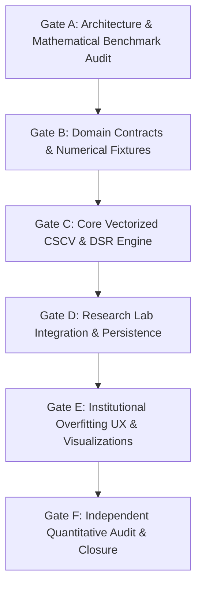

# STAGE 33 PROPOSAL — COMBINATORIAL CROSS-VALIDATION, BACKTEST OVERFITTING DIAGNOSTICS & DEFLATED SHARPE RATIO ENGINE

**Status: PROPOSED — AWAITING PROJECT OWNER APPROVAL**

**Document Version:** 1.0.0  
**Session:** 62  
**Date:** October 21, 2026  
**Author:** Principal Quantitative Finance Architect & Senior Research Systems Engineer  
**Project:** Quantitative Portfolio Optimization Engine  
**Repository:** `UzairAhmad88/Portfolio-Optimization-Engine-by-uzaii`  
**Workspace:** `d:\Quants\Projects\quant-portfolio-engine-starter`  
**Target Branch:** `main`  
**Preceding Milestone:** Stage 32 — Immutable Dataset Versioning, Research Snapshots & Point-in-Time Data Provenance Auditing (Formally Accepted in Session 62)  

---

## 1. Executive Summary & Context

With the formal acceptance of **Stage 32**, the Quantitative Portfolio Optimization Engine achieved regulatory-grade dataset immutability, canonical Merkle/SHA-256 manifest hashing, and zero-drift point-in-time snapshot replay. Researchers can guarantee that any backtest or research experiment executes against strictly frozen underlying price bars and corporate actions, immune to future database mutations, corporate action revisions, or survivorship leakage.

However, in institutional quantitative asset management, solving data provenance exposes the next and most pervasive risk in systematic strategy development: **Backtest Overfitting (Selection Bias / Data Snooping)**. 

When a quantitative researcher evaluates dozens or hundreds of strategy variations (e.g., parameter grids, signal thresholds, asset filters) against the same frozen historical dataset snapshot, standard performance statistics (e.g., annualized Sharpe Ratio) become severely biased upward. A strategy with high historical Sharpe ratio is frequently nothing more than statistical noise that fit historical quirks rather than genuine economic alpha.

**Stage 33** bridges this critical institutional gap by implementing peer-reviewed, state-of-the-art anti-overfitting analytics directly into the engine's Research Lab and Backtesting infrastructure:
1. **Deflated Sharpe Ratio (DSR)** (Bailey & López de Prado, 2014) — adjusting observed Sharpe ratios for the number of trials ($N$), non-normality (skewness and kurtosis), and the cross-sectional variance of trial returns.
2. **Probability of Backtest Overfitting (PBO)** via **Combinatorially Symmetric Cross-Validation (CSCV)** (Bailey et al., 2016) — combinatorial partitioning of historical returns to empirically estimate the probability that the in-sample selected strategy underperforms the median out-of-sample strategy.
3. **Minimum Backtest Length (MinBTL)** — computing the minimum track record length required to reject the null hypothesis of false discovery given the number of parameter iterations tested.
4. **Haircut Sharpe Ratios / Family-Wise Error Rate (FWER / FDR)** — applying multiple testing adjustments (Harvey, Liu, & Zhu, 2016).

---

## 2. Formal Stage 32 Closure Record

The project owner explicitly approved the following decision:
> *“Yes — accept Stage 32 and authorize Stage 33 planning.”*

### 2.1 Acceptance Reconciliation & Retained Boundaries
Stage 32 is formally accepted based on verified deliverables from Sessions 55–61:
- Canonical manifest engine (`manifest.py`) with 8-decimal financial precision and currency binding (Schema v1.2).
- Additive database migration `e5f6a7b8c9d0_add_frozen_payload_to_snapshots.py` persisting normalized OHLCV bars and corporate actions.
- Deterministic snapshot creation (`create_dataset_snapshot`) and replay service (`resolve_snapshot_price_panel`) with mathematical proof of $0.00000000$ price drift under live operational mutations.
- Controlled HTTP 409 `SnapshotIntegrityError` fail-closed verification on payload tampering or corruption.
- Institutional verification UI components (`SnapshotProvenanceBadge`) in React/TypeScript.
- 100% test pass rate across 535 backend tests, 52 frontend tests, and clean production build.

**Retained Disclosed Limitations (Acknowledged by Owner):**
1. **Database-Local Integrity Boundary:** The frozen payload and expected manifest digest reside within the same database trust boundary. While application-level tamper detection is verified, protection against a malicious or compromised database administrator requires future external KMS/WORM out-of-band signing.
2. **PostgreSQL Concurrency Boundary:** Consistent snapshot creation under concurrent writes remains unproven in SQLite test environments. Production deployments with concurrent writer pipelines must enforce `REPEATABLE READ` or transaction-level advisory locking.

---

## 3. Repository Reconnaissance & Evidence-Driven Motivation

### 3.1 Existing Repository Foundation
An audit of current repository capabilities reveals that the structural prerequisites for anti-overfitting diagnostics are fully in place:
1. **Research Experiments Infrastructure (Stage 12):**
   - Models: `ResearchExperimentModel` and `ResearchExperimentRunModel` (`backend/app/models/research.py`).
   - Service: `ResearchExperimentService` (`backend/app/services/research_experiment_service.py`).
   - Tracks trial runs, configuration hashes, metric sets, parameter variants, and execution snapshots.
2. **Vectorized Backtesting Engine (Stage 7 & Stage 30):**
   - Generates daily return vectors, portfolio equity curves, and performance metrics (Sharpe, Sortino, Drawdown) in `backend/app/backtesting/engine.py`.
3. **Immutable Snapshots (Stage 32):**
   - Guaranteed identical underlying return distributions across multiple parameter runs on the same `snapshot_id`.
4. **Statistical Infrastructure (Stage 8 & Stage 29):**
   - Higher-moment calculations (skewness, excess kurtosis), annualized volatility, and drawdown distribution engines.

### 3.2 The Demonstrated Gap
Despite having multi-run experiment tracking in the Research Lab, the engine currently computes only **unadjusted nominal metrics**:
- When a researcher runs an experiment with 50 parameter configurations, each run displays a standalone Sharpe ratio (e.g., $SR = 1.85$).
- The system provides **zero quantitative feedback** on selection bias.
- The researcher cannot determine whether an $SR = 1.85$ out of 50 trials has a 5% or 95% probability of being a fluke.
- Institutional allocators and quantitative investment committees routinely reject backtests that lack selection-bias corrections and CSCV/PBO analysis.

---

## 4. Alternatives Considered

To identify the highest-value next milestone, three strategic directions were evaluated:

| Dimension | Candidate 1: Anti-Overfitting & DSR Engine (Recommended) | Candidate 2: Multi-Asset Macro Regime & Covariance | Candidate 3: Fundamental Alpha Screening Pipeline |
| :--- | :--- | :--- | :--- |
| **Primary Scope** | Combinatorial Cross-Validation (CSCV), Probability of Backtest Overfitting (PBO), Deflated Sharpe Ratio (DSR), MinBTL, Family-Wise Error Rate. | Hidden Markov Models (HMM), macro-regime conditional covariance matrices, dynamic risk budgeting across macro states. | Financial statement ingestion (10-K/10-Q), PIT point-in-time fundamental ratios (P/E, EV/EBITDA, ROIC), multi-factor scoring. |
| **Quant Correctness Impact** | **Highest.** Eliminates false discoveries and data snooping in strategy research; directly addresses statistical validity of reported performance. | High. Improves covariance forecasting under regime shifts and volatility spikes. | Medium. Expands signal universe, but subject to severe data snooping if overfitting diagnostics are absent. |
| **Product Value** | **Immediate.** Instantly upgrades Research Lab to institutional grade; provides quantitative confidence scores for allocators. | Moderate. Requires macroeconomic data feeds not currently modeled or ingested. | Moderate. High user appeal, but massive external data schema and licensing overhead. |
| **Technical Risk** | **Low.** Pure mathematical, statistical, and algorithmic implementation using existing return series in memory; zero external data dependencies. | Medium-High. HMM convergence instability, non-convex likelihood optimization, regime transition matrix sensitivity. | High. Complex vendor fundamental schemas, restatement timing cutoffs, non-standardized accounting metrics across US/PSX. |
| **Implementation Complexity** | **Moderate.** Vectorized combinatorial slicing ($S$ slices, $\binom{S}{S/2}$ combinations), numerical integration of Bailey-López de Prado closed-form CDFs. | High. Baun-Welch / EM algorithms, dynamic covariance shrinkage, regime switching transitions. | Very High. Relational modeling of balance sheets, cash flows, point-in-time filing date vs effective date revisions. |
| **Prerequisites & Dependencies** | **Stage 32 (Complete).** Perfectly leverages immutable snapshots and Research Lab experiment runs. | Market Data Macro Feeds (Not present; would require new data providers). | Fundamental Data Provider (Not present; requires paid financial statement vendor). |

### 4.1 Recommendation Rationale
**Candidate 1 (Combinatorial Cross-Validation, Backtest Overfitting Diagnostics & Deflated Sharpe Ratio Engine)** is overwhelmingly the superior next milestone because:
1. **Zero External Data Blockers:** Operates entirely upon returns generated by the existing backtesting and research engine.
2. **Direct Synergistic Continuation:** Stages 31 and 32 perfected point-in-time data integrity and immutability. Validating that strategies discovered on this clean data are statistically robust is the logical and scientific next step.
3. **Peer-Reviewed Institutional Standard:** Directly operationalizes seminal quantitative finance literature (López de Prado, Bailey, Harvey).

---

## 5. Detailed Scope & Capabilities

### 5.1 In-Scope Deliverables
1. **Mathematical Anti-Overfitting Engine (`backend/app/analytics/overfitting.py`):**
   - **Deflated Sharpe Ratio (DSR):**
     $$\text{DSR} = \Phi\left( \frac{(\widehat{\text{SR}} - \text{SR}^*) \sqrt{T - 1}}{\sqrt{1 - \hat{\gamma}_3 \widehat{\text{SR}} + \frac{\hat{\gamma}_4 - 1}{4} \widehat{\text{SR}}^2}} \right)$$
     where $\text{SR}^*$ is the expected maximum Sharpe ratio under the null hypothesis of zero true alpha across $N$ trials with variance $V$:
     $$\text{SR}^* \approx \sqrt{2 \ln N} \left( 1 - \frac{\gamma}{\sqrt{2 \ln N}} \right) + \frac{\ln(4\pi \ln N)}{2 \sqrt{2 \ln N}}$$
     (adjusted for non-zero variance of trial Sharpe ratios $V$).
   - **Minimum Backtest Length (MinBTL):**
     Estimates the minimum track record $T^*$ required such that $\text{DSR} \ge 0.95$.
   - **Combinatorially Symmetric Cross-Validation (CSCV) & PBO:**
     Partitions $T$ historical return observations into $S$ contiguous sub-periods (where $S$ is even, e.g., $S=10$ or $16$). Evaluates all $\binom{S}{S/2}$ combinations of training (in-sample) and testing (out-of-sample) blocks.
     Computes:
     - **Probability of Backtest Overfitting (PBO):** Empirical probability that the strategy with the best in-sample Sharpe ratio produces below-median out-of-sample performance:
       $$\text{PBO} = \frac{1}{\binom{S}{S/2}} \sum_{c=1}^{\binom{S}{S/2}} \mathbb{I}\left[\text{Rank}_{\text{OOS}}(c) > \frac{N}{2}\right]$$
     - **Performance Degradation Slope:** Linear regression of OOS Sharpe ratio on IS Sharpe ratio across all combinations.
     - **Stochastic Dominance Matrix:** Comparing empirical distributions of optimal vs benchmark selection.
   - **Haircut Sharpe Ratios (Harvey & Liu):**
     Applies Family-Wise Error Rate (FWER) and False Discovery Rate (FDR) adjustments based on Bonferroni, Holm, and BHY corrections.

2. **Domain Models & Research Experiment Integration:**
   - Non-destructive extensions or association schemas on `ResearchExperimentModel` to persist experiment-level overfitting diagnostics (`pbo`, `dsr`, `min_btl_years`, `effective_trials`, `degradation_slope`).
   - Analytical payload serializer for CSCV distribution logits and IS-vs-OOS scatter data.

3. **REST API Extensions (`/api/v1/research/experiments/{id}/overfitting-diagnostics`):**
   - Endpoint to compute or retrieve on-demand CSCV and DSR analytics across all completed runs of a research experiment.
   - Fail-closed validation requiring minimum run counts ($N \ge 2$) and uniform temporal spans.

4. **Institutional Research Lab UX (`frontend/src/components/pages/ResearchLabPage.tsx`):**
   - **Overfitting Diagnostics Dashboard:**
     - Institutional DSR Gauge with statistical significance badge ($p < 0.05$).
     - PBO Alert Card (e.g., "PBO: 12.4% — Low Overfitting Risk" vs "PBO: 68.2% — Severe Overfitting Warning").
     - Minimum Backtest Track Record indicator (Actual vs MinBTL).
     - Interactive IS vs OOS Performance Degradation Chart (Scatter + regression line).
     - CSCV OOS Rank Distribution Histogram.

### 5.2 Explicit Non-Goals
1. **No External Machine Learning Black-Boxes:** Implementation will focus on deterministic analytical statistics and combinatorial cross-validation, avoiding stochastic neural network hyperparameter tuners.
2. **No Real-Time Streaming CSCV:** CSCV is a research/post-experiment diagnostic, not an execution-loop algorithm.
3. **No Modification of Core Backtesting Return Series:** The underlying backtest execution engines remain unaltered; the overfitting engine consumes existing deterministic daily returns.
4. **No Destructive Database Alterations:** All experiment history and existing metrics remain fully preserved.

---

## 6. Proposed Implementation Gates

### Gate A: Architecture, Baseline Audit & Combinatorial Partitioning Math Specification
- **Deliverables:**
  - Technical audit document `docs/STAGE_33_GATE_A_BASELINE_AUDIT.md`.
  - Comprehensive mathematical formulation document with exact equations, parameter bounds, asymptotic limits, and numerical edge-case definitions (zero variance, negative Sharpe, identical returns, extreme kurtosis).
  - Benchmark performance specification for combinatorial matrix operations (ensuring $\binom{16}{8} = 12,870$ combinations execute in $< 500\text{ ms}$ via vectorized NumPy matrix multiplication).
- **Exit Criteria:** Project owner approval of mathematical formulation and computational complexity limits.

### Gate B: Domain Models, Pydantic Schemas & Analytical Benchmark Fixtures
- **Deliverables:**
  - Pydantic models for overfitting requests, responses, and diagnostic metrics (`backend/app/schemas/overfitting.py`).
  - Hand-calculated, literature-verified synthetic analytical test fixtures:
    - Symmetrical Gaussian returns with known theoretical DSR.
    - Pathological high-skew/fat-tail return series.
    - Known overfitted synthetic matrix (100 random Gaussian walks where IS maximum has OOS mean = 0, verifying $\text{PBO} \approx 0.50$).
  - Unit tests verifying fixture formulas before engine implementation.
- **Exit Criteria:** 100% of analytical benchmark fixtures pass mathematical verification.

### Gate C: Core Vectorized CSCV & DSR Numerical Engine
- **Deliverables:**
  - `backend/app/analytics/overfitting.py` containing vectorized implementations of:
    - `calculate_expected_maximum_sharpe(n_trials, variance, skewness, kurtosis)`
    - `calculate_deflated_sharpe_ratio(sharpe, trials_sharpes, n_observations, skewness, kurtosis)`
    - `calculate_minimum_backtest_length(sharpe, trials_sharpes, variance, skewness, kurtosis)`
    - `run_combinatorial_cross_validation(returns_matrix, n_slices=16)`
    - `calculate_pbo_and_degradation(cscv_result)`
  - Vectorized combination indexing using precomputed bitmasks or slice index arrays.
- **Exit Criteria:** Unit test suite verifying mathematical exactness, non-negative bounds, handling of division-by-zero, and execution time $< 1.0\text{s}$ for 100 trials over 1,000 days.

### Gate D: Research Lab Service Integration, API Routes & Database Linkage
- **Deliverables:**
  - Integration into `ResearchExperimentService` to automatically extract the trial return panel for all runs within an experiment.
  - Non-destructive database migration (if persistence is required) or on-demand cached computation service.
  - REST API endpoint: `GET /api/v1/research/experiments/{id}/overfitting-diagnostics`.
  - Comprehensive integration tests validating end-to-end multi-run research workflows and tenant isolation.
- **Exit Criteria:** End-to-end integration tests pass; legacy experiments without multi-runs fail gracefully with informative HTTP 422 messages.

### Gate E: Institutional Overfitting Diagnostics UX & Visualizations
- **Deliverables:**
  - Frontend TypeScript interfaces and API client methods in `frontend/src/services/api.ts`.
  - React components in `ResearchLabPage.tsx`:
    - `OverfittingSummaryCard`: High-level DSR, PBO, and MinBTL status badges.
    - `PBOPerformanceDegradationChart`: Interactive scatter plot of IS vs OOS Sharpe ratios with linear regression slope.
    - `CSCVRankDistributionChart`: Histogram of OOS relative rank percentiles.
  - Vitest component tests verifying rendering, loading states, and edge cases (e.g., experiments with $< 2$ runs).
- **Exit Criteria:** Frontend test suite passes; clean Vite production build; zero layout shifts.

### Gate F: Independent Quantitative Audit, Numerical Verification & Release Readiness
- **Deliverables:**
  - Strictly read-only independent quantitative audit (`docs/STAGE_33_GATE_F_INDEPENDENT_AUDIT.md`).
  - Verification of numerical stability, asymptotic boundary checks ($N \to \infty$, $T \to \infty$), and absence of lookahead bias in combinatorial slicing.
  - Regression testing across all 535+ existing backend tests and 52+ frontend tests.
  - Final owner acceptance review and sign-off.
- **Exit Criteria:** `PASS` verdict from independent auditor; full regression suite passing; zero unhandled edge cases.

---

## 7. Acceptance Criteria

### 7.1 Mandatory Criteria
1. **Mathematical Accuracy:**
   - DSR matches Bailey & López de Prado (2014) benchmark implementations within $10^{-6}$ on standardized Gaussian and skewed return vectors.
   - PBO calculation on purely random uncorrelated white-noise trials yields $\text{PBO} \in [0.45, 0.55]$ (empirically verifying absence of partition bias).
2. **Computational Performance:**
   - CSCV with $S=16$ slices ($\binom{16}{8} = 12,870$ subsets) on an experiment with 50 trials of 1,260 daily bars executes in $< 1,500\text{ ms}$ on standard server hardware without memory spikes.
3. **Robust Numerical Stability:**
   - Graceful handling of zero return variance ($V = 0$), flat equity curves, negative Sharpe ratios, extreme kurtosis ($\gamma_4 > 20$), and single-trial edge cases without unhandled exceptions or NaN leakages.
4. **Architectural & Data Isolation:**
   - Strict tenant isolation: users cannot run or view overfitting diagnostics on experiments belonging to other tenants.
   - Zero side-effects on underlying dataset snapshots or raw price bars.
5. **Quality & Regression Integrity:**
   - 100% test pass rate across new Stage 33 tests and all pre-existing regression suites (535+ backend tests, 52+ frontend tests).
   - Clean, warning-free TypeScript/Vite production build.

### 7.2 Optional / Enhancements (Non-Blocking)
1. Exportable institutional PDF/JSON Overfitting Risk Factsheet.
2. Parallelized CSCV execution using Python multiprocessing or Numba if trial counts exceed $N > 500$.

---

## 8. Risk Register & Mitigations

| Risk ID | Risk Description | Severity | Likelihood | Mitigation Strategy |
| :--- | :--- | :---: | :---: | :--- |
| **RSK-33-01** | **Combinatorial Explosion in CSCV:** Choosing too many slices $S$ (e.g., $S=20 \implies \binom{20}{10} = 184,756$ combinations) causes server CPU timeouts. | High | Low | Fix default to $S=16$ ($\binom{16}{8} = 12,870$) or $S=10$ ($\binom{10}{5} = 252$), bounded strictly in request schema validation ($S \le 16$). Fully vectorise across combinations using matrix operations. |
| **RSK-33-02** | **Heterogeneous Return Lengths Across Runs:** Runs within an experiment tested over varying date ranges or different assets. | Medium | Medium | Validate that all experiment runs share identical start date, end date, and calendar length. Fail closed with descriptive error if date grids do not align. |
| **RSK-33-03** | **Small Sample Instability ($N < 5$):** Estimating cross-trial variance with very few runs leads to unreliable DSR/PBO figures. | Low | High | Display explicit institutional warning in UI when $N < 10$; require $N \ge 2$ as hard minimum to execute. |
| **RSK-33-04** | **Serial Correlation / Autocorrelation in Returns:** Daily returns exhibiting autocorrelation can distort effective sample size $T$. | Medium | Low | Incorporate Lo (2002) autocorrelation adjustment into the Sharpe ratio variance calculation when autocorrelation is statistically significant. |

---

## 9. Recommended First Implementation Step (Gate A)

Upon project owner approval, the immediate next action is **Stage 33 Gate A: Architecture & Mathematical Benchmark Audit**:
1. Formulate exact mathematical specifications and literature citations in `docs/STAGE_33_GATE_A_BASELINE_AUDIT.md`.
2. Benchmark vectorized NumPy combinatorial slicing algorithms against synthetic multi-run panels.
3. Define the formal Pydantic schema contracts for cross-validation payloads.

> [!IMPORTANT]
> **No implementation code has been written or committed in this session.** Stage 33 will remain in proposed status until the project owner explicitly issues the approval command:
> *“Yes — approve Stage 33 proposal and authorize Gate A implementation.”*
