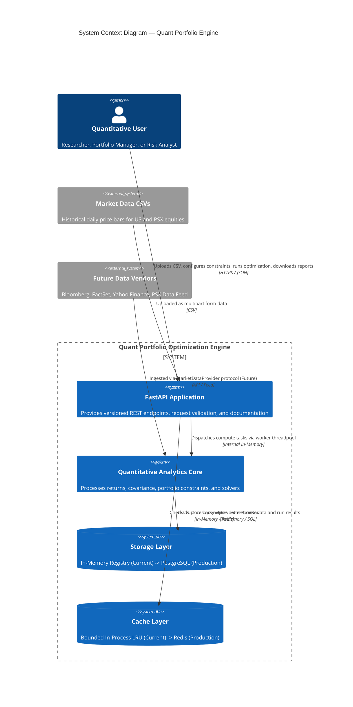
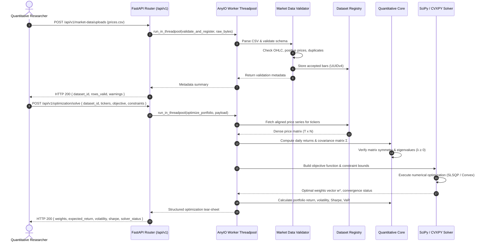

# System Architecture Document — Quant Portfolio Optimization Engine
**Document Version:** 1.0.0  
**Status:** Approved Architecture Baseline  
**Date:** 2026-10-16  
**Author:** Quantitative Finance Software Architecture & Engineering  

---

## 1. Architectural Vision & Pattern Evaluation

### 1.1 The Modular Monolith Architectural Pattern
The **Quant Portfolio Optimization Engine** is structured strictly as a **Modular Monolith**. 

Distributed architectures (microservices, distributed RPC, Kubernetes multi-cluster setups) are **explicitly rejected** for the current and medium-term stages of this product for the following engineering reasons:
1. **Zero Network Serialization Overhead for Dense Arrays:** Quantitative finance workflows pass dense $T \times N$ price matrices, return series, and covariance matrices between calculation steps. Splitting statistical returns, constraint evaluation, and mathematical solvers across HTTP/gRPC microservice boundaries introduces severe serialization latency, network instability, and complex distributed failure modes.
2. **Atomic Invariant Validation:** Mathematical invariants (e.g. weight vectors summing to 1.0, covariance matrices being positive semi-definite) must be enforced atomically in memory.
3. **Operational Simplicity & Reproducibility:** A single codebase running within a unified virtual environment ensures deterministic package dependencies (NumPy, SciPy, Pandas) and straightforward deployment without distributed tracing overhead.
4. **Clean Boundary Discipline:** By enforcing strict internal package boundaries and unidirectional dependency flow, any module (such as the optimization solver or market data provider) can be decoupled into an isolated worker service later if compute scaling demands it.

---

## 2. System Context Diagram

The following diagram illustrates how external actors interact with the engine boundaries:



---

## 3. High-Level Component & Layer Decomposition

The system is organized into five strictly decoupled horizontal layers with unidirectional dependency rules:

```mermaid
graph TD
    subgraph Layer1["1. Transport & Presentation Layer (app/api/v1/)"]
        Routes[Routes & Endpoints]
        ReqSchemas[Pydantic Request Schemas]
        RespSchemas[Pydantic Response Models]
        ErrHandlers[Global Exception Handlers]
    end

    subgraph Layer2["2. Application Service Layer (app/services/)"]
        MDService[Market Data Service]
        PortService[Portfolio Service]
        OptService[Optimization Service]
        BacktestService[Backtest Service]
        ReportService[Reporting Service]
    end

    subgraph Layer3["3. Domain & Quantitative Core (app/quant/)"]
        MathCore[Returns & Covariance Engine]
        ConstraintEngine[Constraint Builder & Feasibility]
        SolverAdapter[Optimization Solver Adapters]
        RiskAnalytics[Risk Metrics & VaR Engine]
        FrontierEngine[Efficient Frontier Generator]
    end

    subgraph Layer4["4. Abstraction Interfaces (app/common/)"]
        DataProviderProto[MarketDataProvider Protocol]
        SolverProto[OptimizationSolver Protocol]
        CacheProto[CacheProvider Protocol]
    end

    subgraph Layer5["5. Infrastructure & Persistence (app/db/, app/market_data/)"]
        SQLRepo[PostgreSQL / SQLite Repositories (Session 10 Active)]
        SQLModels[SQLAlchemy 2.0 ORM Models: datasets, dataset_assets, price_bars]
        AlembicEngine[Alembic Database Migrations]
        MemCache[In-Process Bounded LRU Cache]
    end

    Routes --> ReqSchemas
    Routes --> RespSchemas
    Routes --> MDService
    Routes --> PortService
    Routes --> OptService

    MDService --> MathCore
    MDService --> MemRegistry
    MDService --> MemCache

    PortService --> ConstraintEngine
    OptService --> SolverAdapter
    OptService --> MathCore
    OptService --> RiskAnalytics
    OptService --> FrontierEngine

    SolverAdapter --> SolverProto
    MDService --> DataProviderProto
    MemCache --> CacheProto
```

### Module Responsibilities

1. **`app/api/v1/` (Transport Layer):**
   - Pure HTTP serialization, HTTP status code mapping, and query parameter parsing.
   - Enforces Pydantic request models (`DatasetQuery`, `OptimizationRequest`) and response models (`ValidationReport`, `OptimizationResponse`).
   - Offloads blocking calls to worker threadpools. Contains **zero** mathematical formulas.
2. **`app/services/` (Application Use-Case Orchestration):**
   - Coordinates domain models, dataset caching, and quantitative algorithms.
   - Manages workflow transactions, audit hashing, and session dataset lifetimes.
3. **`app/quant/` (Domain Quantitative Core):**
   - **Completely independent of FastAPI, HTTP, and web concepts.**
   - Pure mathematical, statistical, and numerical optimization routines.
   - Uses NumPy, Pandas, and SciPy exclusively. Functions take arrays/matrices and return structured numerical dataclasses.
4. **`app/backtesting/` (Historical Simulation & Walk-Forward Engine — Active Session 12):**
   - Implements discrete simple return compounding, weight drift, multi-frequency rebalancing (`buy_and_hold`, `daily`, `weekly`, `monthly`, `quarterly`), basis-point transaction costs on traded notional, and basis-point slippage.
   - Walk-forward expanding-window solver with strict chronological discipline (zero look-ahead bias).
   - Relational persistence in `backtest_runs` table with foreign key linkage to `datasets` and `users`.
5. **`app/scenarios/` (Scenario Analysis, Stress Testing & Sensitivity Engine — Active Session 13):**
   - Pure, deterministic calculations for instantaneous asset shocks ($V_{\text{after}} = \sum V_i(1+s_i) + C$), exact additive attribution reconciliation ($\sum \Delta V_i = \Delta V$).
   - Historical date window replay utilizing only validated empirical observations without synthetic extrapolation.
   - Covariance stress with eigenvalue spectrum verification and spectral clipping projection to enforce positive semidefiniteness ($M_{\text{psd}} = Q \max(\Lambda, 0) Q^T$).
   - 1-factor and 2-factor parametric sensitivity sweeps with bounded grid enforcement ($\le 441$ points).
   - Multi-tenant persistence in `scenario_runs` table with foreign keys to `users` and `datasets`.
6. **`app/risk_simulation/` (Monte Carlo Simulation & Probabilistic Risk Engine — Active Session 14):**
   - Pure mathematical functions in `app/quant/var_cvar.py` for empirical, parametric, and historical Value-at-Risk (VaR) and Conditional Value-at-Risk (CVaR / Expected Shortfall) with standard loss-sign convention ($L = V_0 - V_T$, positive VaR/CVaR represents financial loss).
   - Multi-period stochastic return generation supporting Multivariate Normal ($\mathbf{r}_t = \boldsymbol{\mu} + \mathbf{L} \mathbf{z}_t$) and Multivariate Student-t ($\mathbf{r}_t = \boldsymbol{\mu} + \sqrt{\frac{\nu-2}{W_t}} \mathbf{L} \mathbf{z}_t, W_t \sim \text{Gamma}(\nu/2, \nu/2)$) calibrated to match target covariance $\mathbf{\Sigma}$.
   - Spectral positive semidefiniteness projection with small eigenvalue flooring ($\epsilon = 10^{-8}$) to handle empirical covariance rank-deficiency.
   - Discrete compounding portfolio valuation ($V_{i,t} = V_{i,t-1}(1+r_{i,t})$) supporting `buy_and_hold` asset drift and `constant_weights` periodic rebalancing.
   - Multi-tenant relational persistence in `risk_simulation_runs` table with foreign keys to `users` and `datasets`.
7. **`app/performance/` (Portfolio Performance Attribution & Benchmark Analysis — Active Session 15):**
   - Pure mathematical calculations in `app/quant/performance.py` for comparative performance metrics: active returns ($a_t = r_{p,t} - r_{b,t}$), arithmetic active return ($R_p - R_b$), geometric excess return ($\frac{1+R_p}{1+R_b}-1$), annualized tracking error ($TE = \operatorname{Std}(a_t)\sqrt{m}$), Information Ratio ($IR = \frac{\bar{a}m}{TE}$), Beta ($\beta = \frac{\operatorname{Cov}(r_p, r_b)}{\operatorname{Var}(r_b)}$), Jensen's Alpha ($\alpha = \overline{r_p - r_f} - \beta \overline{r_b - r_f}$), Treynor Ratio, and Up/Down capture ratios.
   - Asset-level return contribution with Menchero (2000) logarithmic linking ensuring exact additive reconciliation ($\sum_i C_i = R_{0:T}$).
   - Service orchestrator in `app/performance/service.py` integrating custom portfolios and saved backtest return series.
   - Multi-tenant persistence in `performance_reports` table with foreign key linkage to `users`, `datasets`, and optional `backtest_runs`.
8. **`app/common/protocols.py` (Architectural Contracts):**
   - Python `typing.Protocol` or `abc.ABC` definitions providing pluggability for data providers, solvers, and storage.
9. **`app/db/` and `app/market_data/repository.py` (Persistence Layer — Active Session 10, 12, 13, 14 & 15):**
   - Implements durable relational persistence using SQLAlchemy 2.0 and Alembic.
   - Authoritative source of truth for `users`, `datasets`, `dataset_assets`, `price_bars`, `backtest_runs`, `scenario_runs`, `risk_simulation_runs`, and `performance_reports`.
   - Provides connection pooling, transactional context managers, atomic commits, and SHA-256 deduplication.
10. **`app/factor_investing/` and `app/quant/dynamic_factor_backtest.py` (Dynamic Factor Walk-Forward Engine — Active Session 20 & 21):**
   - Pure numerical routines in `app/quant/factor_model.py` and `app/quant/dynamic_factor_backtest.py`.
   - Multivariate OLS regressions, Barra structural covariance modeling ($\Sigma_{\text{model}} = B \Sigma_F B^\top + \Sigma_\epsilon$), Euler risk attribution, factor-constrained quadratic optimization, and walk-forward rebalancing.
   - Strictly rolling lookback window estimation ($[t_k - W, t_k]$) with zero look-ahead bias; turnover penalty $\lambda_{\text{turn}} \sum |w_i - w_{i,\text{drift}}|$ and basis-point transaction friction.
   - Dynamic factor exposure tracking over historical rebalance schedules.
   - Authenticated REST API at `/api/v1/factor-investing/attribute`, `/api/v1/factor-investing/optimize`, and `/api/v1/factor-investing/backtest`.
11. **`app/multi_asset/` and `app/quant/multi_asset.py` (Multi-Asset Allocation & FX Hedging Engine — Active Session 22):**
   - Pure numerical routines in `app/quant/multi_asset.py`.
   - Multiplicative discrete return conversion $(1 + R_{i,t}^{\text{base}}) = (1 + R_{i,t}^{\text{loc}})(1 + R_{k(i),t}^{\text{fx}})$ and CIP forward carry hedging overlays.
   - Structural FX risk decomposition: Asset local variance ($w^\top \Sigma_{\text{loc}} w$), FX currency variance ($w^\top \Sigma_{\text{fx}} w$), and asset-FX cross-covariance ($2 w^\top \Sigma_{\text{cross}} w$).
   - Hierarchical SLSQP optimization enforcing budget condition $\sum w_i + w_{\text{cash}} = 1.0$, asset class allocation bounds ($L_c \le \sum_{i \in c} w_i \le U_c$), and cash buffer limits.
   - Dynamic cash drag modeling and walk-forward backtesting tracking weight drift, rebalance turnover, and trading friction.
   - Authenticated REST API at `/api/v1/multi-asset/optimize` and `/api/v1/multi-asset/backtest`.

---

## 4. End-to-End CSV-to-Analysis Data Flow

The following sequence diagram outlines the data transformation pipeline from raw CSV ingestion to portfolio optimization:



---

## 5. Strict Dependency Rules & Code Governance

To maintain long-term architectural integrity, the codebase enforces the following dependency hierarchy:

```
[API Layer]  ──▶  [Service Layer]  ──▶  [Quant Core]  ──▶  [NumPy / SciPy]
     │                    │
     ▼                    ▼
[Protocols]          [Infrastructure]
```

### Enforced Rules:
1. **The Quant Core is a Pure Library:** Code inside `app/quant/` must **never** import `fastapi`, `starlette`, `pydantic`, or any web framework module. It must be testable as standalone Python functions in plain pytest scripts without booting an ASGI server.
2. **API Routes Do Not Touch Persistence Directly:** Route handlers in `app/api/` must call application service functions. They must not interact with raw dictionaries, database sessions, or filesystem caches directly.
3. **No Upward Dependencies:** Infrastructure cannot depend on API routes; domain models cannot depend on application services.

---

## 6. Concurrency & Execution Model

### 6.1 Event Loop Protection (Remediation of Session 01 Finding RISK-01)
- FastAPI operates an asynchronous event loop (`asyncio`) on its main thread.
- As discovered in the Session 01 audit, synchronous CPU-bound operations (such as Pandas CSV parsing, matrix inversions, and numerical optimizations) executed inside `async def` routes block the event loop, causing server-wide latency spikes.
- **Architectural Policy:**
  - Route handlers that perform CPU-intensive tasks must delegate execution to Starlette's threadpool:
    ```python
    from starlette.concurrency import run_in_threadpool
    result = await run_in_threadpool(service_function, *args)
    ```
  - Alternatively, routes without asynchronous I/O can be declared as standard synchronous functions (`def`), allowing FastAPI to automatically dispatch them to its background threadpool.

### 6.2 Long-Running Jobs Evolution (Stage 7 & 8)
- Single-period portfolio optimizations ($\le 50$ assets) execute in $\le 2.0\text{ seconds}$ and can run synchronously in the threadpool.
- Long-running multi-year walk-forward backtests and Monte Carlo simulations ($\ge 10,000$ paths) that take $> 5\text{ seconds}$ must transition to an asynchronous task pattern:
  - `POST /api/v1/jobs/backtests` returns HTTP 202 Accepted with a `job_id`.
  - Execution runs on a background worker queue (ARQ / Celery with Redis broker).
  - Client polls `GET /api/v1/jobs/{job_id}` or receives progress notifications.

---

## 7. Storage & Persistence Evolution Plan

The repository deliberately avoids premature database dependencies while laying a clean abstraction for production storage:

| Stage | Storage Strategy | Implementation Details | Concurrency & Durability |
|---|---|---|---|
| **Stage 1–5 (Current to Mid-Stage)** | **Process-Local Memory** | Typed Python dataclasses in bounded `_DATASETS` registry with LRU/FIFO eviction cap (max 30 datasets). | Volatile; lost on server restart; single-process Uvicorn only. |
| **Stage 6–7 (Research Dashboard & Backtesting)** | **Embedded SQLite / DuckDB** | Lightweight local file-based database for session persistence and rapid columnar analytics. | Durable across restarts; zero external infrastructure needed for local research. |
| **Stage 8 (Production Readiness)** | **PostgreSQL + SQLAlchemy 2.0 + Alembic** | Normalized relational schema (Datasets, PriceBars, Portfolios, OptimizationRuns, BacktestArtifacts). | Fully durable, multi-worker concurrent, ACID compliant, audit-logged. |

---

## 8. External Market Data Provider Abstraction

To ensure provider-neutrality and prevent hardcoding to raw CSV files, all ingestion interfaces adhere to the `MarketDataProvider` abstract protocol:

```python
from typing import Protocol, runtime_checkable
import pandas as pd
from datetime import date

@runtime_checkable
class MarketDataProvider(Protocol):
    """Abstract contract for market price bar ingestion."""
    
    def fetch_historical_bars(
        self,
        tickers: list[str],
        market: str,
        start_date: date,
        end_date: date,
    ) -> pd.DataFrame:
        """Fetch historical daily bars normalized to canonical schema.
        Must return columns: date, ticker, market, close, currency.
        Optional columns: open, high, low, adjusted_close, volume.
        """
        ...
```

### Provider Implementation Roadmap:
- `CsvUploadDataProvider` (Stage 1 Current): Extracts bars from uploaded CSV bytes.
- `PostgreSqlDataProvider` (Stage 8 Later): Queries persisted historical tables.
- `ExternalVendorDataProvider` (Post-Stage 8): Adapters for Yahoo Finance, Interactive Brokers, or direct PSX commercial feeds.

---

## 9. Architecture Decision Records (ADRs)

### ADR-01: Modular Monolith vs. Microservices Architecture
- **Context:** Deciding the high-level system topology for the quantitative research engine.
- **Decision:** Adopt a modular monolith architecture.
- **Consequences:** Eliminates network latency during dense matrix transfers; simplifies local development and testing; requires strict discipline to prevent spaghetti imports across internal layers.

### ADR-02: Synchronous Computation in Threadpools vs. Async Event Loop
- **Context:** High CPU load during Pandas parsing and quadratic programming solvers blocks the FastAPI event loop.
- **Decision:** Wrap all CPU-bound quantitative domain calls in `run_in_threadpool`.
- **Consequences:** Prevents async event loop starvation; preserves API responsiveness for concurrent health checks and query requests without introducing an external task queue in early stages.

### ADR-03: Optimization Solver Strategy — SciPy SLSQP with Analytical Gradients
- **Context:** Selecting numerical optimization solvers for Markowitz portfolio construction without adding unnecessary dependencies.
- **Decision:** Use **SciPy's `minimize` with the Sequential Least Squares Programming (SLSQP)** method and exact analytical gradients for Minimum-Variance ($2 \mathbf{\Sigma} \mathbf{w}$) and Maximum-Sharpe ($-\boldsymbol{\mu}/\sigma_p + (\mu_p - R_f)\mathbf{\Sigma}\mathbf{w}/\sigma_p^3$).
- **Consequences:** Eliminates external solver dependency overhead; delivers machine-precision convergence for convex quadratic and non-linear ratios under linear equality and bound constraints; CVXPY remains an optional future adapter for mixed-integer or cone programming if later stages require it.

### ADR-04: Stateless Backend with Cryptographic Provenance Manifests
- **Context:** Ensuring research calculations are 100% reproducible across users and platforms.
- **Decision:** Every analytical result must return a cryptographic parameter manifest containing the input dataset SHA-256, date range, formula options, and solver version.
- **Consequences:** Enables zero-drift verification; any historical report can be re-executed and verified within numerical tolerance ($10^{-6}$).

### ADR-05: Storage Migration Path (In-Memory $\rightarrow$ PostgreSQL)
- **Context:** Balancing fast initial iteration with production durability.
- **Decision:** Retain in-memory repository for Stage 1–5, adding a bounded capacity limiter; migrate to PostgreSQL via SQLAlchemy 2.0 repositories in Stage 8.
- **Consequences:** Avoids Docker and database provisioning overhead during mathematical algorithm development; requires repository interface abstraction so swapping persistence does not alter domain logic.

### ADR-06: Efficient Frontier Generation & Feasibility Strategy (Session 07)
- **Context:** Generating continuous Markowitz efficient frontier curves without fabricating points or failing unexpectedly on infeasible targets.
- **Decision:**
  1. Solve exact feasible expected return bounds $[\mu_{\min}, \mu_{\max}]$ using linear programming (`scipy.optimize.linprog` with the HiGHS solver) prior to any quadratic programming.
  2. For target returns within $[\mu_{\min}, \mu_{\max}]$, interpolate an initial starting point $\mathbf{w}_0 = (1-\theta)\mathbf{w}_{\min} + \theta\mathbf{w}_{\max}$ that strictly satisfies all equality and box constraints on step 0.
  3. Classify points relative to Global Minimum Variance (GMV): upper branch as `efficient`, lower branch as `dominated_inefficient`.
  4. Explicitly mark out-of-bound targets as `infeasible` with empty weights, preserving the requested target sequence without silent omission or fallback fabrication.
- **Consequences:** Prevents solver divergence or false local minima; guarantees mathematically sound classification of efficient versus dominated portfolios; provides full transparency on incomplete frontiers.

### ADR-07: API Reliability, Concurrency & Defensive Immutability (Session 08)
- **Context:** Hardening the public REST API and in-memory registry against race conditions, caller mutation of shared memory records, unhandled exception leakage, and unbounded resource requests.
- **Decision:**
  1. **Thread Synchronization:** All read, write, query, and eviction operations against the in-memory `_DATASETS` registry and `_CACHE` are synchronized via reentrant locks (`threading.RLock`).
  2. **Defensive Immutability:** Functions returning stored records (`get_dataset_rows`, `query_dataset`, and cached previews) create shallow copies of individual row dictionaries (`[dict(r) for r in rows]`). Mutating returned dictionaries in application or caller space cannot alter stored price bars or cached queries.
  3. **Event Loop Offloading:** All CPU-bound validation, optimization, frontier calculation, and comparison operations are wrapped in Starlette's worker threadpool via `run_in_threadpool`.
  4. **Sanitized Error Boundaries:** A global unhandled exception handler catches unexpected runtime exceptions, logs full diagnostics server-side, and returns sanitized HTTP 500 responses without exposing local filesystem paths, database internals, or stack traces.
  5. **Input Hardening:** Configured limits restrict uploads to 10 MB, 250,000 rows, max 100 assets per portfolio, and max 365 compounding periods per year. Upload filenames are sanitized with `os.path.basename` to prevent path traversal attempts.
- **Consequences:** Eliminates memory corruption risks in concurrent read/write environments; guarantees stable response contracts without leakage; preserves deterministic and isolated test execution.

### ADR-08: Relational Persistence & Deduplication Architecture (Session 10)
- **Context:** Transitioning dataset storage from ephemeral in-memory dictionary state to durable, transactional persistence.
- **Decision:**
  1. Adopt **SQLAlchemy 2.0** with **Alembic** migrations and dual-dialect support: production PostgreSQL (via `psycopg` v3) and test/offline development SQLite.
  2. Implement an atomic repository pattern (`create_dataset_with_records`) ensuring datasets, asset summaries, and price bars are written within an all-or-nothing database transaction.
  3. Enforce deterministic content deduplication via SHA-256 digests.
- **Consequences:** Datasets survive server restarts; foreign-key cascades ensure clean orphaned price bar deletion; database health is monitored via `/api/v1/health`.

### ADR-09: Authentication, Authorization & Dataset Tenant Isolation (Session 11)
- **Context:** Enforcing secure named user identity, role-based authorization, and strict tenant isolation across all quantitative research operations.
- **Decision:**
  1. **User Identity & Password Security:** Implement normalized `UserModel` with cryptographic `bcrypt` password hashing (cost factor 12). Plaintext passwords and hashes are never returned in API payloads or logged.
  2. **Dual Session Token Architecture:** Standard `HS256` signed JWTs containing subject (`user_id`), email, role, and expiration. Supported via HttpOnly, SameSite=Lax cookies for web clients and Authorization Bearer headers for programmatic clients.
  3. **Brute-Force Rate Limiting:** In-memory, thread-safe lockout tracking (max 5 consecutive failures locks out identifier for 5 minutes).
  4. **Dataset Tenant Isolation:** Every registered dataset is associated with its creator (`user_id`). Queries, assets, optimization, efficient frontier, and comparison routes strictly enforce access control: researchers can only access their own or shared datasets; administrators have global oversight. Deduplication is scoped to prevent cross-tenant data leakage.
  5. **CORS & Defensive Headers:** Prohibit wildcard origins with credentialed cookies; enforce explicit trusted origins (`CORS_ORIGINS`); inject security headers (`X-Content-Type-Options`, `X-Frame-Options`, `X-XSS-Protection`, `Referrer-Policy`).
- **Consequences:** Eliminates unauthenticated access risks; guarantees data confidentiality across quantitative researchers; adheres to institutional security standards.

### ADR-10: Scenario Analysis, Stress Testing & Covariance PSD Projection (Session 13)
- **Context:** Providing instantaneous asset-level shocks, historical crisis replays, and covariance perturbations without fabricating synthetic data or violating mathematical positive semidefiniteness.
- **Decision:**
  1. Enforce strict additive valuation reconciliation ($\sum \Delta V_i = \Delta V$) with explicit cash treatment.
  2. Constrain historical event replays strictly to observed historical bars without linear interpolation.
  3. Implement spectral clipping projection ($M_{\text{psd}} = Q \max(\Lambda, 0) Q^T$) to guarantee valid covariance matrices under arbitrary user perturbations.
  4. Persist runs in `scenario_runs` with user tenant isolation and Alembic migration `e4f5a6b7c8d9`.
- **Consequences:** Eliminates mathematically impossible negative portfolio variances; ensures complete auditability.

### ADR-11: Monte Carlo Simulation, Probabilistic Risk Analysis & VaR/CVaR (Session 14)
- **Context:** Simulating multi-period portfolio wealth trajectories, evaluating tail risk (VaR & CVaR / Expected Shortfall), and comparing empirical, parametric, and historical risk estimators.
- **Decision:**
  1. **Deterministic Random Generation:** Use `numpy.random.default_rng(seed)` so that identical inputs and seed reproduce identical asset return vectors and terminal wealth outcomes.
  2. **Covariance Factorization & PSD Guarantee:** Factorize covariance via Cholesky decomposition $\mathbf{\Sigma} = \mathbf{L} \mathbf{L}^T$. If the matrix is ill-conditioned or rank-deficient, project onto the positive semidefinite cone via eigenvalue flooring ($\min(\lambda_i, 10^{-8})$) prior to Cholesky factorization.
  3. **Multivariate Distribution Extensions:** Support Multivariate Normal ($\mathbf{r}_t = \boldsymbol{\mu} + \mathbf{L} \mathbf{z}_t$) and Multivariate Student-t ($\mathbf{r}_t = \boldsymbol{\mu} + \sqrt{\frac{\nu-2}{W_t}} \mathbf{L} \mathbf{z}_t, W_t \sim \text{Gamma}(\nu/2, \nu/2)$), calibrated so that theoretical return covariance matches $\mathbf{\Sigma}$.
  4. **Strict Loss-Sign Convention:** Define portfolio loss as $L = V_0 - V_T$. Positive VaR and CVaR represent positive economic loss. Empirical CVaR is calculated as the average loss in the worst $(1-q)$ tail at or beyond the VaR quantile.
  5. **Bounded Persistence & Provenance:** Store simulation metadata, summary statistics, VaR/CVaR metrics, and downsampled trajectory envelopes in `risk_simulation_runs` (Alembic migration `f5a6b7c8d9e0`) without saving large $P \times T$ path matrices.
- **Consequences:** Ensures reproducible quant research; prevents memory bloat while preserving rich probabilistic risk diagnostics.

### ADR-12: Menchero Multi-Period Return Attribution & Conditional Brinson Deferral (Session 15)
- **Context:** Implementing asset-level return contributions over multi-period horizons, comparing against empirical benchmarks, and evaluating whether Brinson allocation/selection attribution is supported by existing dataset schemas.
- **Decision:**
  1. **Empirical Benchmark Requirement:** Use only verified benchmark asset price bars present in the linked dataset with identical currency and calendar alignment. Reject cross-currency comparisons (e.g. PKR portfolio vs USD benchmark) and never synthesize or forward-fill missing benchmark bars.
  2. **Active vs. Excess Return Conventions:** Explicitly distinguish arithmetic active return ($a_t = r_{p,t} - r_{b,t}$, cumulative $R_p - R_b$) from geometric excess return ($e_t = \frac{1+r_{p,t}}{1+r_{b,t}} - 1$, cumulative $\frac{1+R_p}{1+R_b} - 1$).
  3. **Multi-Period Menchero (2000) Linking:** Single-period asset contribution is $c_{i,t} = w_{i,t-1} r_{i,t}$. Multi-period contributions $C_i = \sum_t L_t c_{i,t}$ use Menchero logarithmic linking weights $L_t = \frac{\ln(1+r_{p,t})}{r_{p,t}} \frac{R_p}{\ln(1+R_p)}$ to guarantee exact additive reconciliation to cumulative portfolio return ($\sum_{i=1}^N C_i = R_{0:T}$) within numerical precision ($10^{-6}$).
  4. **Conditional Brinson Attribution Deferral:** Because uploaded CSV market data schemas contain only single-asset OHLCV bars without benchmark constituent weights or industry classifications, Brinson-Fachler/Brinson-Hood-Beebower allocation and selection attribution is formally deferred. We document this limitation explicitly rather than inventing benchmark constituent holdings.
  5. **Tenant-Isolated Report Persistence:** Persist evaluated performance reports, active metrics, Menchero contributions, and timeseries in `performance_reports` (Alembic migration `a1b2c3d4e5f6`) scoped to the creating `user_id`.
- **Consequences:** Provides mathematically rigorous, additive asset-level return diagnostics without fabricating unavailable market constituent data.

### ADR-13: Portfolio Research Experiments, Strategy Comparison & Reproducible Research Runs (Session 16)
- **Context:** Transitioning ad-hoc analytics runs into structured, reproducible research workflows where experiments have formal definitions, versioned canonical configurations, non-destructive sequential executions, and cross-strategy comparative analytics.
- **Decision:**
  1. **Separation of Concerns:** Strictly decouple **Experiment Definition** (`research_experiments` table) from **Experiment Execution** (`research_experiment_runs` table). An experiment defines the hypothesis, strategy modality, and canonical configuration. Rerunning an experiment creates a separate, incremented run record ($1 \to 2$) without overwriting historical runs.
  2. **Canonical JSON Serialization & SHA-256 Fingerprinting:** Compute configuration fingerprints deterministically by recursively sorting dictionary keys, serializing floats to 8 decimal places (`f"{val:.8f}"`), stripping non-semantic whitespace and labels, and computing SHA-256 digests. Non-semantic perturbations preserve the fingerprint; semantic alterations (assets, weights, constraints, costs, seeds) produce distinct fingerprints.
  3. **Cryptographic Provenance Verification:** Record both the expected `dataset_content_sha256` in the configuration and the live dataset's content hash at execution time. Reruns verify that the dataset exists and hasn't been modified. If provenance is unverifiable or data has changed, the run is flagged as non-reproducible with explicit warnings.
  4. **Cross-Strategy Comparison Engine:** Compare compatible completed runs across backtests, Monte Carlo simulations, and benchmark attributions. Enforce strict currency matching, period alignment, and gross vs net transparency. Metrics that are unsupported by a run's underlying model (e.g. tracking error for absolute backtests or CVaR for deterministic backtests) remain explicitly `None` rather than fabricated.
  5. **Normalized Persistence & Cascade Deletion:** Store experiment definitions and runs in `research_experiments` and `research_experiment_runs` (Alembic migration `b2c3d4e5f6a7`) with tenant isolation on `user_id` and foreign key cascade deletion.
- **Consequences:** Researchers can formulate hypotheses, re-execute historical runs safely, compare multi-strategy performance, and audit provenance with zero risk of historical data destruction or metric fabrication.

### ADR-14: Robust Portfolio Optimization, Estimation Uncertainty & Constraint Sensitivity (Session 17)
- **Context:** Conventional mean-variance optimization produces extreme, error-maximizing allocations when applied directly to sample estimates of expected returns and covariance matrices. Researchers need mathematically explicit worst-case formulations, covariance shrinkage regularization, constraint sensitivity diagnostics, and chronological out-of-sample backtesting without look-ahead bias or false claims of guaranteed outperformance.
- **Decision:**
  1. **Explicit Worst-Case Return Formulations:** Model uncertainty sets $\mathcal{U}_\mu$ rigorously:
     - **Box Uncertainty:** $\mathcal{U}_{\text{box}} = \{\mu \in \mathbb{R}^N : |\mu_i - \hat{\mu}_i| \le \delta_i, \delta_i = \kappa \cdot \text{SE}_i\}$. Under long-only weights ($w \ge 0$), the worst-case expected return is analytically $\min_{\mu \in \mathcal{U}_{\text{box}}} w^\top \mu = w^\top (\hat{\mu} - \delta)$.
     - **Ellipsoidal Uncertainty:** $\mathcal{U}_{\text{ellip}} = \{\mu \in \mathbb{R}^N : (\mu - \hat{\mu})^\top \hat{\Sigma}^{-1} (\mu - \hat{\mu}) \le \kappa^2\}$. The worst-case return is analytically $\min_{\mu \in \mathcal{U}_{\text{ellip}}} w^\top \mu = w^\top \hat{\mu} - \kappa \sqrt{w^\top \hat{\Sigma} w}$.
  2. **Covariance Regularization via Structured Shrinkage:** Regularize sample covariance $\hat{\Sigma}$ via convex combination $\Sigma_{\text{shrunk}} = (1-\lambda)\hat{\Sigma} + \lambda T$ with $\lambda \in [0, 1]$. Support three canonical targets:
     - **Diagonal Sample Variances:** $T_{ii} = \hat{\Sigma}_{ii}$, $T_{ij} = 0$ ($i \neq j$) (Ledoit-Wolf diagonal target).
     - **Scaled Identity:** $T = \bar{\sigma}^2 \mathbf{I}$, where $\bar{\sigma}^2 = \frac{1}{N}\operatorname{Tr}(\hat{\Sigma})$ (equal variance, zero correlation).
     - **Constant Correlation:** $T_{ii} = \hat{\Sigma}_{ii}$, $T_{ij} = \bar{\rho}\sqrt{\hat{\Sigma}_{ii}\hat{\Sigma}_{jj}}$ where $\bar{\rho}$ is the average off-diagonal sample correlation.
  3. **Analytical Gradients & Quadratic Optimization:** Formulate robust Maximum Sharpe, Global Minimum Variance, and Mean-Variance Utility ($\max_w \mu_{\text{worst}}(w) - \frac{1}{2}\gamma w^\top \Sigma_{\text{shrunk}} w$) with analytical objective and gradient evaluation passed directly to SciPy SLSQP. Check economic validity ($\max(\mu_{\text{worst}}) > R_f$) prior to Sharpe optimization to prevent unbounded or inverted allocations.
  4. **Interpretability & Sensitivity Diagnostics:** Compute $D_1 = \sum_i |w_i^{\text{robust}} - w_i^{\text{baseline}}|$, Herfindahl-Hirschman Index concentration ($HHI = \sum w_i^2$), and effective asset count ($N_{\text{eff}} = 1/HHI$). Implement strictly bounded 1D parameter sweeps ($\le 25$ evaluations) with explicit infeasibility reporting without silent constraint relaxation.
  5. **Chronological Leakage-Free Backtesting:** Enforce strict separation between in-sample training window ($t \le T_{\text{split}}$) and out-of-sample evaluation window ($t > T_{\text{split}}$). Compute return estimates, uncertainty sets, and shrunk covariance exclusively on training data; evaluate allocations using chronological out-of-sample bars, rebalancing schedules, and realistic transaction friction.
- **Consequences:** Provides institutional researchers with robust allocation tools that hedge parameter uncertainty without fabricating certainty or making unsupported claims of risk elimination.

### ADR-15: Black-Litterman Bayesian Portfolio Optimization & Out-of-Sample Tilt Backtesting (Session 18)
- **Context:** Classical Markowitz mean-variance optimization produces extreme and unstable asset allocations due to estimation error in sample mean returns. The Black-Litterman model resolves this instability by establishing an economically anchored neutral prior (implied equilibrium excess returns from reverse optimization of a market benchmark) and updating it with investor views via Bayesian probability theory.
- **Decision:**
  1. **Equilibrium Return Formulation:** Reverse-optimize benchmark market weights $w_{\text{eq}}$ to extract market-implied equilibrium returns: $\Pi = r_f \mathbf{1} + \gamma \Sigma w_{\text{eq}}$, where risk aversion parameter $\gamma = \frac{\mu_m - r_f}{\sigma_m^2}$ or user-specified.
  2. **View Representation & Uncertainty Calibration:**
     - Views are encoded in pick matrix $P \in \mathbb{R}^{K \times N}$ and expected return vector $q \in \mathbb{R}^K$. Absolute views have row sum $1$ on the target asset; relative views have dollar-neutral long/short weights summing to $0$.
     - Support two rigorous uncertainty calibrations for diagonal view covariance $\Omega$:
       - **He-Litterman Formulation:** $\Omega = \operatorname{diag}(P (\tau \Sigma) P^\top)$.
       - **Idzorek Confidence Scaling:** $\Omega_{k,k} = \frac{1 - c_k}{c_k} (P \tau \Sigma P^\top)_{k,k}$ for user confidence $c_k \in (0, 1)$.
  3. **Numerically Stable Woodbury Bayesian Posterior:**
     - Posterior mean: $\mu_{\text{BL}} = \Pi + \tau \Sigma P^\top (P \tau \Sigma P^\top + \Omega)^{-1} (q - P \Pi)$.
     - Posterior covariance: $\Sigma_{\text{post}} = \Sigma + M = (1+\tau)\Sigma - \tau^2 \Sigma P^\top (P \tau \Sigma P^\top + \Omega)^{-1} P \Sigma$.
     - When no views are supplied ($K=0$), $\mu_{\text{BL}} \equiv \Pi$ and $w_{\text{BL}} \equiv w_{\text{eq}}$ identically.
  4. **Active Tilt Diagnostics & View Absorption:**
     - Compute active tilts $\Delta w = w_{\text{BL}} - w_{\text{eq}}$, tracking error, active share, Herfindahl concentration, and view absorption metric $A_k = \frac{(P \mu_{\text{BL}})_k - (P \Pi)_k}{q_k - (P \Pi)_k} \in [0, 1]$ measuring the proportion of each view absorbed into posterior returns.
  5. **Leakage-Free Chronological Backtesting:**
     - In-sample estimation ($t \le T_{\text{split}}$) calibrates $\Sigma$ and $\Pi$; out-of-sample period ($t > T_{\text{split}}$) evaluates chronological execution of Black-Litterman allocations against the Equilibrium benchmark with realistic transaction costs and slippage via `run_portfolio_simulation`.
  6. **Multi-Tenant REST API & UI:**
     - Authenticated REST API at `/api/v1/black-litterman/optimize` and `/api/v1/black-litterman/backtest`. Institutional React 19 / TypeScript workspace (`BlackLittermanPage.tsx`) with Views Studio, active tilt waterfall chart, side-by-side prior/posterior tables, and out-of-sample performance backtesting.
### ADR-16: Equal Risk Contribution (ERC) & Hierarchical Risk Parity (HRP) Portfolio Construction (Session 19)
- **Context:** Classical Markowitz optimization depends heavily on expected return estimates $\hat{\mu}$, which are notoriously noisy and unstable. Risk-based allocation strategies (Risk Parity) eliminate return forecasts entirely and allocate capital solely based on covariance risk structure. However, classical Equal Risk Contribution (ERC) still requires numerical covariance matrix inversion or quadratic solving, which can fail or become unstable when matrices are ill-conditioned or when $N > T$. Machine-learning graph-theoretic methods such as Hierarchical Risk Parity (HRP) address this by operating on tree topologies without requiring matrix inversion.
- **Decision:**
  1. **Pure Euler Risk Decomposition:**
     - Express portfolio volatility $\sigma_p(w) = \sqrt{w^\top \Sigma w}$ as an exact Euler homogeneous function:
       $$\sigma_p(w) = \sum_{i=1}^N w_i \frac{\partial \sigma_p}{\partial w_i} = \sum_{i=1}^N w_i \frac{(\Sigma w)_i}{\sigma_p} = \sum_{i=1}^N \text{TRC}_i$$
     - Compute percentage risk contribution $\%RC_i = \frac{\text{TRC}_i}{\sigma_p} = \frac{w_i (\Sigma w)_i}{\sigma_p^2}$ with exact partition of unity $\sum \%RC_i \equiv 1.0$.
  2. **Convex Log-Barrier Equal Risk Contribution (ERC):**
     - Formulate the unconstrained/long-only ERC problem as a strictly convex log-barrier optimization (Spinu, 2013; Bai et al., 2016):
       $$\min_{y > 0} \frac{1}{2} y^\top \Sigma y - \sum_{i=1}^N b_i \ln(y_i)$$
     - With analytical gradient $g(y) = \Sigma y - \frac{b}{y}$ and positive definite Hessian $H(y) = \Sigma + \operatorname{diag}(b / y^2)$, guaranteeing unique global convergence via SLSQP. Normalized weights $w_i = y_i / \sum y_k$ satisfy $\text{TRC}_i / \sigma_p = b_i$ exactly.
  3. **Hierarchical Risk Parity (HRP):**
     - Implement Marcos López de Prado's (2016) three-stage algorithm:
       1. **Tree Clustering:** Convert correlation $\rho_{i,j}$ to distance metric $d_{i,j} = \sqrt{\frac{1 - \rho_{i,j}}{2}} \in [0, 1]$. Compute pairwise Euclidean distances $D(i, j) = \sqrt{\sum_k (d_{i,k} - d_{j,k})^2}$ and generate hierarchical linkage tree (Single, Complete, or Average linkage).
       2. **Quasi-Diagonalization:** Reorder the covariance matrix leaves by recursively traversing the linkage tree so that the largest covariances are along the diagonal.
       3. **Recursive Bisection:** Top-down recursive splitting of ordered asset clusters into sub-clusters $C_1, C_2$. Allocate capital between clusters inversely proportional to their cluster variance:
          $$\alpha_1 = 1 - \frac{\tilde{V}_1}{\tilde{V}_1 + \tilde{V}_2}, \quad \alpha_2 = 1 - \alpha_1, \quad \tilde{V}_k = w_k^\top \Sigma_k w_k \text{ with } w_k \propto \operatorname{diag}(\Sigma_k)^{-1}$$
     - HRP is mathematically immune to singular/rank-deficient covariance matrices ($\operatorname{det}(\Sigma) = 0$), requires zero matrix inversions, and is permutation invariant.
  4. **Quantitative Risk Inequality Diagnostics:**
     - Compute the **Risk Gini Coefficient** $G_{\text{risk}} = \frac{\sum_i \sum_j |\%RC_i - \%RC_j|}{2 N \sum_i \%RC_i} \in [0, 1]$ (0 = perfect parity, 1 = concentrated).
     - Compute the **Effective Number of Bets** $N_{\text{ent}} = \exp\left(-\sum_{i=1}^N \%RC_i \ln \%RC_i\right) \in [1, N]$.
     - Compute the **Diversification Ratio** $\text{DR} = \frac{w^\top \sigma_{\text{assets}}}{\sigma_p} \ge 1.0$.
  5. **Session 18 Black-Litterman Excess-Return Refinement:**
     - Refined `compute_unconstrained_bl_weights` in `backend/app/quant/black_litterman.py` to evaluate on excess returns $\mu_{\text{BL}} - r_f \mathbf{1}$:
       $$w_{\text{raw}} = \frac{1}{\gamma} \Sigma^{-1} (\mu_{\text{BL}} - r_f \mathbf{1})$$
     - Guarantees exact recovery of benchmark equilibrium weights $w_{\text{eq}}$ when views are empty ($K=0$), eliminating the previous drift toward GMV for $r_f > 0$.
  6. **Chronological Backtesting & Interactive Institutional UI:**
     - Pure numerical engine in `backend/app/quant/risk_parity.py`.
     - Authenticated REST API at `/api/v1/risk-parity/optimize` and `/api/v1/risk-parity/backtest`.
     - Interactive React 19 / TypeScript workspace (`RiskParityPage.tsx`) with side-by-side capital weight vs %RC risk contribution bar charts, dendrogram quasi-diagonalization display, risk inequality tear-sheets, and out-of-sample backtest curves.
- **Consequences:** Eliminates return forecasting error and covariance inversion blowups. Provides quantitative asset managers with robust, diversified portfolio allocations supported by formal mathematical risk decomposition and empirical backtesting.

### ADR-17: Multi-Factor Risk Modeling, Barra Structural Decomposition & Factor-Constrained Optimization (Session 20)
- **Context:** Classical portfolio risk management evaluates risk purely at the individual asset level through sample covariance matrices $\Sigma$. In institutional portfolio management, active asset managers decompose portfolio risk into systematic macroeconomic and market-wide factor exposures (e.g. Market Beta, Size, Value, Momentum) and idiosyncratic stock-specific variance. Furthermore, quantitative managers require the ability to construct factor-tilted portfolios with targeted factor constraints (e.g., benchmark-neutral size exposure, bounded market beta) while optimizing quadratic objectives (Minimum Variance, Maximum Sharpe, Maximum Utility).
- **Decision:**
  1. **Multivariate OLS Factor Regressions:**
     - For each asset $i \in \{1, \dots, N\}$, estimate time-series regression against $K$ factors:
       $$R_{i,t} - r_{f,t} = \alpha_i + \sum_{k=1}^K \beta_{i,k} F_{k,t} + \epsilon_{i,t}, \quad t = 1, \dots, T$$
     - Compute annualized alpha, coefficient standard errors via $(X^\top X)^{-1} s_\epsilon^2$, t-statistics, p-values, $R^2$, and specific idiosyncratic variance $s_{\epsilon,i}^2 = \frac{1}{T-K-1} \sum_{t=1}^T \hat{\epsilon}_{i,t}^2$.
  2. **Synthetic Factor Grounding (Zero Look-Ahead Bias):**
     - Synthesize factors deterministically from the authoritative asset universe without look-ahead bias or external data dependencies:
       - **Market ($MKT$):** Equal-weighted average excess return across all assets $\frac{1}{N}\sum_{i=1}^N (R_{i,t} - r_{f,t})$.
       - **Size ($SMB$):** Volatility-spread proxy subtracting low-volatility asset returns from high-volatility asset returns.
       - **Value ($HML$):** Cumulative performance spread proxy subtracting high-performing asset returns from low-performing asset returns.
       - **Momentum ($MOM$):** Rolling window momentum spread subtracting lagging asset returns from leading asset returns.
       - **PCA Factors:** Singular Value Decomposition (SVD) of normalized return matrix, extracting top $K$ principal eigen-factors explaining maximum variance.
  3. **Barra Structural Covariance Modeling:**
     - Construct structured covariance matrix:
       $$\Sigma_{\text{model}} = B \Sigma_F B^\top + \Sigma_\epsilon$$
       where $B \in \mathbb{R}^{N \times K}$ is the factor loadings matrix, $\Sigma_F \in \mathbb{R}^{K \times K}$ is the annualized factor covariance matrix, and $\Sigma_\epsilon = \operatorname{diag}(s_{\epsilon,1}^2, \dots, s_{\epsilon,N}^2)$.
     - Enforce exact matrix symmetry $\Sigma = \frac{1}{2}(\Sigma + \Sigma^\top)$ and positive semidefiniteness $\lambda_{\min} > 0$.
  4. **Exact Systematic vs Specific Risk Decomposition:**
     - Portfolio variance decomposes additively into systematic and specific risk:
       $$\sigma_p^2 = \sigma_{\text{sys}}^2 + \sigma_{\text{idio}}^2 = w^\top B \Sigma_F B^\top w + w^\top \Sigma_\epsilon w$$
     - Individual factor variance contributions are derived via Euler homogeneous decomposition:
       $$\text{Contr}_k = \beta_{p,k} \cdot (\Sigma_F \beta_p)_k, \quad \sum_{k=1}^K \text{Contr}_k = \sigma_{\text{sys}}^2$$
  5. **Factor-Constrained Quadratic Optimization:**
     - Formulate portfolio optimization with linear factor tilt bounds:
       $$\min_w w^\top \Sigma_{\text{model}} w \quad \text{or} \quad \max_w \frac{w^\top \mu - r_f}{\sqrt{w^\top \Sigma_{\text{model}} w}}$$
       subject to $\sum_{i=1}^N w_i = 1$, $w_i \in [w_{\min}, w_{\max}]$, and $\beta_{k,\min} \le B_{:,k}^\top w \le \beta_{k,\max}$ for $k \in \{1, \dots, K\}$.
     - Solved numerically using SciPy SLSQP with analytical Jacobians for linear factor constraints.
  6. **Multi-Tenant REST API & Institutional UI:**
     - Pure numerical engine in `backend/app/quant/factor_model.py`.
     - Authenticated REST API at `/api/v1/factor-investing/attribute` and `/api/v1/factor-investing/optimize`.
     - Interactive React 19 / TypeScript workspace (`FactorInvestingPage.tsx`) with factor exposure tables, Barra risk proportion bar charts, asset regression diagnostic tables, and factor-tilted optimization controls.
- **Consequences:** Empowers researchers and asset allocators with institutional-grade factor attribution, identifying systematic macro risks versus stock selection skill, and providing factor-tilted portfolio construction adhering to rigorous risk constraints.

### ADR-18: Dynamic Factor Walk-Forward Backtesting & Multi-Factor Alpha Generation Engine (Session 21)
- **Context:** In real-world quantitative asset management, factor exposures and asset factor betas are non-stationary over multi-year horizons. Static factor models estimated once over the entire sample induce severe look-ahead bias and fail to capture regime shifts, factor momentum rotation, or changing market dynamics. Institutional deployment requires walk-forward rolling factor re-estimation, dynamic factor-tilted rebalancing, turnover penalization, basis-point transaction cost modeling, and temporal factor exposure tracking.
- **Decision:**
  1. **Strict Rolling Window Estimation:**
     - At each rebalance date $t_k$, factor returns and multivariate OLS asset loadings $B(t_k)$ are estimated strictly over the prior $W$ trading days $[t_k - W, t_k)$.
     - Zero look-ahead bias: future data beyond $t_k$ is strictly inaccessible during the rebalance decision.
  2. **Multi-Factor Alpha Signal Generation:**
     - Expected returns $\mu(t_k)$ are dynamically synthesized across multiple alpha strategies:
       - **Factor Tilt:** $\alpha_i = \sum_{k=1}^K c_k \beta_{i,k}(t_k)$, tilting toward desired factor premia.
       - **Factor Min Variance:** Pure risk minimization on structural Barra covariance $\Sigma_{\text{model}}(t_k)$ with active factor bounds.
       - **Factor Momentum Rotation:** Rolling factor Sharpe ratio weighting $c_k(t_k) = \operatorname{SR}_k(t_k)$ dynamically rewarding outperforming risk premia.
  3. **Turnover-Penalized Quadratic Solver:**
     - To prevent excessive portfolio churn and transaction drag, the solver optimizes:
       $$\min_w \frac{1}{2} w^\top \Sigma_{\text{model}} w - \gamma w^\top \mu + \lambda_{\text{turn}} \sum_{i=1}^N |w_i - w_{i,\text{drift}}|$$
       subject to $\sum_i w_i = 1$, $w_i \in [w_{\min}, w_{\max}]$, and factor constraints $\beta_{k,\min} \le B_{:,k}^\top w \le \beta_{k,\max}$.
  4. **Realistic Transaction Friction & Daily Compounding:**
     - Portfolio weights drift between rebalance dates according to daily asset simple returns:
       $$w_{i, t} = \frac{w_{i, t-1} (1 + R_{i, t})}{1 + R_{p, t}}$$
     - At rebalance $t_k$, 1-way turnover is charged at $c_{\text{bps}}$ basis points:
       $$\text{Cost}_{t_k} = c_{\text{bps}} \times 10^{-4} \times \frac{1}{2} \sum_{i=1}^N |w_{i, t_k} - w_{i, t_k - 1}^{\text{drift}}|$$
  5. **Dynamic Factor Exposure Time-Series:**
     - Temporal factor exposures $\beta_{p, k}(t_k) = \sum_{i=1}^N w_i(t_k) \beta_{i, k}(t_k)$ are tracked at every rebalance event and reported as longitudinal time series alongside realized portfolio and benchmark equity curves.
  6. **Authenticated REST API & Institutional UI Workspace:**
     - Endpoint: `POST /api/v1/factor-investing/backtest` enforcing dataset ownership and input validation.
     - Dedicated React workspace (`FactorInvestingPage.tsx` Tab 3) featuring interactive equity/drawdown SVG charts, summary KPIs, rebalance logs, and factor exposure progression tables.
- **Consequences:** Bridges the gap between static factor risk attribution and actionable, production-grade quantitative systematic strategies. Ensures institutional allocators can stress-test factor-based investment mandates against realistic trading frictions and time-varying factor betas.

### ADR-19: Multi-Asset Class Allocation, Cash Drag & Multi-Currency FX Hedging Engine (Session 22)
- **Context:** In institutional cross-asset portfolio management, institutional mandates rarely invest in a single domestic equity universe. Multi-asset portfolios span Equities, Fixed Income, Commodities, Real Estate, and Cash across multiple international currency jurisdictions (e.g., USD, EUR, GBP, JPY). Ignoring cross-currency conversion induces severe distortion: local returns $R_i^{\text{loc}}$ must be accurately translated to the reporting base currency via compounding $(1 + R_i^{\text{base}}) = (1 + R_i^{\text{loc}})(1 + R_c^{\text{fx}})$, cash allocations drag performance while dampening drawdown, and unhedged foreign currency exposures introduce substantial volatility that can be actively hedged via forward overlays governed by Covered Interest Parity (CIP) carry costs.
- **Decision:**
  1. **Multi-Asset Taxonomy & Cash Buffer Modeling:**
     - Assets belong to distinct classes $\mathcal{C} = \{\text{Equity}, \text{Fixed Income}, \text{Commodity}, \text{Real Estate}, \text{Cash}\}$, with risk-free cash buffers explicitly satisfying portfolio budget: $\sum_{i \in \text{Risky}} w_i + w_{\text{cash}} = 1$.
     - Explicit cash return modeling: $R_{\text{cash}, t} = r_f^{\text{base}} / 252$ acts as an analytical drag on returns and stabilizer of volatility.
  2. **Multi-Currency Compounding & Forward Hedging:**
     - Daily local returns are converted to base currency via exact simple return compounding:
       $$R_{i, t}^{\text{base}} = (1 + R_{i, t}^{\text{loc}})(1 + R_{c(i), t}^{\text{fx}}) - 1$$
     - Forward hedge overlays with hedge ratio $h_c \in [0, 1]$ generate hedged asset returns:
       $$R_{i, t}^{\text{hedged}} = R_{i, t}^{\text{base}} - h_{c(i)} R_{c(i), t}^{\text{fx}} + h_{c(i)} \text{carry}_c$$
       where CIP carry drag is: $\text{carry}_c = \frac{r_f^{\text{base}} - r_f^c}{252}$.
  3. **Structural FX Risk Decomposition:**
     - Portfolio variance is decomposed into asset local variance, currency variance, and cross-coupling interaction:
       $$\sigma_p^2 = \sigma_{\text{local}}^2 + \sigma_{\text{fx}}^2 + 2 \operatorname{Cov}(\text{local}, \text{fx})$$
  4. **Hierarchical Multi-Asset Constrained Optimization:**
     - The quantitative engine supports hierarchical asset class bounds $L_k \le \sum_{i \in \mathcal{A}_k} w_i \le U_k$, individual asset bounds, turnover penalties, and explicit cash buffer targets.
  5. **Dynamic Walk-Forward Backtester with Rebalancing Friction:**
     - Models daily weight drift between rebalance dates, exact 1-way turnover deduction, and longitudinal tracking of asset class allocations, cash drag, and FX risk contributions over time.
  6. **Authenticated REST API & Institutional UI Workspace:**
     - `POST /api/v1/multi-asset/optimize` and `POST /api/v1/multi-asset/backtest` with full tenant isolation.
     - Dedicated React workspace (`MultiAssetPage.tsx`) featuring 2 analytical tabs, dual-series interactive SVG charts, currency breakdown tables, and rebalance audit logs.
- **Consequences:** Extends the platform from pure single-currency equity research to global, institutional multi-asset asset allocation with mathematically rigorous cross-currency risk controls.

### ADR-20: Non-Linear Execution Costs, Market Impact Modeling & Optimal Trade Scheduling (Almgren-Chriss Engine) (Session 23)
- **Context:** In institutional asset management, executing large portfolio rebalances or liquidating multi-million dollar positions using naive flat basis-point assumptions creates severe implementation shortfall. Liquidating too quickly generates heavy temporary price impact by eating through available order book depth; liquidating too slowly exposes the remaining inventory to unhedged volatility risk. Optimal execution requires balancing market impact costs against volatility risk via the canonical Almgren-Chriss (2000) framework and empirical Square-Root Law modeling.
- **Decision:**
  1. **Canonical Almgren-Chriss (2000) Trajectory Formulation:**
     - The continuous-time optimal trajectory minimizing expected cost plus risk penalty $U[x] = E[x] + \lambda V[x]$ is given by the hyperbolic closed form:
       $$x_j^* = X_0 \frac{\sinh(\kappa (T - t_j))}{\sinh(\kappa T)}$$
       where urgency parameter $\kappa = \sqrt{\frac{\lambda \sigma^2}{\eta}}$, with discrete trade increments $n_j = x_{j-1} - x_j$ for $j \in \{1, \dots, N\}$.
     - The implementation gracefully converges to linear TWAP execution ($x_j = X_0(1 - j/N)$) as risk aversion $\lambda \to 0$.
  2. **Institutional Performance & Risk Analytics:**
     - Analytical evaluation of Expected Shortfall $E[x] = \frac{1}{2} \gamma X_0^2 + \tilde{\eta} \sum_{j=1}^N \frac{n_j^2}{\tau}$, Shortfall Variance $V[x] = \sigma^2 \tau \sum_{j=1}^N x_j^2$, and Liquidation Half-Life $\tau_{1/2} = \frac{\ln(2)}{\kappa}$.
  3. **Empirical Square-Root Law of Market Impact:**
     - Portfolio rebalances evaluate non-linear price impact across order sizes $\Delta \$ = V_p |w_i^* - w_i^{\text{init}}|$:
       $$\text{Impact}_{\text{bps}} = Y \cdot \sigma_{\text{daily}} \cdot \sqrt{\frac{|\Delta \$|}{\text{ADV}}} \times 10^4$$
     - Total friction decomposes additively into permanent price concession ($\frac{1}{2} I_{\text{perm}}$), temporary execution concession ($I_{\text{temp}}$), and linear broker commission fees.
  4. **Multi-Tenant REST API & Institutional UI Workspace:**
     - Authenticated REST API at `POST /api/v1/execution/optimal-schedule` and `POST /api/v1/execution/rebalance-impact` with dataset tenant isolation.
     - Dedicated React workspace (`ExecutionPage.tsx`) featuring 2 analytical tabs, dual-series interactive SVG trajectory charts (Almgren-Chriss vs TWAP/VWAP, trade sizes, risk-cost efficient frontier), and portfolio rebalance impact audit tables.
- **Consequences:** Eliminates idealized zero-impact assumptions from portfolio management, giving allocators institutional execution benchmarks and quantitative trade scheduling before sending orders to market.

### ADR-21: Regime-Switching Asset Allocation, Hidden Markov Models (HMM) & Dynamic Volatility Targeting (Session 24)
- **Context:** Financial markets exhibit structural regime shifts—abruptly alternating between persistent low-volatility trending bull states and high-volatility distressed bear markets. Static covariance matrices and unconditional risk models suffer severe degradation during regime transitions, underestimating tail risk in market panics while unnecessarily penalizing assets in benign periods. To dynamically manage systematic drawdown and maintain constant portfolio risk, an institutional engine requires latent regime detection via Gaussian Hidden Markov Models (HMM) and dynamic volatility-targeted leverage overlays.
- **Decision:**
  1. **Gaussian Hidden Markov Model (HMM) Architecture:**
     - Latent market state $s_t \in \{0, \dots, K-1\}$ with first-order Markov transition matrix $A = [P(s_t = j \mid s_{t-1} = i)]$, initial distribution $\pi$, and state-dependent Gaussian emissions $r_t \mid s_t = k \sim \mathcal{N}(\mu_k, \Sigma_k)$.
     - Calibration via numerically scaled Baum-Welch Expectation-Maximization (EM) avoiding underflow over long histories, tracking log-likelihood $\ln P(R \mid \theta)$, and computing BIC/AIC model selection diagnostics.
     - Global optimal path decoded via the classic Viterbi algorithm.
  2. **Deterministic Label-Switching Invariance:**
     - Latent states are deterministically sorted by trace covariance (or scalar return variance) such that State 0 consistently corresponds to the lowest-volatility regime ($\operatorname{Tr}(\Sigma_0) < \operatorname{Tr}(\Sigma_1) < \dots$), guaranteeing stability and reproducibility across calibrations.
  3. **Strict Zero Look-Ahead Bias Guarantee:**
     - All dynamic portfolio allocation decisions are conditioned exclusively upon causal forward-filtered probabilities:
       $$\hat{\alpha}_t = P(s_t = k \mid r_1, \dots, r_t)$$
     - Smoothed probabilities $\gamma_t = P(s_t = k \mid r_1, \dots, r_T)$ are strictly reserved for retrospective diagnostic reporting and never leaked into walk-forward trading decisions.
  4. **Regime-Conditioned Covariance Blending & Volatility Targeting:**
     - Dynamic expected covariance is blended across regime states: $\mathbf{\Sigma}_{\text{blend}, t} = \sum_{k=1}^K \hat{\alpha}_{t,k} \mathbf{\Sigma}_k$.
     - Dynamic risk scaling computes leverage scalar:
       $$k_t = \min\left(\text{Lev}_{\max}, \frac{\sigma_{\text{target}}}{\hat{\sigma}_t}\right)$$
       where unscaled capital $1 - k_t$ is held in risk-free cash buffers when $k_t < 1.0$.
  5. **Walk-Forward Chronological Backtesting & Performance Evaluation:**
     - Rolling lookback window estimation ($W \ge 60$ days), periodic rebalancing with basis-point transaction fee deductions, dynamic leverage multipliers, and comprehensive institutional performance evaluation (CAGR, realized volatility, tracking error, Sharpe, Sortino, max drawdown, Calmar).
  6. **Multi-Tenant REST API & Institutional UI Workspace:**
     - Authenticated REST API endpoints: `POST /api/v1/regime-switching/detect` and `POST /api/v1/regime-switching/backtest` with strict tenant isolation.
     - Dedicated React workspace (`RegimeSwitchingPage.tsx`) featuring 2 analytical tabs, dual-series interactive SVG charts (filtered probability timelines, strategy vs benchmark equity curves), transition probability heatmaps, and rebalance history tables.
- **Consequences:** Empowers institutional researchers to quantify latent market turbulence, avoid severe drawdowns during market distress, and harvest risk premia consistently under controlled volatility targets.

### ADR-22: Multi-Asset Performance Attribution, Brinson-Fachler Decomposition & Systematic Factor Risk Attribution (Session 25)
- **Context:** Institutional asset managers and allocators require rigorous mathematical performance attribution to explain whether portfolio outperformance (or underperformance) arises from asset allocation decisions, individual stock selection, or systematic factor tilts. Furthermore, multi-period compounding induces non-linear interaction terms that break standard arithmetic additivity; without exact multi-period linking (such as the Cariño 1999 logarithmic formulation), attribution reports suffer from substantial unexplained residuals. Additionally, modern risk management mandates decomposing active risk (tracking error) into systematic factor exposures versus idiosyncratic stock-picking variance.
- **Decision:**
  1. **Single-Period Arithmetic Attribution Formulation:**
     - Support both canonical formulations:
       - **Brinson-Fachler (1985):** Benchmark-relative allocation $A_i = (w_{p,i} - w_{b,i})(R_{b,i} - R_b)$, stock selection $S_i = w_{b,i}(R_{p,i} - R_{b,i})$, and interaction $I_i = (w_{p,i} - w_{b,i})(R_{p,i} - R_{b,i})$.
       - **Brinson-Hood-Beebower (1986):** Absolute benchmark allocation $A_i^{\text{BHB}} = (w_{p,i} - w_{b,i}) R_{b,i}$.
     - Single-period arithmetic identity strictly reconciled: $\sum_i (A_i + S_i + I_i) \equiv \Delta R$.
  2. **Cariño (1999) Logarithmic Multi-Period Compounding Linking:**
     - Multi-period compounded returns $R_p^{\text{cum}} = \prod_t (1 + R_{p,t}) - 1$, $R_b^{\text{cum}} = \prod_t (1 + R_{b,t}) - 1$, $\Delta R^{\text{cum}} = R_p^{\text{cum}} - R_b^{\text{cum}}$.
     - Sub-period linking coefficients:
       $$c_t = \frac{\ln(1 + R_{p,t}) - \ln(1 + R_{b,t})}{R_{p,t} - R_{b,t}} \times \frac{R_p^{\text{cum}} - R_b^{\text{cum}}}{\ln(1 + R_p^{\text{cum}}) - \ln(1 + R_b^{\text{cum}})}$$
       with continuous limiting fallback $c_t \to 1.0$ when $R_p \to R_b$.
     - Linked cumulative effects $\tilde{A}_i = \sum_t c_t A_{i,t}$, $\tilde{S}_i = \sum_t c_t S_{i,t}$, $\tilde{I}_i = \sum_t c_t I_{i,t}$ guarantee zero residual: $\sum_i (\tilde{A}_i + \tilde{S}_i + \tilde{I}_i) \equiv \Delta R^{\text{cum}}$ within $10^{-10}$.
  3. **Multi-Factor Barra-Style Systematic Risk & Return Attribution:**
     - Active return decomposed into systematic factor returns $\sum_k \Delta \beta_k \bar{F}_k$ and specific asset selection return $\alpha_{\text{spec}} = \Delta R - \text{Systematic}$.
     - Active tracking error variance decomposed into systematic covariance risk $\Delta \beta^T \mathbf{\Sigma}_F \Delta \beta$ and specific idiosyncratic variance $\Delta w^T \mathbf{\Sigma}_\epsilon \Delta w$.
     - Factor models supported: CAPM, Fama-French 3-Factor, Carhart 4-Factor, and statistical PCA factors.
  4. **Multi-Tenant REST API & Institutional UI Workspace:**
     - Authenticated REST API routes: `POST /api/v1/attribution/brinson` and `POST /api/v1/attribution/factor` with dataset ownership verification.
     - Dedicated React workspace (`BrinsonAttributionPage.tsx`) featuring 2 analytical tabs, interactive SVG attribution waterfall charts, sector breakdown tables, and active risk progress bars.
- **Consequences:** Provides institutional allocators and quant researchers with comprehensive, mathematically verified attribution tear-sheets eliminating unexplained residuals and bridging fundamental sector allocation with systematic factor risk analysis.

### ADR-23: Copula-Based Tail Dependency, Non-Linear Extreme Co-Movement & Tail Risk Parity Allocation (Session 27)
- **Context:** Classical Mean-Variance optimization and linear correlation models assume multivariate elliptical returns, underestimating tail risk during systemic financial crises. In market crashes, asset correlations typically spike towards unity, causing diversification to collapse precisely when downside protection is needed most. An institutional-grade risk platform requires copula-based dependence structures to decouple marginal fat tails from joint dependence, measure asymmetric lower-tail ($\lambda_L$) vs upper-tail ($\lambda_U$) dependence, generate realistic extreme loss scenarios via multivariate copula simulation, and construct Tail Risk Parity (TRP) portfolios equalizing asset tail risk contributions.
- **Decision:**
  1. **Canonical Maximum Likelihood (CML) & Pseudo-Observation Architecture:**
     - Continuous returns mapped to uniform variables $u_i = F_i(r_i) \in (0, 1)$ via non-parametric empirical ranks $\hat{u}_{i,t} = \frac{\operatorname{rank}(R_{i,t})}{T+1}$ or parametric Student-t marginal CDFs.
     - Strict boundary handling prevents numerical singularities at 0 and 1.
  2. **Copula Families & Analytical Tail Dependence Coefficients:**
     - **Clayton Copula:** $C(u, v) = (u^{-\theta} + v^{-\theta} - 1)^{-1/	heta}$ with $\theta > 0$, modeling asymmetric lower crash comovement: $\lambda_L = 2^{-1/\theta}, \lambda_U = 0$.
     - **Gumbel Copula:** $C(u, v) = \exp(-[(-\ln u)^\theta + (-\ln v)^\theta]^{1/\theta})$ with $\theta \ge 1$, modeling asymmetric upper boom comovement: $\lambda_L = 0, \lambda_U = 2 - 2^{1/\theta}$.
     - **Student-t Copula:** Correlation matrix $\mathbf{P}$ and degrees of freedom $\nu > 2$, modeling symmetric fat-tailed joint losses: $\lambda_L = \lambda_U = 2 t_{\nu+1}\left(-\sqrt{\frac{(\nu+1)(1-\rho)}{1+\rho}}\right)$.
     - **Gaussian Baseline:** Standard elliptical benchmark with $\lambda_L = \lambda_U = 0$.
     - Model selection via AIC/BIC across supported families.
  3. **Multivariate Dependent Return Simulation:**
     - Marshall-Olkin Laplace transform algorithm for Clayton simulation; Cholesky correlation decomposition with chi-square scaling for Student-t and Gaussian simulation.
     - Uniform samples inverted through marginal empirical quantiles or parametric Student-t distributions under deterministic user seeds.
  4. **Euler Tail Risk Decomposition & Tail Risk Parity (TRP):**
     - Value-at-Risk $\text{VaR}_\alpha(L) = -\text{quantile}_{1-\alpha}(R_p)$ and Expected Shortfall $\text{CVaR}_\alpha(L) = -\mathbb{E}[R_p \mid R_p \le -\text{VaR}_\alpha]$.
     - Euler Tail Risk Contributions: $TRC_i = -w_i \mathbb{E}[R_i \mid R_p \le -\text{VaR}_\alpha]$.
     - Strict verification of the Euler homogeneity invariant: $\sum_{i=1}^N TRC_i \equiv \text{CVaR}_\alpha(w)$ within $10^{-10}$ residual error.
     - Tail Risk Parity optimization via SLSQP minimizing contribution dispersion: $\min_w \sum_{i,j} (TRC_i - TRC_j)^2$ subject to $\sum w_i = 1$ and $w_i \ge 0$.
  5. **Multi-Tenant REST API & Institutional UI Workspace:**
     - Authenticated REST API routes: `POST /api/v1/copula/fit`, `POST /api/v1/copula/simulate`, `POST /api/v1/copula/tail-risk-parity` (and alias `/optimize`) with strict tenant isolation.
     - Dedicated React 19 workspace (`CopulaTailRiskPage.tsx`) featuring model controls, interactive tail dependence matrix heatmap, pairwise metrics table, Monte Carlo preview, and TRP allocation breakdown.
- **Consequences:** Extends the platform beyond Gaussian regimes to non-linear tail dependency, providing quantitative researchers with robust tools to measure systemic crash comovement and build tail-risk-resilient portfolios.

### ADR-24: Regular Vine Copula Architecture & Pair-Copula Decomposition (Session 29)
- **Context:** Standard multivariate Archimedean copulas (Clayton, Gumbel) force a single symmetric parameter $\theta$ across all pairs, creating severe exchangeability restrictions in high dimensions ($d \ge 3$). In real asset markets, pair-wise relationships are heterogeneous (e.g., tech equities exhibit upper tail momentum, financial equities exhibit lower tail crash co-movement, and defensive assets exhibit independence). To overcome exchangeability and curse-of-dimensionality hurdles, Aas et al. (2009) and Bedford & Cooke (2002) introduced Regular Vine Copulas (Pair-Copula Constructions - PCC), decomposing any $d$-dimensional copula density into $d(d-1)/2$ bivariate building blocks organized in $d-1$ hierarchical trees. Additionally, an independent mathematical audit identified DEF-28-01 in Stage 22 (multivariate Gumbel simulation using a Gaussian proxy with zero upper tail dependence), necessitating mathematical remediation via exact Chambers-Mallows-Stuck positive-stable frailty sampling.
- **Decision:**
  1. **Positive-Stable Frailty Generator Remediation (DEF-28-01):**
     - Replaced Gaussian proxy in Gumbel simulation with exact Chambers-Mallows-Stuck (1976) positive-stable sampling: $V \sim S(1/\theta, 1, (\cos(\pi / 2\theta))^\theta, 0)$.
     - Formulated standard Archimedean frailty transform: $U_i = \exp(-(-\ln W_i / V)^{1/\theta})$ with $W_i \sim \mathcal{U}(0, 1)$, restoring true empirical upper tail clustering ($\lambda_U = 2 - 2^{1/\theta} > 0$) matching analytical closed-form benchmarks.
  2. **Joe (1996) Conditional $h$-Function & Inverse $h$-Function Architecture:**
     - Implemented conditional distribution operators:
       $$h(u, v; \theta) = F(u \mid v) = \frac{\partial C(u, v)}{\partial v}$$
       and inverse transformations $h^{-1}(p, v; \theta)$ solving $h(u, v; \theta) = p$ for $u$:
       - **Gaussian:** $h(u, v; \rho) = \Phi\left(\frac{\Phi^{-1}(u) - \rho \Phi^{-1}(v)}{\sqrt{1 - \rho^2}}\right), \quad h^{-1}(p, v; \rho) = \Phi\left(\Phi^{-1}(p)\sqrt{1 - \rho^2} + \rho \Phi^{-1}(v)\right)$
       - **Student-t:** $h(u, v; \rho, \nu) = t_{\nu+1}\left(\frac{t_\nu^{-1}(u) - \rho t_\nu^{-1}(v)}{\sqrt{\frac{(\nu + (t_\nu^{-1}(v))^2)(1 - \rho^2)}{\nu + 1}}}\right)$
       - **Clayton:** $h(u, v; \theta) = v^{-\theta-1}(u^{-\theta} + v^{-\theta} - 1)^{-1/\theta - 1}, \quad h^{-1}(p, v; \theta) = \left((p^{-\theta/(\theta+1)} - 1)v^{-\theta} + 1\right)^{-1/\theta}$
       - **Gumbel:** $h(u, v; \theta) = \frac{C(u, v)}{v} \frac{(-\ln v)^{\theta-1}}{((-\ln u)^\theta + (-\ln v)^\theta)^{1 - 1/\theta}}$, with $h^{-1}$ solved via robust 1D Brent root-finding.
       - **Independence:** $h(u, v) = u, \quad h^{-1}(p, v) = p$.
     - Verified exact round-trip identity $h^{-1}(h(u, v), v) \equiv u$ across all five families to $< 10^{-6}$.
  3. **C-Vine & D-Vine Pair-Copula Decomposition Topologies:**
     - **Canonical Vine (C-Vine):** Star-structured trees with central pivot variables selected by maximizing the sum of absolute Kendall's taus ($\sum_{k} |\tau_{j, k}|$), capturing leading market co-movements in Tree 1 and minimizing residual conditional dependence in deeper trees.
     - **D-Vine:** Sequential line paths modeling neighborhood dependency ordering ($x_1 - x_2 - \dots - x_d$).
     - Automated edge selection: fits all 5 families per edge and chooses the minimum AIC specification.
  4. **Sequential Vine Monte Carlo Simulation & Vine Tail Risk Parity:**
     - Sample $w_1, \dots, w_d \sim_{\text{iid}} \mathcal{U}(0, 1)$, recursively transform through inverse $h$-functions to generate dependent pseudo-observations $(u_1, \dots, u_d)$, and invert through empirical marginal quantiles.
     - Optimized Vine Tail Risk Parity (TRP) portfolios equalizing Euler CVaR contributions without exchangeability restrictions.
  5. **Multi-Tenant REST API & UI Workspace Integration:**
     - Added endpoints: `POST /api/v1/copula/vine/fit`, `POST /api/v1/copula/vine/simulate`, `POST /api/v1/copula/vine/tail-risk-parity`.
     - Integrated Regular Vine Copula tab in `CopulaTailRiskPage.tsx` with C-Vine/D-Vine controls, hierarchical tree visualization with conditioning sets, and Vine TRP comparison.
- **Consequences:** Enables flexible, high-dimensional non-linear tail risk modeling where each asset pair can express a different copula family and tail asymmetry, eliminating exchangeability bottlenecks and restoring exact mathematical integrity to Gumbel simulation.


