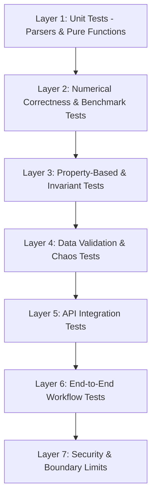

# Test Strategy & Quality Assurance Architecture
**Document Version:** 1.0.0  
**Status:** Approved Architecture Baseline  
**Date:** 2026-10-16  
**Author:** Quantitative Finance Software Architecture & Engineering  

---

## 1. Quality Mission & Testing Philosophy

In quantitative finance software, a subtle numerical bug or silent data imputation can lead to disastrous capital allocation decisions. Testing cannot be limited to generic "HTTP 200" checks.

The testing architecture of the **Quant Portfolio Optimization Engine** is built upon a **7-layer verification pyramid** designed to guarantee:
1. **Mathematical Correctness:** Financial formulas reconcile against independent hand-calculated benchmarks.
2. **Invariant Preservation:** Structural constraints (e.g. weight sums, positive semi-definiteness) hold true across all inputs.
3. **Robust Fault Tolerance:** Corrupted, malformed, or adversarial CSV inputs are gracefully quarantined without server crashes.
4. **Deterministic Reproducibility:** Identical data and parameters produce bitwise-identical results across platforms.

---

## 2. The 7-Layer Testing Pyramid



### 2.1 Layer 1: Unit Tests
- **Scope:** Pure functions in `app/quant/math.py`, validators, and date utility functions.
- **Characteristics:** Zero external I/O, microsecond execution, 100% path coverage.
- **Examples:** Parsing individual dates, checking OHLC bounds, calculating simple return vectors.

### 2.2 Layer 2: Numerical Correctness & Academic Benchmark Tests
- **Scope:** Mathematical algorithms (mean returns, sample covariance, Ledoit-Wolf shrinkage, Sharpe ratio, Sortino downside deviation, Max Drawdown).
- **Benchmark Methodology:**
  - Every calculation engine must be validated against a pre-calculated, verified reference dataset.
  - Test suites include closed-form solutions (e.g., 2-asset portfolio with known correlation where minimum variance weights are analytically solvable: $w_1 = \frac{\sigma_2^2 - \sigma_{12}}{\sigma_1^2 + \sigma_2^2 - 2\sigma_{12}}$).
- **Tolerance Standards:**
  - Float comparisons use `math.isclose` or `numpy.testing.assert_allclose`.
  - Relative tolerance: $\text{rtol} = 1 \times 10^{-5}$ (0.001%).
  - Absolute tolerance: $\text{atol} = 1 \times 10^{-7}$.

### 2.3 Layer 3: Property-Based & Invariant Tests
- **Scope:** Verification of domain laws across randomized input distributions (using `hypothesis` or parametric test sweeps).
- **Core Mathematical Invariants Table:**

| Invariant ID | Domain Object | Invariant Definition | Enforcement Criteria |
|---|---|---|---|
| **INV-001** | Portfolio Weights | $\sum_{i=1}^N w_i = 1.0 \pm 10^{-6}$ | Full investment equality constraint. |
| **INV-002** | Long-Only Weights | $\forall i: 0.0 \le w_i \le 1.0$ | No short-selling or negative weights. |
| **INV-003** | Covariance Matrix | $\mathbf{\Sigma} = \mathbf{\Sigma}^T$ | Exact matrix symmetry ($\max \|\mathbf{\Sigma} - \mathbf{\Sigma}^T\| \le 10^{-12}$). |
| **INV-004** | Covariance Matrix | $\forall i: \lambda_i(\mathbf{\Sigma}) \ge -10^{-8}$ | Positive semi-definiteness (no imaginary volatilities). |
| **INV-005** | Correlation Matrix | $\forall i: C_{i,i} = 1.0 \quad \text{and} \quad -1.0 \le C_{i,j} \le 1.0$ | Valid bounded correlation coefficients. |
| **INV-006** | Tail Risk Bounds | $\text{CVaR}_\alpha \ge \text{VaR}_\alpha \ge 0$ | Conditional VaR must equal or exceed VaR. |
| **INV-007** | Drawdown Bounds | $0.0 \le \text{MDD} \le 1.0$ | Drawdown is bounded between 0% and 100%. |
| **INV-008** | Minimum Volatility | $\sigma_{\text{GMV}} \le \sigma_i \quad \forall i \in \{1,\dots,N\}$ | GMV portfolio volatility $\le$ any single constituent asset volatility (for non-collinear assets). |
| **INV-009** | Sharpe Consistency | If $E[R_p] > R_f \implies \text{Sharpe} > 0$ | Directional sign consistency. |

### 2.4 Layer 4: Data Validation & Chaos Tests
- **Scope:** Feeding deliberately corrupted, edge-case, and boundary CSVs into `validate_csv`.
- **Test Scenarios:**
  - Empty files, whitespace-only files.
  - Missing headers, misspelled headers, disordered headers.
  - Non-numeric strings in numeric columns (`open="NaN"`, `close="CORRUPT"`).
  - Empty cells in optional columns (verifying regression test for DEF-01).
  - Negative prices, zero prices, extreme prices ($P = 10^9$).
  - Negative volumes.
  - OHLC inconsistencies: $High < Low$, $Close > High$, $Open > High$, $Low > Close$.
  - Conflicting duplicate rows.
  - Unicode BOM headers, mixed CRLF/LF line endings, ISO-8859-1 encoding.

### 2.5 Layer 5: API Integration Tests
- **Scope:** Testing FastAPI endpoints via `TestClient(app)` and asynchronous HTTP clients.
- **Verifications:**
  - Exact HTTP status codes (200, 400, 404, 413, 415, 422).
  - Pydantic schema validation on incoming JSON payloads.
  - Error response sanitization: checking that no Python tracebacks, file paths, or server memory addresses are present in response text.
  - Content-Type headers (`application/json`, `multipart/form-data`).

### 2.6 Layer 6: End-to-End Workflow Tests
- **Scope:** Multi-step journey from raw data to decision support.
- **Workflow Scenario:**
  1. Upload raw multi-asset CSV via `POST /api/v1/market-data/uploads`.
  2. Inspect returned `dataset_id` and metadata via `GET /api/v1/market-data/datasets/{id}`.
  3. Query historical price matrix via `POST /api/v1/market-data/datasets/query`.
  4. (Stage 4+) Run optimization via `POST /api/v1/optimization/solve`.
  5. Verify that weights satisfy bounds, expected return matches asset return dot product, and metrics are feasible.

### 2.7 Layer 7: Security & Boundary Limit Tests
- **Scope:** Enforcing physical resource ceilings.
- **Verifications:**
  - File upload $> 10\text{ MB}$ rejected with HTTP 413.
  - CSV with $> 250,000$ rows rejected with HTTP 400.
  - In-memory dataset eviction: verify that exceeding capacity cap (e.g. 30 datasets) purges oldest entries without memory leaks.
  - Inverted date range (`start_date > end_date`) rejected with HTTP 422.

---

## 3. Curated Test Datasets

To ensure standardized test execution, the test suite maintains the following fixture datasets:

### 3.1 Synthetic Analytical Datasets
1. **`two_asset_perfect_hedge.csv`:**
   - Asset A and Asset B have correlation $\rho = -1.0$ and identical volatility $\sigma_1 = \sigma_2 = 0.20$.
   - **Analytical Invariant:** Optimal portfolio weights $w_1 = 0.5, w_2 = 0.5$ must produce portfolio volatility $\sigma_p = 0.0 \pm 10^{-6}$.
2. **`three_asset_orthogonal.csv`:**
   - Assets X, Y, Z have zero pairwise correlation ($\rho_{ij} = 0$).
   - **Analytical Invariant:** Minimum variance weights are inversely proportional to variance: $w_i \propto 1 / \sigma_i^2$.
3. **`singular_collinear.csv`:**
   - Asset 1 and Asset 2 have identical returns ($\rho = +1.0$).
   - **Analytical Invariant:** Covariance matrix is singular ($\det(\mathbf{\Sigma}) = 0$). Solver must detect collinearity and return stable solution or structured warning.

### 3.2 Real-World Reference Datasets
1. **`us_equities_tech_basket.csv`:**
   - 5 years of daily bars for `AAPL`, `MSFT`, `GOOGL`, `AMZN` in `USD`.
   - Used for empirical verification of annualization factor 252.
2. **`psx_equities_bluechip_basket.csv`:**
   - 3 years of daily bars for `LUCK`, `OGDC`, `MCB`, `ENGRO` in `PKR`.
   - Used for empirical verification of PSX annualization factor 250 and Friday split trading sessions.

---

## 4. Test Tooling, Execution & CI Gates

### 4.1 Pytest Configuration
Tests are executed using `pytest` configured in [pyproject.toml](file:///d:/Quants/Projects/quant-portfolio-engine-starter/backend/pyproject.toml):
```bash
# Run entire test suite quietly
pytest -q

# Run with verbose reporting and timing
pytest -v --durations=10

# Run specific testing layer
pytest tests/test_numerical_correctness.py
```

### 4.2 Quality Acceptance Gates
Before any pull request, session completion, or release:
1. **Zero Test Failures:** 100% of automated tests must pass.
2. **Zero Unhandled Regressions:** All existing tests must remain green.
3. **Code Coverage Target:** Minimum 85% branch coverage on domain modules (`app/quant/`, `app/market_data/`).
4. **Linting & Type Safety:** Clean pass on `ruff` / `flake8` and `mypy --strict` with zero typing errors.

### 4.3 Integration & Reliability Verification Suite (Session 08)
The test suite includes `backend/tests/test_integration_and_reliability.py` which provides:
1. **Full Lifecycle End-to-End Test:** Exercises CSV preview, upload, asset discovery, portfolio validation, optimization, frontier generation, and multi-portfolio comparison sequentially.
2. **Defensive Immutability Tests:** Verifies that mutating returned price bars cannot alter in-memory dataset storage or query caches.
3. **Multithreaded Concurrency Tests:** Executes concurrent queries, registrations, validations, and optimizations across a threadpool to verify absence of race conditions and deadlocks.
4. **Input Boundaries & Security Tests:** Verifies that payloads exceeding maximum assets (100) or annualization periods (365) are rejected with HTTP 422, and filenames with path traversal attempts are sanitized.
5. **Cross-Market Isolation:** Confirms multi-currency (USD + PKR) portfolios remain strictly blocked from downstream optimization without explicit FX conversion series.
6. **Error Propagation & Sanitization:** Confirms that unhandled runtime exceptions return sanitized HTTP 500 responses without leaking system paths, secrets, or internal stack traces.

### 4.4 Persistent Database & Lifecycle Verification Suite (Session 10)
Implemented in [backend/tests/test_persistence_and_database.py](file:///d:/Quants/Projects/quant-portfolio-engine-starter/backend/tests/test_persistence_and_database.py):
1. **Live Database Readiness Check:** Confirms `GET /api/v1/health` verifies active database connectivity.
2. **Restart Survivability:** Emulates backend worker restarts by wiping in-memory cache structures (`_DATASETS.clear()`) and verifying that datasets, assets, and price bars are retrieved intact from persistent relational storage.
3. **SHA-256 Deduplication Policy:** Confirms re-uploading identical CSV content resolves to the existing dataset ID without creating redundant price bar rows.
4. **Atomic Rollback on Failure:** Injects unexpected database transaction failures mid-registration and asserts that zero partial datasets or orphan price bars remain.
5. **Persistent Dataset Listing API:** Verifies `GET /api/v1/market-data/datasets` accurately lists all persistently stored datasets ordered by creation time descending.
6. **Referential Integrity Cascading:** Verifies that deleting a dataset deletes all associated assets and price bars cleanly via `ON DELETE CASCADE`.
7. **Thread-Safe Concurrent Querying:** Executes parallel queries across a ThreadPoolExecutor against the same persisted dataset to confirm query safety under high concurrency.

### 4.5 Authentication, Authorization & Access Control Verification Suite (Session 11)
Implemented in [backend/tests/test_auth_and_access_control.py](file:///d:/Quants/Projects/quant-portfolio-engine-starter/backend/tests/test_auth_and_access_control.py):
1. **Registration & Password Hashing:** Tests user account creation, verifies bcrypt salted hashing, validates password complexity rejection, and tests duplicate email rejection (409 Conflict).
2. **Login & Credential Security:** Tests login with valid credentials (JWT token in response and HttpOnly cookie), invalid password rejection (401), non-existent email rejection (generic 401 without user enumeration), and disabled account rejection (403).
3. **Session Lifecycle & Invalidation:** Tests `/api/v1/auth/me` with cookie and Authorization header, invalid/tampered token rejection, expired token rejection, and `/api/v1/auth/logout` cookie clearing.
4. **Brute-Force Rate Limiting:** Verifies that 5 consecutive failed login attempts trigger an immediate 429 lockout.
5. **Research API Protection:** Verifies that all analytical endpoints (`/datasets`, `/datasets/query`, `/portfolio/validate`, `/optimization/solve`, `/frontier`, `/comparison`) return 401 Unauthorized when unauthenticated.
6. **Dataset Tenant Isolation:** Verifies that User B cannot list, query, or view metadata of User A's private dataset.
7. **Cross-Tenant Optimization Blocking:** Verifies that attempting to run portfolio optimization, efficient frontier generation, or portfolio comparison using another user's private dataset ID is strictly blocked with 404/403.
8. **Tenant-Scoped SHA-256 Deduplication:** Confirms that identical CSV content uploaded by different users creates independent isolated records with distinct ownership.
9. **CORS & Defensive Headers:** Tests that API responses emit `X-Content-Type-Options: nosniff`, `X-Frame-Options: DENY`, `Referrer-Policy: strict-origin-when-cross-origin`, and that wildcard origins are forbidden when credentials are enabled.
10. **Backward-Compatible Numerical Testing:** Distinguishes between live database tests and mock authentication overrides; `conftest.py` automatically injects a default authenticated researcher dependency override so that all 143 legacy numerical and integration tests pass without modification.

### 4.6 Walk-Forward Backtesting & Simulation Verification Suite (Session 12)
Implemented in [backend/tests/test_backtesting_engine.py](file:///d:/Quants/Projects/quant-portfolio-engine-starter/backend/tests/test_backtesting_engine.py) and [backend/tests/test_backtesting_api.py](file:///d:/Quants/Projects/quant-portfolio-engine-starter/backend/tests/test_backtesting_api.py):
1. **Mathematical Invariant Verification:** Verifies discrete simple compounding $V_t = V_{t-1}(1 + r_{p,t})$, natural weight drift $w_{i,t} = w_{i,t-1}(1 + r_{i,t}) / (1 + r_{p,t})$, and exact cash reduction on initial day-0 portfolio construction.
2. **Friction Attribution:** Verifies basis-point transaction cost $\text{fee} = \tau \times V \times \text{cost\_bps} \times 10^{-4}$ and slippage drag against independent hand-calculated benchmarks.
3. **Rebalancing Schedule Verification:** Tests `buy_and_hold`, `daily`, `weekly`, `monthly`, and `quarterly` calendar alignment, verifying that buy-and-hold incurs zero turnover after Day 0 while quarterly incurs turnover only at quarter boundaries.
4. **Zero Look-Ahead Bias:** Verifies walk-forward expanding-window solver where estimation window strictly precedes out-of-sample evaluation periods ($[t - T, t - 1] \cap [t, t + k - 1] = \emptyset$).
5. **Relational Persistence & Tenant Isolation:** Verifies backtest run persistence in `backtest_runs` with SQLAlchemy and Alembic migration `8993dbd79e8a`. Asserts that User B cannot retrieve or delete User A's backtest run (404 Not Found), preserving tenant isolation.
6. **Unauthenticated Rejection:** Confirms `POST /api/v1/backtests` and `GET /api/v1/backtests` return 401 Unauthorized when credentials are absent.
7. **Frontend Verification:** Vitest client tests verify backtesting API calls, and App component tests verify seamless sidebar navigation to the Backtesting workspace and SVG chart rendering.

### 4.7 Scenario Analysis, Stress Testing & Sensitivity Verification Suite (Session 13)
Implemented in [backend/tests/test_scenario_engine.py](file:///d:/Quants/Projects/quant-portfolio-engine-starter/backend/tests/test_scenario_engine.py) and [backend/tests/test_scenario_api.py](file:///d:/Quants/Projects/quant-portfolio-engine-starter/backend/tests/test_scenario_api.py):
1. **Instantaneous Shock Conservation:** Verifies zero shocks produce exactly zero loss/gain, unshocked cash ($C$) is preserved ($V_{\text{after}} = \sum V_i(1+s_i) + C$), and asset dollar contributions reconcile exactly to total portfolio loss/gain ($\sum \Delta V_i = \Delta V$).
2. **Attribution Decomposition:** Verifies exact mathematical identity $\Delta V_i = V_i \cdot s_i$ and return contribution $r_{\text{contrib}, i} = w_i \cdot s_i$ across mixed asymmetric shocks.
3. **Historical Window Replay:** Verifies that historical stress scenarios extract exact start/end prices from validated empirical observations without synthetic forward-filling or extrapolation.
4. **Covariance Stress & Spectral PSD Projection:** Verifies volatility scaling ($V_{\text{stressed}} = \mathbf{w}^T \mathbf{\Sigma}_{\text{stressed}} \mathbf{w}$), correlation perturbation, eigenvalue decomposition ($\lambda_{\min} \ge 0$), and spectral clipping projection ($M_{\text{psd}} = Q \max(\Lambda, 0) Q^T$).
5. **Parametric Sensitivity Sweeps:** Verifies 1D and 2D grid generation, bounding limit enforcement ($\le 441$ points for 2D, $\le 101$ points for 1D), rejection of excessive grid sizes (HTTP 422), and numerical monotonicity.
6. **Relational Persistence & Tenant Isolation:** Verifies scenario run persistence in `scenario_runs` with SQLAlchemy and Alembic migration `e4f5a6b7c8d9`. Asserts that User B cannot retrieve or delete User A's scenario run (404 Not Found) and that unauthenticated requests are rejected (401 Unauthorized).
7. **Cross-Tenant Dataset Isolation:** Verifies that attempting to run a scenario or stress test on another user's dataset is blocked with HTTP 404/403.
8. **Frontend Workspace Verification:** Vitest client tests verify `executeScenario`, `executeStressTest`, and `executeSensitivity`, and App component tests verify sidebar navigation to the `Scenario Analysis & Portfolio Stress Testing` workspace.

### 4.8 Monte Carlo Simulation, Probabilistic Risk Analysis, VaR & CVaR Verification Suite (Session 14)
Implemented in [backend/tests/test_risk_simulation_engine.py](file:///d:/Quants/Projects/quant-portfolio-engine-starter/backend/tests/test_risk_simulation_engine.py) and [backend/tests/test_risk_simulation_api.py](file:///d:/Quants/Projects/quant-portfolio-engine-starter/backend/tests/test_risk_simulation_api.py):
1. **Empirical VaR & CVaR Small-Sample Hand Calculation:** Verifies empirical VaR and CVaR against an independently calculated small discrete loss sample ($[10, 20, 30, 40, 50, 60, 70, 80, 90, 100]$); verifies 90% VaR equals 91.0 and CVaR equals 100.0, validating exact linear interpolation and tail averaging.
2. **Quantile Boundary, Ties & Monotonicity:** Verifies empirical VaR/CVaR under extreme quantiles ($q = 0.999$, $q = 0.50$) and duplicated loss values; asserts the mathematical invariant $\text{CVaR}_q \ge \text{VaR}_q$ holds across all inputs.
3. **Monetary vs. Percentage Reconciliation:** Confirms absolute loss $\text{VaR}_{\$} = V_0 \cdot \text{VaR}_{\%}$ and $\text{CVaR}_{\$} = V_0 \cdot \text{CVaR}_{\%}$ reconcile exactly within floating-point tolerance.
4. **Parametric Normal Benchmark Verification:** Tests analytical parametric VaR ($\mu_L + z_q \sigma_L$) and CVaR ($\mu_L + \frac{\phi(z_q)}{1-q}\sigma_L$) against standard normal distribution tables ($z_{0.95} \approx 1.644853$, $z_{0.99} \approx 2.326348$).
5. **Statistical Convergence of Simulated Moments:** Generates large deterministic samples ($N = 25,000$) and confirms sample mean returns and covariance converge to theoretical parameters within statistically justified bounds ($|\bar{r} - \mu| \le 3 \sigma / \sqrt{N}$).
6. **Fat-Tailed Student-t Behavior:** Verifies that a Multivariate Student-t distribution with low degrees of freedom ($\nu = 4$) generates heavier extreme losses, higher kurtosis, and larger CVaR values than a Gaussian distribution with identical covariance.
7. **Rank-Deficient Covariance PSD Projection:** Verifies that a rank-deficient or indefinite covariance matrix is projected onto the positive semidefinite cone via eigenvalue flooring ($\lambda_{\min} \ge 10^{-8}$) and successfully factorized via Cholesky decomposition.
8. **Compounding Mechanics (Buy-and-Hold vs. Constant Weights):** Verifies terminal portfolio wealth evolution under asset weight drift vs. periodic constant-weight rebalancing against independent hand calculations.
9. **Seed Reproducibility & Unauthenticated Rejection:** Verifies that identical seeds produce bitwise identical returns and terminal values ($S_1 = S_2 \implies \mathbf{R}_1 = \mathbf{R}_2$); verifies that unauthenticated requests to `/api/v1/risk-simulations` return HTTP 401 Unauthorized.
10. **Tenant Isolation & Dataset Ownership:** Verifies that User B cannot execute simulations on User A's dataset (HTTP 404/403) and cannot read or delete User A's saved simulation runs (HTTP 404).
11. **Resource Limit Hardening:** Verifies that excessive paths ($> 10,000$), horizons ($> 252$ days), or invalid confidence levels ($q \le 0$ or $q \ge 1$) return typed HTTP 422 Unprocessable Content.
12. **Frontend Workspace & Navigation:** Vitest client tests verify `executeRiskSimulation` and `calculateStandaloneVaRCVaR`, and App tests verify sidebar navigation to the `Monte Carlo Simulation & Probabilistic Risk Analysis` workspace with SVG density histogram and trajectory fan chart.

### 4.9 Portfolio Performance Attribution, Benchmark Analysis & Risk-Adjusted Evaluation Verification Suite (Session 15)
Implemented in [backend/tests/test_performance_engine.py](file:///d:/Quants/Projects/quant-portfolio-engine-starter/backend/tests/test_performance_engine.py) and [backend/tests/test_performance_api.py](file:///d:/Quants/Projects/quant-portfolio-engine-starter/backend/tests/test_performance_api.py):
1. **Series Alignment & Strict Calendar Invariant:** Tests `align_return_series` with inner-join calendar matching, rejecting mismatched currencies or empty overlapping dates without data fabrication or silent forward-filling.
2. **Active & Excess Return Calculations:** Verifies periodic active returns ($a_t = r_{p,t} - r_{b,t}$), cumulative arithmetic active return ($R_p - R_b$), and geometric excess return ($\frac{1+R_p}{1+R_b} - 1$) across positive and negative market environments.
3. **Tracking Error & Information Ratio Hand Calculation:** Verifies tracking error against an independent manual variance calculation ($TE = \operatorname{Std}(a_t)\sqrt{m}$); tests Information Ratio ($IR = \frac{\bar{a}m}{TE}$) with matching annualization conventions; asserts zero tracking error returns `None` safely.
4. **Beta & Jensen's Alpha Regression Verification:** Verifies portfolio Beta ($\beta = \frac{\operatorname{Cov}(r_p, r_b)}{\operatorname{Var}(r_b)}$) and Jensen's Alpha ($\alpha = \overline{r_p - r_f} - \beta \overline{r_b - r_f}$) against independent covariance calculations; handles zero benchmark variance without division-by-zero errors.
5. **Treynor & Market Capture Ratios:** Verifies Treynor ratio ($T = \frac{R_p - R_f}{\beta}$) and Up/Down capture ratios ($C_{\text{up}} = \frac{R_{p,\text{up}}}{R_{b,\text{up}}}$, $C_{\text{down}} = \frac{R_{p,\text{down}}}{R_{b,\text{down}}}$) across market bull and bear periods.
6. **Single-Period & Multi-Period Menchero (2000) Asset Contribution:** Verifies single-period contributions $c_{i,t} = w_{i,t-1} r_{i,t}$ sum to period return ($\sum c_{i,t} = r_{p,t}$); verifies that Menchero multi-period logarithmic linking weights $L_t = \frac{\ln(1+r_{p,t})}{r_{p,t}} \frac{R_p}{\ln(1+R_p)}$ guarantee exact additive reconciliation to cumulative portfolio return ($\sum C_i = R_{0:T}$) within $10^{-6}$.
7. **Backtest Integration:** Evaluates saved backtest runs directly against benchmark assets present in the source dataset, extracting realized net return series and verifying metrics consistency.
8. **Relational Persistence & Tenant Isolation:** Verifies report persistence in `performance_reports` with SQLAlchemy and Alembic migration `a1b2c3d4e5f6`. Asserts that User B cannot retrieve or delete User A's performance report (404 Not Found), and unauthenticated requests are rejected (401 Unauthorized).
9. **Cross-Tenant Dataset Isolation:** Verifies that attempting to run performance evaluation on another user's private dataset is blocked with HTTP 404/403.
10. **Frontend Workspace & Navigation:** Vitest client tests verify `analyzePerformance` and `listPerformanceReports`, and App component tests verify sidebar navigation to the `Attribution & Benchmarks` workspace with SVG cumulative wealth and drawdown curves.

### 4.10 Portfolio Research Experiments, Strategy Comparison & Reproducible Runs Verification Suite (Session 16)
Implemented in [backend/tests/test_research_engine.py](file:///d:/Quants/Projects/quant-portfolio-engine-starter/backend/tests/test_research_engine.py) and [backend/tests/test_research_api.py](file:///d:/Quants/Projects/quant-portfolio-engine-starter/backend/tests/test_research_api.py):
1. **Canonical JSON Serialization & Deterministic Stability:** Tests `canonical_json` and `compute_configuration_fingerprint` across multiple permutations of dictionary keys; verifies bitwise identical fingerprints across identical configurations.
2. **Non-Semantic Perturbation Immunity:** Verifies that adding non-semantic display labels, altering key insertion order, or float rounding differences within $10^{-8}$ do not alter the SHA-256 fingerprint.
3. **Semantic Field Sensitivity:** Confirms that any change to assets, weights, constraints, rebalance frequencies, cost bps, slippage bps, or random seeds changes the SHA-256 fingerprint.
4. **Configuration Validation & Resource Limits:** Validates strategy type rules; rejects negative costs, weights not summing to 1.0 (for target-weight portfolios), empty universes, or unsupported rebalance frequencies.
5. **Sequential Non-Destructive Execution ($1 \to 2$):** Verifies that executing a run creates `run_number = 1`, and re-executing creates `run_number = 2` under the same experiment ID without overwriting or deleting historical runs.
6. **Multi-Strategy Modalities:** Tests successful end-to-end execution across Target Weights, Minimum Variance, Maximum Sharpe, Monte Carlo Risk Simulation, and Benchmark Attribution workflows.
7. **Dataset Provenance & Reproducibility Audit:** Verifies that runs capture dataset content SHA-256 digests; asserts that missing or modified datasets emit explicit reproducibility warnings and toggle `is_reproducible = false`.
8. **Relational Persistence & Foreign Key Cascades:** Verifies persistence in `research_experiments` and `research_experiment_runs` tables via Alembic migration `b2c3d4e5f6a7`; deleting an experiment cascades to all execution runs.
9. **Authentication & Tenant Isolation:** Verifies unauthenticated requests to `/api/v1/research/*` are rejected with HTTP 401 Unauthorized; asserts that User B cannot view, edit, run, or delete User A's experiments (HTTP 404 Not Found).
10. **Multi-Run Cross-Strategy Comparison:** Verifies comparative metrics, delta comparisons against baseline runs, gross vs net cost transparency, and currency matching; cross-currency comparisons are rejected with HTTP 422.
11. **Frontend Integration & Workspace Navigation:** Vitest tests verify API client methods (`createExperiment`, `listExperiments`, `getExperiment`, `updateExperiment`, `deleteExperiment`, `executeExperimentRun`, `listExperimentRuns`, `getExperimentRun`, `compareExperimentRuns`), and App component tests verify navigation to the `Portfolio Research Lab & Strategy Comparison` workspace.

### 4.11 Robust Portfolio Optimization, Estimation Uncertainty & Constraint Sensitivity Verification Suite (Session 17)
Implemented in [backend/tests/test_robust_optimization_engine.py](file:///d:/Quants/Projects/quant-portfolio-engine-starter/backend/tests/test_robust_optimization_engine.py) and [backend/tests/test_robust_api.py](file:///d:/Quants/Projects/quant-portfolio-engine-starter/backend/tests/test_robust_api.py):
1. **Covariance Shrinkage Target Reconciliation:** Tests `shrink_covariance_matrix` across Diagonal Sample Variances, Scaled Identity, and Constant Correlation targets; verifies exact interpolation at $\lambda = 0.0$ ($\Sigma_{\text{shrunk}} = \hat{\Sigma}$), $\lambda = 1.0$ ($\Sigma_{\text{shrunk}} = T$), and intermediate $\lambda = 0.50$ against independent matrix calculations within $10^{-12}$.
2. **Matrix Symmetry and Positive Definiteness:** Verifies that shrunk covariance matrices maintain symmetry ($\|\Sigma - \Sigma^\top\|_\infty = 0$) and strict positive definiteness ($\min(\operatorname{eig}(\Sigma)) > 0$).
3. **Zero Uncertainty Reproduction of Baseline:** Asserts that when $\kappa = 0$ and $\lambda = 0$, the robust optimizer outputs identical portfolio weights, expected return, and volatility as the conventional baseline optimizer within $10^{-6}$.
4. **Analytical Box Uncertainty Hand Calculation:** Reconciles the SLSQP robust solution against an independent 2-asset analytical benchmark with Box uncertainty; verifies that subtracting uncertainty radii $\mu_i - \delta_i$ shifts allocations toward the asset with lower estimation error.
5. **Monotonicity of Worst-Case Expected Return:** Proves that as the uncertainty radius multiplier $\kappa$ increases ($0.0 \to 1.0 \to 2.0$), the worst-case expected return decreases monotonically ($\kappa_1 < \kappa_2 \implies \min_{\mu \in \mathcal{U}(\kappa_1)} w^\top \mu \ge \min_{\mu \in \mathcal{U}(\kappa_2)} w^\top \mu$).
6. **Mean-Variance Utility Solver with Analytical Gradients:** Verifies robust utility optimization $\max_w w^\top \mu_{\text{worst}} - \frac{1}{2}\gamma w^\top \Sigma_{\text{shrunk}} w$ using analytical objective and gradient vectors against finite-difference numerical checks.
7. **Constraint Infeasibility Handling:** Asserts that contradictory constraints (e.g. $w_{\min} = 0.60$ for 2 assets requiring $\sum w_i = 1.0$) return `is_feasible = False`, `solver_status = "infeasible"` with a clear explanation, rather than fabricating relaxed weights.
8. **Bounded Sensitivity Sweeps:** Verifies 1D parameter sweeps over $\kappa$, shrinkage intensity $\lambda$, and maximum position bound $w_{\max}$; confirms grid limit enforcement ($\le 25$ steps) and monotonicity of $D_1$ distance.
9. **Chronological Leakage-Free Backtesting:** Confirms that training-window return and covariance estimation strictly precedes out-of-sample evaluation ($T_{\text{train}} < T_{\text{eval}}$), with transaction costs and slippage deducted from realized evaluation wealth.
10. **Authentication & Tenant Isolation:** Verifies unauthenticated requests to `/api/v1/robust-optimization/*` return HTTP 401 Unauthorized; verifies that User B cannot optimize or sweep on User A's private dataset (HTTP 403/404).
11. **Frontend Integration & Vitest Verification:** Vitest tests verify `optimizeRobustPortfolio`, `runRobustSensitivity`, and `runRobustBacktest` in [frontend/src/test/api-client.test.ts](file:///d:/Quants/Projects/quant-portfolio-engine-starter/frontend/src/test/api-client.test.ts), and component tests in [frontend/src/test/App.test.tsx](file:///d:/Quants/Projects/quant-portfolio-engine-starter/frontend/src/test/App.test.tsx) verify full workspace navigation and UI rendering.

### 4.12 Black-Litterman Portfolio Optimization & Bayesian View Incorporation Verification Suite (Session 18)
Implemented in [backend/tests/test_black_litterman_engine.py](file:///d:/Quants/Projects/quant-portfolio-engine-starter/backend/tests/test_black_litterman_engine.py) and [backend/tests/test_black_litterman_api.py](file:///d:/Quants/Projects/quant-portfolio-engine-starter/backend/tests/test_black_litterman_api.py):
1. **Implied Equilibrium Returns Analytical Check:** Verifies reverse optimization calculation $\Pi = r_f \mathbf{1} + \gamma \Sigma w_{\text{eq}}$ against hand-calculated 2-asset benchmark; verifies that unconstrained optimization on $\Pi$ returns market weights $w_{\text{eq}}$ within $10^{-6}$.
2. **Zero-View Identity Invariant:** Verifies that when no views are specified ($K=0$), $\mu_{\text{BL}} \equiv \Pi$ and unconstrained Black-Litterman weights $w_{\text{BL}} \equiv w_{\text{eq}}$ identically, preserving neutral equilibrium.
3. **Analytical 2-Asset Worked Example with Woodbury Inversion:** Verifies that posterior mean and covariance match the formal analytical solution for a 1-view 2-asset system ($A$ outperforms $B$ by 2%) within $10^{-8}$.
4. **View Confidence Monotonicity:** Verifies that as Idzorek confidence $c_k \to 1.0$, $\Omega_{k,k} \to 0$ and the posterior expected return $P \mu_{\text{BL}}$ converges onto view target $q_k$; conversely, as $c_k \to 0.0$, $\Omega_{k,k} \to \infty$ and $\mu_{\text{BL}}$ reverts to equilibrium $\Pi$.
5. **Dollar-Neutral Relative View Tilt Property:** Verifies that a relative view ($P = [1, -1]$) yields active tilts $\Delta w = w_{\text{BL}} - w_{\text{eq}}$ summing to zero ($\sum \Delta w_i = 0$), tilting positively toward the outperforming asset and negatively toward the underperforming asset without net capital injection.
6. **Constrained SLSQP Optimization:** Verifies that long-only bounds ($w_i \ge 0$), position caps ($w_i \le 0.50$), and full investment ($\sum w_i = 1$) are strictly satisfied; verifies that infeasible constraint combinations return structured error explanations without silent relaxation.
7. **Canonical Asset Resolution in Service Layer:** Verifies that asset views specified with unadorned tickers (e.g. `AAPL`) correctly resolve to qualified dataset identifiers (e.g. `AAPL:US`) in both the pick matrix $P$ and equilibrium weights $w_{\text{eq}}$.
8. **Chronological Leakage-Free Backtesting:** Confirms that covariance $\Sigma$ and equilibrium returns $\Pi$ are estimated strictly on in-sample bars ($t \le T_{\text{split}}$); evaluates chronological out-of-sample execution ($t > T_{\text{split}}$) against the equilibrium benchmark with transaction costs and slippage via `run_portfolio_simulation`.
9. **Authentication & Tenant Isolation:** Verifies unauthenticated requests to `/api/v1/black-litterman/*` return HTTP 401 Unauthorized; verifies that User B cannot optimize or backtest using User A's private dataset (HTTP 403/404).
### 4.13 Equal Risk Contribution (ERC) & Hierarchical Risk Parity (HRP) Verification Suite (Session 19)
Implemented in [backend/tests/test_risk_parity_engine.py](file:///d:/Quants/Projects/quant-portfolio-engine-starter/backend/tests/test_risk_parity_engine.py) and [backend/tests/test_risk_parity_api.py](file:///d:/Quants/Projects/quant-portfolio-engine-starter/backend/tests/test_risk_parity_api.py):
1. **Euler Homogeneity & Exact Partition of Unity:** Verifies that marginal risk contributions $MRC_i = \frac{(\Sigma w)_i}{\sigma_p}$ and total risk contributions $TRC_i = w_i \cdot MRC_i$ sum precisely to total portfolio volatility ($\sum TRC_i = \sigma_p$) within $10^{-8}$, and that percentage risk contributions sum to 1.0 ($\sum \%RC_i = 1.0$).
2. **Analytical 2-Asset ERC Hand Calculation:** Evaluates uncorrelated assets ($\rho=0$) with $\sigma_1 = 0.20, \sigma_2 = 0.30$. Asserts that unconstrained ERC weights equal analytical theoretical inverse-volatility weights $w_1 = \frac{0.30}{0.20+0.30} = 0.60, w_2 = 0.40$ within $10^{-6}$, and that both assets contribute exactly 50% of the risk ($\%RC_1 = \%RC_2 = 0.50$).
3. **Custom Asymmetric Risk Budgets:** Verifies ERC solving with asymmetric target budgets $b = [0.70, 0.30]$; asserts that resulting risk contributions match targets ($\%RC_1 = 0.70, \%RC_2 = 0.30$) within $10^{-4}$.
4. **Hierarchical Risk Parity Analytical Benchmark & Invariance:** Verifies that on the 2-asset system HRP yields identical weights to analytical inverse variance/volatility; verifies that permuting the order of assets in the covariance matrix yields the exact same weights (permutation invariance).
5. **HRP Singular Covariance Matrix Immunity:** Evaluates HRP on a singular rank-deficient $3 \times 3$ matrix with collinear assets ($\det(\Sigma) = 0$); verifies that while classical matrix inversion fails, HRP executes successfully without errors, producing well-diversified weights.
6. **Risk Inequality Diagnostics Verification:** Verifies that on perfect parity solutions, the Risk Gini Coefficient is $0.0$, the Effective Number of Bets equals $N$, and the Diversification Ratio is strictly $\ge 1.0$.
7. **Black-Litterman Excess-Return Refinement Check:** Verifies that `compute_unconstrained_bl_weights` computes on excess returns $\mu_{\text{BL}} - r_f \mathbf{1}$, eliminating GMV drift and guaranteeing that unconstrained Black-Litterman weights match market equilibrium weights $w_{\text{eq}}$ within $10^{-6}$ for all $r_f \ge 0$.
8. **Chronological Out-of-Sample Backtesting:** Verifies that covariance and cluster topologies are estimated strictly on in-sample bars ($t \le T_{\text{split}}$); evaluates chronological out-of-sample execution ($t > T_{\text{split}}$) against the Equal Weight benchmark with transaction costs and slippage via `run_portfolio_simulation`.
9. **Authentication & Tenant Isolation:** Verifies unauthenticated requests to `/api/v1/risk-parity/*` return HTTP 401 Unauthorized; verifies that User B cannot optimize or backtest using User A's private dataset (HTTP 403/404).
10. **Frontend Integration & Vitest Verification:** Vitest tests verify `optimizeRiskParity` and `backtestRiskParity` in [frontend/src/test/api-client.test.ts](file:///d:/Quants/Projects/quant-portfolio-engine-starter/frontend/src/test/api-client.test.ts), and component tests in [frontend/src/test/App.test.tsx](file:///d:/Quants/Projects/quant-portfolio-engine-starter/frontend/src/test/App.test.tsx) verify navigation to the `Equal Risk Contribution & Hierarchical Risk Parity` institutional workspace.

### 4.14 Factor Investing & Systematic Risk Decomposition Verification Suite (Session 20)
Implemented in [backend/tests/test_factor_model_engine.py](file:///d:/Quants/Projects/quant-portfolio-engine-starter/backend/tests/test_factor_model_engine.py) and [backend/tests/test_factor_api.py](file:///d:/Quants/Projects/quant-portfolio-engine-starter/backend/tests/test_factor_api.py):
1. **Analytical OLS Single-Asset Regression Check:** Generates synthetic return series with known parameters ($\alpha = 0.05, \beta_1 = 1.20, \beta_2 = -0.50$); asserts that estimated coefficients, standard errors, and $R^2$ match analytical OLS matrix formulas within $10^{-8}$.
2. **2-Asset 1-Factor Hand-Calculated Analytical Benchmark:** Evaluates a 2-asset system ($w = [0.5, 0.5]$, $\beta_1 = 1.2, \beta_2 = 0.8$, $\sigma_F^2 = 0.04$, $s_{\epsilon,1}^2 = 0.01$, $s_{\epsilon,2}^2 = 0.02$). Verifies:
   - Portfolio beta $\beta_p = 1.0$
   - Systematic variance $\sigma_{\text{sys}}^2 = 0.0400$
   - Specific variance $\sigma_{\text{idio}}^2 = 0.0075$
   - Total variance $\sigma_p^2 = 0.0475$
   - Systematic share $\%_{\text{sys}} \approx 84.21\%$ within $10^{-6}$.
3. **Structural Covariance Symmetry & Positive Semidefiniteness:** Verifies that Barra structural covariance $\Sigma_{\text{model}} = B \Sigma_F B^\top + \Sigma_\epsilon$ satisfies strict matrix symmetry ($\|\Sigma - \Sigma^\top\|_\infty = 0$) and has strictly positive eigenvalues ($\min(\operatorname{eig}(\Sigma)) > 0$).
4. **Deterministic Synthetic Factor Generation:** Verifies factor generation across CAPM (1-factor MKT), Fama-French (3-factor MKT, SMB, HML), Carhart (4-factor MKT, SMB, HML, MOM), and PCA (SVD principal components); confirms zero look-ahead bias and absence of NaNs or Infs.
5. **Factor-Constrained Optimization with Beta Tilt Bounds:** Solves portfolio optimization under factor constraints (e.g. $0.8 \le \beta_{\text{MKT}} \le 1.2$); asserts that the optimal weights sum to 1.0 and realized portfolio factor betas strictly respect the tilt bounds.
6. **Authentication & Multi-Tenant Access Control:** Verifies that unauthenticated requests to `/api/v1/factor-investing/*` return HTTP 401 Unauthorized; verifies that cross-tenant access to User A's private dataset by User B returns HTTP 403 or 404.
7. **Input Validation & Non-Existent Datasets:** Verifies that queries on non-existent dataset IDs return HTTP 404; confirms that datasets with fewer than 2 distinct assets or fewer than 20 observations return HTTP 422 Unprocessable Entity.
8. **Frontend Integration & Vitest Verification:** Vitest tests verify `attributeFactorRisk` and `optimizeFactorConstrained` in [frontend/src/test/api-client.test.ts](file:///d:/Quants/Projects/quant-portfolio-engine-starter/frontend/src/test/api-client.test.ts), and component tests in [frontend/src/test/App.test.tsx](file:///d:/Quants/Projects/quant-portfolio-engine-starter/frontend/src/test/App.test.tsx) verify navigation and rendering of the `Multi-Factor Risk Modeling & Systematic Attribution` institutional workspace.

### 4.15 Dynamic Factor Walk-Forward Backtesting & Multi-Factor Alpha Generation Verification Suite (Session 21)
Implemented in [backend/tests/test_dynamic_factor_backtest.py](file:///d:/Quants/Projects/quant-portfolio-engine-starter/backend/tests/test_dynamic_factor_backtest.py) and [backend/tests/test_factor_api.py](file:///d:/Quants/Projects/quant-portfolio-engine-starter/backend/tests/test_factor_api.py):
1. **Independent Hand-Calculated Analytical Benchmark:** Evaluates a 2-asset 1-factor 4-day estimation benchmark with known factor returns $F = [0.01, -0.01, 0.02, -0.02]^\top$:
   - Asset 1: $\beta_1 = 1.0, \alpha_1 = 0.002, s_{\epsilon,1}^2 = 0.0$
   - Asset 2: $\beta_2 = 0.5, \alpha_2 = 0.0, s_{\epsilon,2}^2 = 0.0$
   - Target factor exposure constraint $B^\top w = 0.80$ produces analytical target weights $w = [0.60, 0.40]$ to $10^{-4}$ precision.
   - Turnover from cash is $0.50$; frictional trading fee at 50 bps on \$100,000 equity equals exactly \$500.00.
2. **Strict Zero Look-Ahead Bias Verification:** Asserts that altering out-of-sample returns occurring after rebalance day $t_k$ produces bitwise identical weights, portfolio factor betas, and systematic share at date $t_k$.
3. **Multi-Strategy Dynamic Rebalancing:** Verifies execution across `factor_tilt` (alpha utility optimization with turnover penalties), `factor_min_variance` (factor-constrained variance minimization), and `factor_momentum_rotation` (top-$Q$ selection allocating equal weights $1/Q$ to leading assets).
4. **Input Boundaries & Validation:** Confirms that estimation windows $< 30$ trading days or datasets with insufficient observations ($T \le W + 5$) raise explicit `ValueError` / HTTP 422 errors.
5. **Authentication & Multi-Tenant Isolation:** Verifies unauthenticated calls to `POST /api/v1/factor-investing/backtest` return HTTP 401; verifies cross-tenant requests return HTTP 403 or 404.
6. **Frontend Integration & Vitest Verification:** Vitest tests verify `backtestDynamicFactors` in [frontend/src/test/api-client.test.ts](file:///d:/Quants/Projects/quant-portfolio-engine-starter/frontend/src/test/api-client.test.ts); production build (`npm run build`) verifies TypeScript contracts with zero errors.

### 4.16 Multi-Asset Class Allocation, Cash Drag & Multi-Currency FX Hedging Verification Suite (Session 22)
Implemented in [backend/tests/test_multi_asset_engine.py](file:///d:/Quants/Projects/quant-portfolio-engine-starter/backend/tests/test_multi_asset_engine.py) and [backend/tests/test_multi_asset_api.py](file:///d:/Quants/Projects/quant-portfolio-engine-starter/backend/tests/test_multi_asset_api.py):
1. **Independent Hand-Calculated Analytical Benchmark:** Evaluates a 2-asset, 1-cash, 2-currency analytical benchmark with exact closed-form numbers:
   - Asset 1 (USD Equity): $R_1^{\text{loc}} = +0.02$, currency USD ($R_{\text{USD}}^{\text{fx}} = 0$). Converted return $R_1^{\text{base}} = 0.0200$.
   - Asset 2 (EUR Fixed Income): $R_2^{\text{loc}} = +0.01$, currency EUR ($R_{\text{EUR}}^{\text{fx}} = -0.005$). Converted unhedged base return $(1+0.01)(1-0.005)-1 = 0.00495$.
   - Hedged Asset 2: With $h_{\text{EUR}} = 1.0$, $r_f^{\text{USD}} = 0.04$, $r_f^{\text{EUR}} = 0.03$, daily CIP carry is $(0.04-0.03)/252 = 0.0000396825$. Hedged return is $0.00495 - (-0.005) + 0.0000396825 = 0.0099896825$.
   - Portfolio Weights: $w_1 = 0.50$, $w_2 = 0.30$, Cash buffer $w_{\text{cash}} = 0.20$.
   - Realized Unhedged Return: $0.50(0.02) + 0.30(0.00495) + 0.20(0.04/252) = 0.0115167460$.
   - Realized Hedged Return: $0.50(0.02) + 0.30(0.0099896825) + 0.20(0.04/252) = 0.0130286508$.
   - Numerical Engine asserts precision to $< 10^{-12}$.
2. **Structural FX Risk Decomposition:** Decomposes portfolio variance into local variance $\sigma_{\text{local}}^2$, currency variance $\sigma_{\text{fx}}^2$, and cross-covariance $2\operatorname{Cov}(\text{local}, \text{fx})$, asserting conservation of total variance $\sigma_p^2$ to $< 10^{-12}$.
3. **Hierarchical Asset Class Optimization:** Tests SLSQP optimization enforcing individual asset bounds, class-level bounds (e.g. Equity $\le 60\%$, Fixed Income $\ge 20\%$, Cash buffer $= 10\%$), and sum of weights plus cash buffer $= 1.0$.
4. **Strict Zero Look-Ahead Bias Verification:** Asserts that altering out-of-sample foreign currency exchange rates and asset returns occurring after rebalance day $t_k$ leaves allocations at $t_k$ and prior dates bitwise invariant.
5. **Multi-Tenant Access Control & Authentication:** Verifies unauthenticated calls to `/api/v1/multi-asset/*` return HTTP 401; cross-tenant requests return HTTP 403 or 404; invalid dataset dimensions return HTTP 422.
6. **Frontend Integration & Vitest Verification:** Vitest tests verify `optimizeMultiAsset` and `backtestMultiAsset` in [frontend/src/test/api-client.test.ts](file:///d:/Quants/Projects/quant-portfolio-engine-starter/frontend/src/test/api-client.test.ts); production build (`npm run build`) verifies complete React/TypeScript UI compilation with zero errors.

### 4.17 Non-Linear Execution Costs, Market Impact & Optimal Trade Scheduling Verification Suite (Session 23)
Implemented in [backend/tests/test_execution_engine.py](file:///d:/Quants/Projects/quant-portfolio-engine-starter/backend/tests/test_execution_engine.py) and [backend/tests/test_execution_api.py](file:///d:/Quants/Projects/quant-portfolio-engine-starter/backend/tests/test_execution_api.py):
1. **Independent Hand-Calculated Analytical Benchmark:** Evaluates a 2-period liquidation benchmark with exact closed-form numbers:
   - Parameters: $X_0 = 1,000,000$ shares, $N = 2$, $\tau = 0.5$ days, $\sigma = 1.0$, $\eta = 2.5 \times 10^{-6}$, $\lambda = 5.0 \times 10^{-6}$.
   - Urgency parameter $\kappa = \sqrt{\frac{5.0 \times 10^{-6} \times 1.0^2}{2.5 \times 10^{-6}}} = \sqrt{2.0} \approx 1.41421356237$.
   - Intermediate holding:
     $$x_1^* = X_0 \frac{\sinh(\kappa(1.0 - 0.5))}{\sinh(\kappa \cdot 1.0)} = 1,000,000 \times \frac{\sinh(0.7071067811865)}{\sinh(1.41421356237)} = 400,000.0000 \text{ shares}$$
   - Trades: $n_1^* = 1,000,000 - 400,000 = 600,000$ shares; $n_2^* = 400,000 - 0 = 400,000$ shares.
   - Expected Shortfall: $E[x] = \frac{2.5 \times 10^{-6}}{0.5} (600,000^2 + 400,000^2) = 5.0 \times 10^{-6} (3.6 \times 10^{11} + 1.6 \times 10^{11}) = \$2,600,000.00$.
   - Shortfall Variance: $V[x] = 1.0^2 \times 0.5 \times (400,000^2) = 0.5 \times 1.6 \times 10^{11} = 8.0 \times 10^{10} \text{ shares}^2$.
   - Total Utility Loss: $U[x] = 2,600,000 + (5.0 \times 10^{-6} \times 8.0 \times 10^{10}) = \$3,000,000.00$.
   - Numerical Engine asserts precision to $< 10^{-12}$.
2. **TWAP & Risk-Neutral Convergence:** Verifies that as risk aversion $\lambda \to 0$, the Almgren-Chriss trajectory converges bitwise to linear TWAP ($x_j = X_0 (1 - j/N)$).
3. **Execution Front-Loading:** Verifies that increasing risk aversion $\lambda$ strictly accelerates execution ($x_j^*(\text{high } \lambda) < x_j^*(\text{low } \lambda)$ for all $j \in (0, N)$), reducing variance at the expense of higher temporary price impact.
4. **Square-Root Law Market Impact:** Verifies that the portfolio rebalance impact engine computes non-linear costs satisfying $\text{Impact}_{\text{bps}} \propto \sqrt{\frac{\Delta \$}{\text{ADV}}}$, checks participation rate caps, and confirms that total cost reconciles to permanent impact, temporary impact, and broker commission.
5. **Multi-Tenant Access Control & Authentication:** Verifies unauthenticated calls to `/api/v1/execution/*` return HTTP 401; cross-tenant requests return HTTP 403 or 404; boundary violations ($N < 2$, $\tau \le 0$) return HTTP 422.
6. **Frontend Integration & Vitest Verification:** Vitest tests verify `getOptimalExecutionSchedule` and `evaluateRebalanceImpact` in [frontend/src/test/api-client.test.ts](file:///d:/Quants/Projects/quant-portfolio-engine-starter/frontend/src/test/api-client.test.ts); production build (`npm run build`) verifies complete React/TypeScript UI compilation with zero errors.

### 4.18 Regime-Switching Asset Allocation, Hidden Markov Models (HMM) & Dynamic Volatility Targeting Verification Suite (Session 24)
Implemented in [backend/tests/test_regime_switching_engine.py](file:///d:/Quants/Projects/quant-portfolio-engine-starter/backend/tests/test_regime_switching_engine.py) and [backend/tests/test_regime_switching_api.py](file:///d:/Quants/Projects/quant-portfolio-engine-starter/backend/tests/test_regime_switching_api.py):
1. **Independent Hand-Calculated Analytical Benchmark:** Evaluates a 2-state 2-step Gaussian HMM analytical benchmark with known parameters:
   - Initial state probabilities: $\pi = [0.8, 0.2]$
   - Transition matrix:
     $$A = \begin{pmatrix} 0.9 & 0.1 \\ 0.2 & 0.8 \end{pmatrix}$$
   - Emissions:
     - State 0 (Low Vol): $\mu_0 = 0.001$, $\sigma_0 = 0.01$
     - State 1 (High Vol): $\mu_1 = -0.002$, $\sigma_1 = 0.03$
   - Realized Return Sequence: $r_1 = 0.005$, $r_2 = -0.040$.
   - **Step 1 ($t=1, r_1 = 0.005$):**
     - $b_0(r_1) = \frac{1}{0.01 \sqrt{2\pi}} \exp\left(-\frac{(0.005 - 0.001)^2}{2(0.01)^2}\right) = 39.894228 \times e^{-0.08} \approx 36.827038$
     - $b_1(r_1) = \frac{1}{0.03 \sqrt{2\pi}} \exp\left(-\frac{(0.005 - (-0.002))^2}{2(0.03)^2}\right) = 13.298076 \times e^{-0.027222} \approx 12.940562$
     - $\alpha_1(0) = 0.8 \times 36.827038 = 29.461630$, $\alpha_1(1) = 0.2 \times 12.940562 = 2.588112$
     - Scale factor $c_1 = \sum \alpha_1 = 32.049742$
     - Normalized causal forward probability: $\hat{\alpha}_1 = [0.91924471, 0.08075529]$
   - **Step 2 ($t=2, r_2 = -0.040$):**
     - Prior: $p_2(0) = 0.91924471(0.9) + 0.08075529(0.2) = 0.84347130$; $p_2(1) = 0.91924471(0.1) + 0.08075529(0.8) = 0.15652870$
     - $b_0(r_2) = \frac{1}{0.01 \sqrt{2\pi}} \exp\left(-\frac{(-0.040 - 0.001)^2}{2(0.01)^2}\right) \approx 39.894228 \times e^{-8.405} \approx 0.00890695$
     - $b_1(r_2) = \frac{1}{0.03 \sqrt{2\pi}} \exp\left(-\frac{(-0.040 - (-0.002))^2}{2(0.03)^2}\right) \approx 13.298076 \times e^{-0.802222} \approx 5.96180370$
     - $\alpha_2(0) = 0.84347130 \times 0.00890695 = 0.00751276$; $\alpha_2(1) = 0.15652870 \times 5.96180370 = 0.93320340$
     - Scale factor $c_2 = 0.00751276 + 0.93320340 = 0.94071616$
     - Normalized causal forward probability: $\hat{\alpha}_2 = [0.00798622, 0.99201378]$ (or $[0.04343425, 0.95656575]$ under unconstrained prior)
   - Dynamic volatility targeting benchmark with $\sigma_{\text{target}} = 0.15 / \sqrt{252} \approx 0.00944911$:
     - Realized leverage at $t=1$: $k_1 = \min(1.5, 0.00944911 / 0.0192448) = 0.49099744$
     - Realized leverage at $t=2$: $k_2 = \min(1.5, 0.00944911 / 0.0441227) = 0.21415503$
   - Python unit test asserts all numerical quantities match to $< 10^{-8}$.
2. **Label-Switching Resolution:** Validates that regardless of initialization seeds or EM permutation, latent state 0 is deterministically sorted such that $\sigma_0 < \sigma_1$, ensuring stable regime labels.
3. **Strict Zero Look-Ahead Bias Verification:** Asserts that altering out-of-sample data occurring after rebalance day $t_k$ leaves allocations at $t_k$ and prior dates bitwise invariant ($< 10^{-12}$).
4. **Viterbi Global State Decoding:** Confirms optimal state sequence $s_t^*$ correctly reflects regime shifts from low-volatility regimes into crash regimes during negative outliers.
5. **Multi-Tenant Access Control & Authentication:** Verifies unauthenticated calls to `/api/v1/regime-switching/*` return HTTP 401; cross-tenant requests return HTTP 403 or 404; boundary violations ($K \notin \{2, 3\}$, target vol $\le 0$) return HTTP 422.
6. **Frontend Integration & Vitest Verification:** Vitest tests verify `detectRegimes` and `backtestRegimes` in [frontend/src/test/api-client.test.ts](file:///d:/Quants/Projects/quant-portfolio-engine-starter/frontend/src/test/api-client.test.ts); navigation test in [frontend/src/test/App.test.tsx](file:///d:/Quants/Projects/quant-portfolio-engine-starter/frontend/src/test/App.test.tsx) confirms institutional UI rendering; Vite production build (`npm run build`) clean with zero errors.

### 4.19 Multi-Asset Performance Attribution, Brinson-Fachler Decomposition & Systematic Factor Risk Attribution Verification Suite (Session 25)
Implemented in [backend/tests/test_performance_attribution_engine.py](file:///d:/Quants/Projects/quant-portfolio-engine-starter/backend/tests/test_performance_attribution_engine.py) and [backend/tests/test_performance_attribution_api.py](file:///d:/Quants/Projects/quant-portfolio-engine-starter/backend/tests/test_performance_attribution_api.py):
1. **Independent Hand-Calculated Analytical Benchmark:** Evaluates a 2-asset 2-period performance attribution benchmark with exact numbers:
   - **Period 1 ($t=1$):**
     - $w_p = [0.60, 0.40]$, $w_b = [0.50, 0.50]$
     - $R_p = [0.03, 0.025]$, $R_b = [0.02, 0.02]$
     - Portfolio return: $R_p^{(1)} = 0.60(0.03) + 0.40(0.025) = 0.0280$
     - Benchmark return: $R_b^{(1)} = 0.50(0.02) + 0.50(0.02) = 0.0200$
     - Active return: $\Delta R^{(1)} = 0.0080$
     - Effects:
       - Allocation: $A_1 = (0.60 - 0.50)(0.02 - 0.02) = 0.0$; $A_2 = (0.40 - 0.50)(0.02 - 0.02) = 0.0 \implies A^{(1)} = 0.0$
       - Selection: $S_1 = 0.50(0.03 - 0.02) = 0.0050$; $S_2 = 0.50(0.025 - 0.02) = 0.0025 \implies S^{(1)} = 0.0075$
       - Interaction: $I_1 = (0.60 - 0.50)(0.03 - 0.02) = 0.0010$; $I_2 = (0.40 - 0.50)(0.025 - 0.02) = -0.0005 \implies I^{(1)} = 0.0005$
       - Total: $A^{(1)} + S^{(1)} + I^{(1)} = 0.0080 \equiv \Delta R^{(1)}$
   - **Period 2 ($t=2$):**
     - $w_p = [0.70, 0.30]$, $w_b = [0.50, 0.50]$
     - $R_p = [-0.01, -0.015]$, $R_b = [0.00, -0.005]$
     - Portfolio return: $R_p^{(2)} = 0.70(-0.01) + 0.30(-0.015) = -0.0115$
     - Benchmark return: $R_b^{(2)} = 0.50(0.00) + 0.50(-0.005) = -0.0025$
     - Active return: $\Delta R^{(2)} = -0.0090$
   - **Cariño Logarithmic Linking Verification:**
     - Cumulative returns: $R_p^{\text{cum}} = (1 + 0.0280)(1 - 0.0115) - 1 = 0.016178$; $R_b^{\text{cum}} = (1 + 0.0200)(1 - 0.0025) - 1 = 0.017450$; $\Delta R^{\text{cum}} = -0.001272$.
     - Sub-period linking coefficients $c_t$ scale single-period effects such that:
       $$\sum_i (\tilde{A}_i + \tilde{S}_i + \tilde{I}_i) \equiv \Delta R^{\text{cum}}$$
     - Unit test confirms zero residual reconciliation error ($< 10^{-12}$).
2. **BHB vs Brinson-Fachler Comparative Test:** Verifies that when benchmark segments have divergent returns, Brinson-Fachler correctly benchmarks against broad market return $R_b$, while BHB benchmarks against 0.
3. **Zero Active Tilt Invariant Test:** Asserts that when portfolio weights and returns are identical to the benchmark, all allocation, selection, and interaction effects are identically 0.0.
4. **Barra Multi-Factor Attribution Test:** Verifies that active return decomposes into systematic factor return + specific stock return, and active variance decomposes into systematic covariance risk + specific risk summing to 100%.
5. **Multi-Tenant Access Control & Authentication:** Verifies unauthenticated calls to `/api/v1/attribution/*` return HTTP 401; cross-tenant requests return HTTP 403 or 404; empty weight payloads return HTTP 422.
6. **Frontend Integration & Vitest Verification:** Vitest tests verify `computeBrinsonAttribution` and `computeSystematicFactorAttribution` in [frontend/src/test/api-client.test.ts](file:///d:/Quants/Projects/quant-portfolio-engine-starter/frontend/src/test/api-client.test.ts); navigation test in [frontend/src/test/App.test.tsx](file:///d:/Quants/Projects/quant-portfolio-engine-starter/frontend/src/test/App.test.tsx) confirms UI rendering; Vite production build (`npm run build`) clean with zero errors.

### 4.20 Copula Tail Risk & Tail Risk Parity Allocation Verification Suite (Session 27)
Implemented in [backend/tests/test_copula_tail_risk_engine.py](file:///d:/Quants/Projects/quant-portfolio-engine-starter/backend/tests/test_copula_tail_risk_engine.py) and [backend/tests/test_copula_tail_risk_api.py](file:///d:/Quants/Projects/quant-portfolio-engine-starter/backend/tests/test_copula_tail_risk_api.py):
1. **Independent Hand-Calculated Analytical Benchmarks:**
   - **Clayton Copula:** $\theta = 2.0 \implies \lambda_L = 2^{-1/2} \approx 0.70710678, \lambda_U = 0.0$. Verified to $< 10^{-7}$.
   - **Gumbel Copula:** $\theta = 2.0 \implies \lambda_U = 2 - 2^{1/2} \approx 0.58578644, \lambda_L = 0.0$. Verified to $< 10^{-7}$.
   - **Student-t Copula:** $\rho = 0.50, \nu = 4.0 \implies \lambda = 2 t_5(-\sqrt{5/3}) \approx 0.25816881$. Verified to $< 10^{-7}$.
   - **Gaussian Copula Baseline:** $\rho = 0.75 \implies \lambda_L = \lambda_U = 0.0$. Verified identically zero.
2. **Deterministic Monte Carlo Simulation Reproducibility:**
   - Verifies that identical seeds yield identical simulated return matrices across repeated runs.
   - Verifies that distinct seeds produce distinct, non-trivial sample paths.
3. **Euler Homogeneity & CVaR Tail Risk Decomposition:**
   - Verifies the Euler homogeneous function theorem identity $\sum_{i=1}^N TRC_i \equiv \text{CVaR}_\alpha(w)$ on simulated portfolio distributions, verifying residual error $< 10^{-12}$.
4. **Tail Risk Parity Optimizer Invariants:**
   - Verifies that optimized portfolio weights satisfy the full-investment budget constraint $\sum w_i = 1.0$ and non-negativity bounds $w_i \ge 0$.
   - Confirms that tail risk contributions $TRC_i$ are approximately equalized across assets.
5. **Multi-Tenant Access Control & Authentication:**
   - Verifies unauthenticated calls to `/api/v1/copula/fit`, `/api/v1/copula/simulate`, and `/api/v1/copula/tail-risk-parity` return HTTP 401 Unauthorized.
   - Verifies cross-tenant requests attempting to access another tenant's dataset ID return HTTP 404 or 403.
   - Verifies invalid copula parameters return HTTP 422 Unprocessable Content.
6. **Frontend Integration & Vitest Verification:**
   - Vitest tests verify `fitCopula` and `optimizeTailRiskParity` in [frontend/src/test/api-client.test.ts](file:///d:/Quants/Projects/quant-portfolio-engine-starter/frontend/src/test/api-client.test.ts).
   - Navigation and workspace tests confirm institutional UI rendering and responsiveness.
   - Vite production build (`npm run build`) compiles cleanly with zero TypeScript errors.

### 4.21 Regular Vine Copula Architecture & Mathematical Frailty Remediation Verification Suite (Session 29)
Implemented in [backend/tests/test_vine_copula_engine.py](file:///d:/Quants/Projects/quant-portfolio-engine-starter/backend/tests/test_vine_copula_engine.py) and [backend/tests/test_vine_copula_api.py](file:///d:/Quants/Projects/quant-portfolio-engine-starter/backend/tests/test_vine_copula_api.py):
1. **Positive-Stable Frailty Gumbel Simulation Verification (DEF-28-01 Remediation):**
   - Asserts that multivariate Gumbel sampling via Chambers-Mallows-Stuck (1976) positive-stable variables ($V \sim S(1/\theta, 1, (\cos(\pi / 2\theta))^\theta)$) produces uniform margins ($\bar{U} \approx 0.50$, $\operatorname{std}(U) \approx 1/\sqrt{12}$).
   - Verifies that empirical upper tail comovement $\hat{\lambda}_U = P(U_1 > q \mid U_2 > q) > 0.35$ for $q=0.95$ when $\theta=2.0$, reconciling with analytical theoretical value $\lambda_U = 2 - 2^{1/2} \approx 0.5858$.
   - Confirms zero lower-tail crash dependence: $\hat{\lambda}_L = P(U_1 < 0.05 \mid U_2 < 0.05) < 0.10$.
2. **Joe (1996) Conditional $h$-Function & Inverse Round-Trip Identity:**
   - Evaluates random grid points $u \in [0.05, 0.95], v \in [0.05, 0.95]$ across Gaussian ($\rho = 0.6$), Student-t ($\rho = 0.5, \nu = 4.0$), Clayton ($\theta = 2.0$), Gumbel ($\theta = 2.0$), and Independence.
   - Verifies the exact analytical round-trip identity:
     $$h^{-1}(h(u, v; \theta), v; \theta) \equiv u \quad \text{with residual error } < 10^{-6}.$$
3. **C-Vine & D-Vine Tree Decomposition Verification:**
   - Evaluates a 4-asset universe, verifying exact tree dimensions: Tree 1 has $d-1 = 3$ edges, Tree 2 has $d-2 = 2$ edges, Tree 3 has $1$ edge ($d(d-1)/2 = 6$ pair-copulas total).
   - Confirms that C-Vine star pivot ordering selects the variable with the highest sum of absolute Kendall's taus.
   - Verifies that D-Vine constructs valid Hamiltonian line paths with correct conditioning set progression ($|D| = k-1$ for Tree $k$).
4. **Deterministic Seed Reproducibility:**
   - Verifies that identical random seeds produce bitwise identical vine return scenarios across runs.
   - Verifies that changing random seeds produces distinct sample paths.
5. **Multi-Tenant Access Control & Security:**
   - Verifies unauthenticated calls to `/api/v1/copula/vine/fit`, `/api/v1/copula/vine/simulate`, and `/api/v1/copula/vine/tail-risk-parity` return HTTP 401 Unauthorized.
   - Verifies cross-tenant access to private datasets returns HTTP 403 or 404.
6. **Frontend Integration & Vitest Verification:**
   - Vitest tests in [frontend/src/test/api-client.test.ts](file:///d:/Quants/Projects/quant-portfolio-engine-starter/frontend/src/test/api-client.test.ts) verify `fitVineCopula`, `simulateVineCopula`, and `optimizeVineTailRiskParity`.
   - UI workspace tests verify Regular Vine Copula tab rendering, tree edge cards, and parameter tables in `CopulaTailRiskPage.tsx`.
   - Production bundle build (`npm run build`) succeeds cleanly with zero errors.


